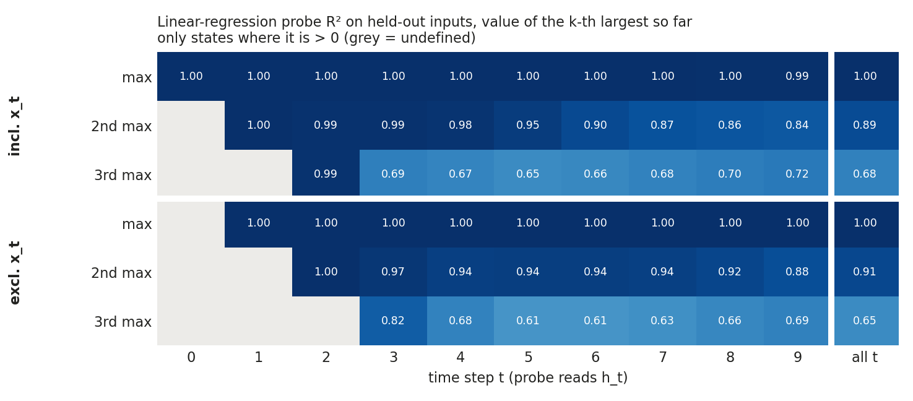
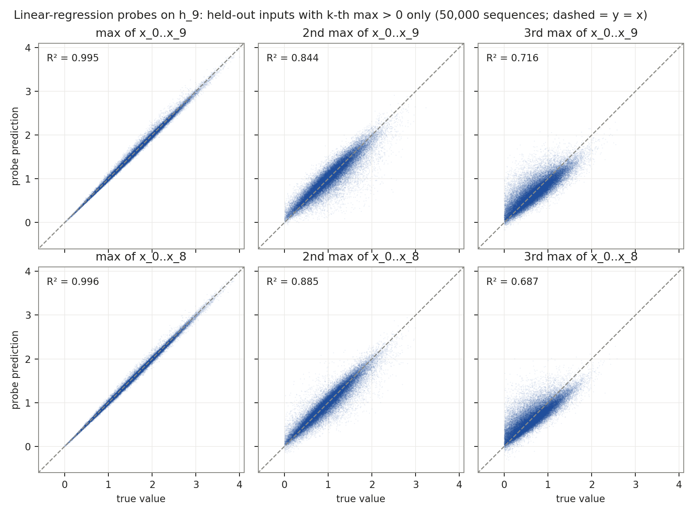
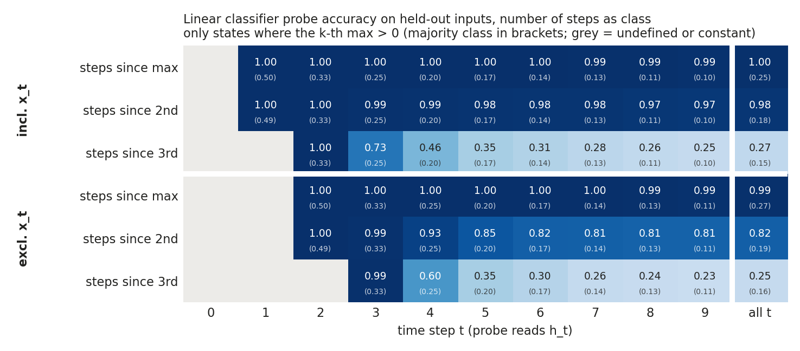
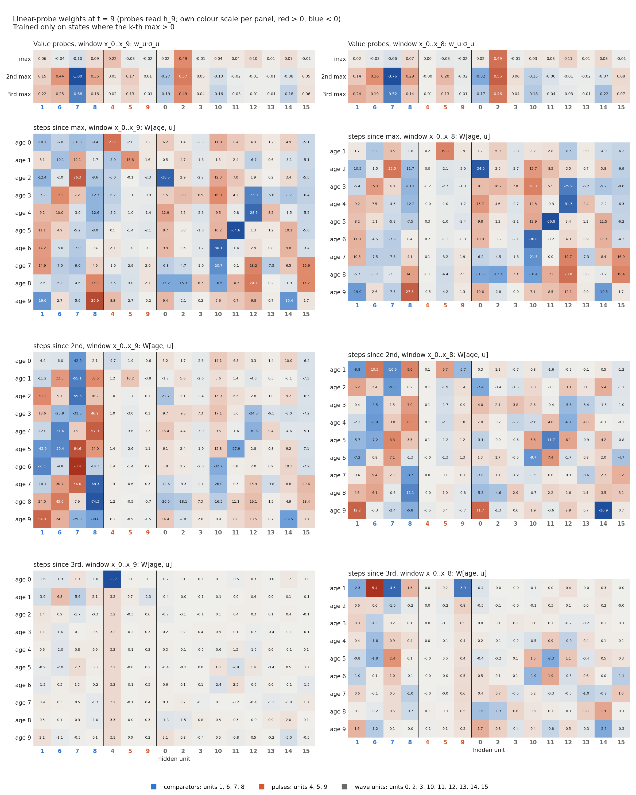

# Linear probes, a separate probe for every time step: positive values only

This is a variant of `../linear-probes-for-every-t/`. The network, data, targets, probes and scoring are the same. The one change is that **states where the $k$-th largest value is $\le 0$ are left out**, both from training and from scoring, for the probes of the $k$-th value and of its age.

## Summary

- **The max is linear in $h_t$ at every step:** $R^2 \ge 0.99$ everywhere, including the "all $t$" probe (1.00, against 0.92–0.93 before). Without the negative maxima, one probe pooled over $t$ is as good as a separate one per step.
- **The 2nd max** is read with $R^2$ 0.84–1.00 per step (0.97–1.00 at $t \le 3$, about 0.84–0.88 at $t = 9$). The pooled probe rises from 0.75–0.80 to 0.89–0.91.
- **The 3rd max** changes little at late steps (0.69–0.72 at $t = 9$) but beats the correlation baseline by more than before. At $t = 9$, for example, it is 0.72 against a baseline of 0.54.
- **Ages.** $a_1$ is decoded at 0.99–1.00 at every step. $a_2$ including $x_t$ is decoded at 0.97–1.00 (0.96 before at $t = 9$). $a_3$ is still close to chance at late $t$.
- **At $t = 9$ the filter changes almost nothing**, because few states there are excluded: 0–2% for the max and 2nd max, about 5–9% for the 3rd max. The changes are at early $t$, where many states have a negative $k$-th max.

## What changed relative to `../linear-probes-for-every-t/`

For variant $v$ (including or excluding $x_t$) and rank $k \in \{1, 2, 3\}$, a state $(\text{sequence}, t)$ is kept for the probes of $x_{(k)}$ and $a_k$ only if the $k$-th largest value of its window is $> 0$. The window is $x_0,\dots,x_t$ (including) or $x_0,\dots,x_{t-1}$ (excluding). The filter applies to each state separately and to the held-out set the same way. A sequence that starts with negative inputs is left out at the early steps and used at later steps.

The kept fraction is $P(\mathrm{Bin}(n, \tfrac12) \ge k)$, with $n$ the window length. For example, it is 50% for the max at $t = 0$ including $x_t$, 12% for the 3rd max at $t = 2$ (including) or $t = 3$ (excluding), and 91–95% for the 3rd max at $t = 9$.

Everything else is unchanged: 200,000 training and 50,000 held-out sequences, seed 0. There is one affine least-squares probe per (value target, $t$) and one multinomial logistic regression ($C = 10$, standardised states) per (age target, $t$). Each target also has a probe pooled over all $t$ (column "all $t$"). The scatter and weight figures show the probes at $t = 9$.

## Results

### Values: $R^2$ of a linear regression



| target | $t=0$ | 1 | 2 | 3 | 4 | 5 | 6 | 7 | 8 | 9 | all $t$ |
|---|---|---|---|---|---|---|---|---|---|---|---|
| max (incl) | 1.00 | 1.00 | 1.00 | 1.00 | 1.00 | 1.00 | 1.00 | 1.00 | 1.00 | 0.99 | 1.00 |
| 2nd max (incl) | – | 1.00 | 0.99 | 0.99 | 0.98 | 0.95 | 0.90 | 0.87 | 0.86 | 0.84 | 0.89 |
| 3rd max (incl) | – | – | 0.99 | 0.69 | 0.67 | 0.65 | 0.66 | 0.68 | 0.70 | 0.72 | 0.68 |
| max (excl) | – | 1.00 | 1.00 | 1.00 | 1.00 | 1.00 | 1.00 | 1.00 | 1.00 | 1.00 | 1.00 |
| 2nd max (excl) | – | – | 1.00 | 0.97 | 0.94 | 0.94 | 0.94 | 0.94 | 0.92 | 0.88 | 0.91 |
| 3rd max (excl) | – | – | – | 0.82 | 0.68 | 0.61 | 0.61 | 0.63 | 0.66 | 0.69 | 0.65 |



- **Early steps are trivial.** When only two or three inputs have been seen and all of them are positive, the probes reach $R^2 \approx 1$. For example, the 3rd max at $t = 2$ including $x_t$ is the smallest of three positive values, and gets 0.99.
- **The 2nd max falls with $t$** from about 0.99 to 0.84–0.88, even with a separate probe at each step. It is harder to read late in the sequence.
- **The "all $t$" column** now nearly matches the shared-probe variant (`../../linear-probes-positive/`), as it should, since it is the same kind of pooled probe.

**Control for correlated order statistics.** As in the unfiltered report, we fit a regression from the *true* earlier order statistics at each $t$, on the same kept states:

| $t$ | 3rd max (incl): baseline from true max and 2nd | 3rd max (incl): probe on $h_t$ | 3rd max (excl): baseline from true max and 2nd | 3rd max (excl): probe on $h_t$ |
|---|---|---|---|---|
| 3 | 0.35 | 0.69 | 0.33 | 0.82 |
| 5 | 0.44 | 0.65 | 0.40 | 0.61 |
| 9 | 0.54 | 0.72 | 0.53 | 0.69 |

The probe beats the baseline by 0.16–0.49. A baseline predicting the 2nd max from the true max alone gets 0.20–0.39 across $t$, far below the 2nd-max probe.

### Steps since: accuracy of a linear classifier



| target | $t=1$ | 2 | 3 | 4 | 5 | 6 | 7 | 8 | 9 | all $t$ |
|---|---|---|---|---|---|---|---|---|---|---|
| $a_1$ (incl) | 1.00 (.50) | 1.00 (.33) | 1.00 (.25) | 1.00 (.20) | 1.00 (.17) | 1.00 (.14) | .99 (.13) | .99 (.11) | .99 (.10) | 1.00 (.25) |
| $a_2$ (incl) | 1.00 (.49) | 1.00 (.33) | .99 (.25) | .99 (.20) | .98 (.17) | .98 (.14) | .98 (.13) | .97 (.11) | .97 (.10) | .98 (.18) |
| $a_3$ (incl) | – | 1.00 (.33) | .73 (.25) | .46 (.20) | .35 (.17) | .31 (.14) | .28 (.13) | .26 (.11) | .25 (.10) | .27 (.15) |
| $a_1$ (excl) | – | 1.00 (.50) | 1.00 (.33) | 1.00 (.25) | 1.00 (.20) | 1.00 (.17) | 1.00 (.14) | .99 (.13) | .99 (.11) | .99 (.27) |
| $a_2$ (excl) | – | 1.00 (.49) | .99 (.33) | .93 (.25) | .85 (.20) | .82 (.17) | .81 (.14) | .81 (.13) | .81 (.11) | .82 (.19) |
| $a_3$ (excl) | – | – | .99 (.33) | .60 (.25) | .35 (.20) | .30 (.17) | .26 (.14) | .24 (.13) | .23 (.11) | .25 (.16) |

The majority-class baseline at that $t$ is in brackets. $t = 0$ is not scored.

- **$a_1$ and $a_2$ (including $x_t$)** are read almost perfectly at every step. Before the filter, $a_2$ dipped to 0.85 at $t = 3$–4. Those errors came from states whose 2nd max was still negative.
- **$a_2$ excluding $x_t$** levels off at about 0.81, a little above the 0.74–0.79 before the filter ($t = 6$–9).
- **$a_3$** decays toward about 2.5× its baseline at $t = 9$, as before.

### Probe weights at $t = 9$



These are almost the same as without the filter, since only a few percent of the $t = 9$ states are excluded:

- **Value probes.** The max rests on unit 2 (0.49), plus unit 4, the record pulse (0.22), when $x_9$ is included. The 2nd and 3rd max rest on unit 7 (−0.52 to −1.00) and unit 2.
- **Classifiers.** $a_1$ age 0 is dominated by unit 4 (+21.9), and $a_3$ age 0 by unit 4 with the opposite sign (−28.7).

## Caveats

- Scoring on positive values only answers a narrower question than the unfiltered analysis. It says nothing about negative order statistics, which $h_t$ encodes poorly.
- The kept states at early $t$ are a selected sample: sequences with enough positive inputs. That is part of why early-step scores are near 1.
- The probes read the post-ReLU state $h_t$ only. A linear probe shows information is *available*, not that it is *used*.
- All results use Gaussian inputs. This is the task distribution in the colleague's paper, but the original's training notebook used $\mathrm{Unif}(-1,1)$ (see `../../replica/README.md`).

## Reproducing

The scripts are in `../../hide/linear-probes-for-every-t-positive/`, and can be run from any directory. They are the same as in `../../hide/linear-probes-for-every-t/`, except that `targets()` applies `positive()` and the fits drop states whose target is undefined (`sel()`).

```
python -B ../../hide/linear-probes-for-every-t-positive/linear_probes.py      [n_train] [seed]        # R² figure; about 13 s
python -B ../../hide/linear-probes-for-every-t-positive/steps_classifier.py   [n_train] [seed]        # classifier figure; about 4.5 min
python -B ../../hide/linear-probes-for-every-t-positive/scatter_values.py     [t] [n_train] [seed]    # scatter at step t (default 9)
python -B ../../hide/linear-probes-for-every-t-positive/probe_weights.py      [t] [n_train] [seed]    # weights at step t (default 9)
```
