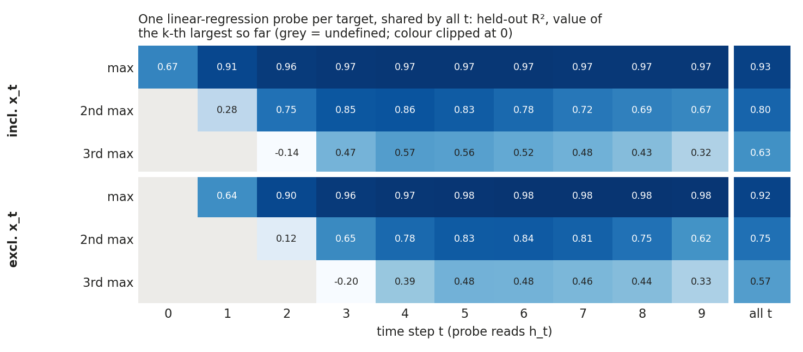
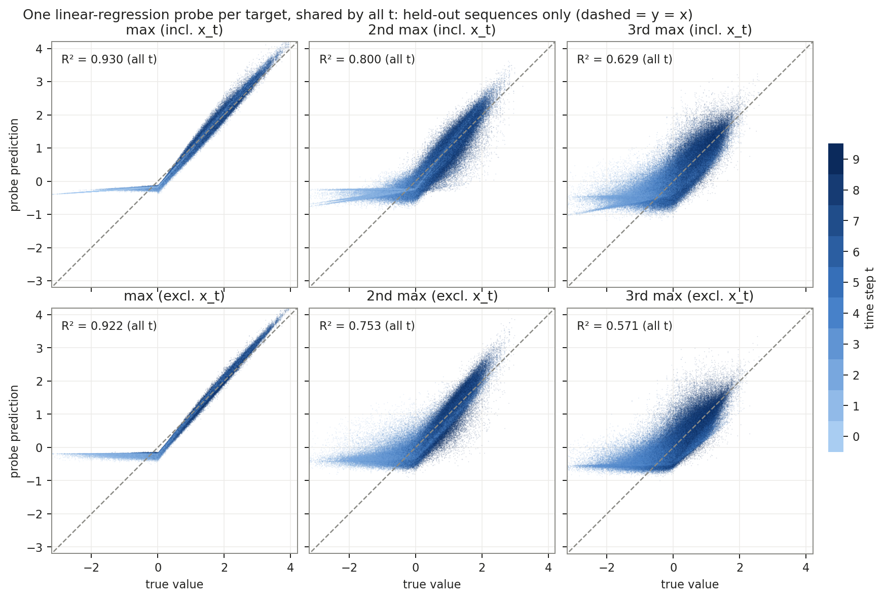
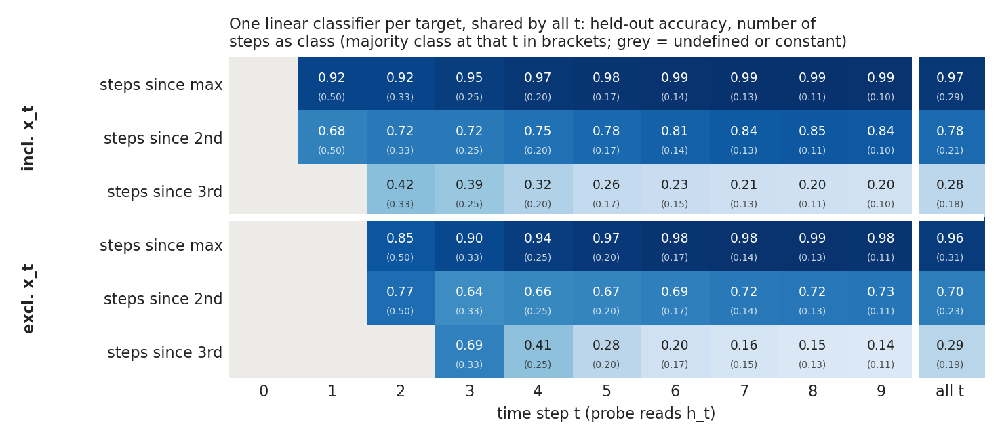
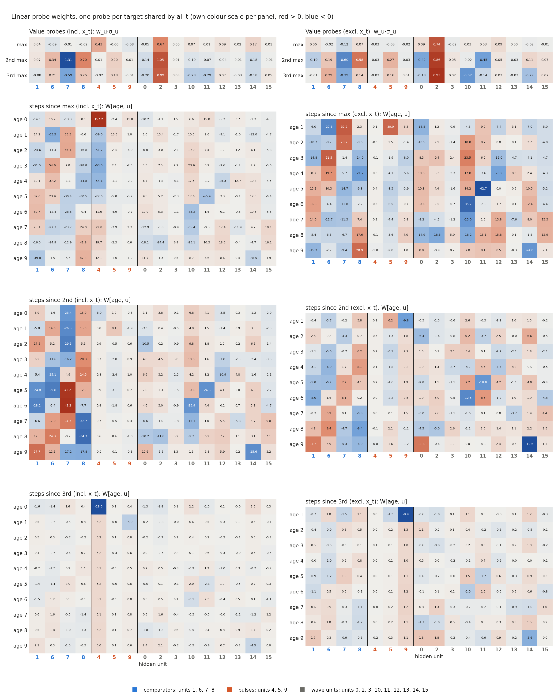

# Linear probes on the hidden state of the second-argmax RNN: one probe per target, shared by all time steps

## Summary

We trained linear probes on the 16 hidden units of ARC's 432-parameter second-argmax RNN. Each probe predicts one of these:

- the three largest inputs seen so far;
- how many steps ago each of them was seen;
- the same six quantities with the current input $x_t$ left out.

There is **one probe per target**, trained on the hidden states of all time steps together. The probe is not told $t$. We score it on held-out sequences at each $t$ separately and over all $t$ together. (An earlier analysis with a separate probe for every $t$ is kept in `../linear-probes-for-every-t/`. At the end of this report we compare the two.)

**Main results**

- **The running max has one shared linear readout.** $R^2 \ge 0.90$ from $t = 2$ on (0.96–0.98 from $t = 3$), and 0.92–0.93 over all $t$. Above zero the prediction sits on $y = x$ at every step. Negative maxima are mapped to about 0, because the bias-free ReLU network stores only the positive part.
- **The 2nd max is only partly shared across time.** $R^2$ is 0.80 (including $x_t$) and 0.75 (excluding) over all $t$. It peaks at 0.86 at $t = 4$ (including) and 0.84 at $t = 6$ (excluding), then falls to 0.67 and 0.62 at $t = 9$. A separate probe at $t = 9$ reached 0.85–0.89, so the readout for the 2nd max drifts over the sequence.
- **The 3rd max has no shared readout beyond its correlation with the max and 2nd max.** The shared probe's $R^2$ (0.63 over all $t$) is about what you get by regressing on the true max and 2nd max (0.60). At $t = 9$ the two are equal (0.32 vs 0.33).
- **The age of the max is decoded by one shared classifier:** 97% overall, rising from 0.92 at $t = 1$ to 0.99 for $t \ge 6$.
- **The age of the 2nd max is decoded at 0.78 overall** (including $x_t$), rising from 0.68 to 0.84–0.85 at late $t$. The per-step probes reached 0.96 at $t = 9$.
- **The age of the 3rd max is near chance.** Excluding $x_t$, its accuracy is at the majority baseline from $t = 6$ on.

## Setup

**Network.** It is ARC's $M_{16,10}$ second-argmax RNN, with weights from `reverse-engineered-networks/1-algzoo-second-argmax-432/code/m16_10_weights.npz`:

$$h_t = \mathrm{ReLU}(W_{ih}\,x_t + W_{hh}\,h_{t-1}), \qquad h_{-1} = 0, \qquad \ell = W_{out}\,h_9 .$$

It has no biases and a sequence length of 10. Its task is to output the position of the second-largest input.

**Inputs.** Each input is iid $\mathcal N(0,1)$, as in the colleague's analysis. We used 200,000 training sequences and 50,000 held-out sequences, with seed 0. These are the same data as in the per-step analysis.

**Targets.** At step $t$ the probe reads $h_t$, the state just after the network has read $x_t$. In a given window, let $x_{(1)} > x_{(2)} > x_{(3)}$ be the three largest values, at positions $p_1, p_2, p_3$. "Steps since" is counted from the current step $t$:

| variant | window | value targets | "steps since" targets |
|---|---|---|---|
| including $x_t$ | $x_0,\dots,x_t$ | $x_{(1)}, x_{(2)}, x_{(3)}$ | $a_k = t - p_k \ge 0$ ($0$ means $x_t$ itself) |
| excluding $x_t$ | $x_0,\dots,x_{t-1}$ | $x_{(1)}, x_{(2)}, x_{(3)}$ | $a_k = t - p_k \ge 1$ |

In the excluding variant, a new record at $x_t$ is ignored, so the previous max still counts as the max. A target is undefined at steps where the window holds fewer than $k$ values, and those steps are left out of both training and scoring.

**Probes.** Each target gets a single probe. It is trained on the stacked states $\{h_t\}$ of every step $t$ where the target is defined, which is up to $10 \times 200{,}000$ training states.

- *Values:* an affine least-squares fit, $y \approx w^\top h + b$, with the same $(w, b)$ at every $t$.
- *Steps since:* multinomial logistic regression on the standardised state $z = (h - \mu)/\sigma$, with $\mu$ and $\sigma$ taken over the pooled training states,
  $$P(a_k = c \mid h) = \mathrm{softmax}_c(W z + b),$$
  with regularisation strength $C = 10$ and classes $c = 0,\dots,9$ (or $1,\dots,9$ excluding $x_t$).

**Scores.** The value probes are scored by $R^2$ and the classifiers by accuracy, both on held-out sequences. Per $t$, each score uses only that step's states. For $R^2$ the denominator is that step's own variance. So a negative $R^2$ at some $t$ means the shared probe does worse there than guessing that step's mean. The "all $t$" column scores all held-out states together. Its $R^2$ is measured against the pooled variance, so it also credits the probe for following how the target's mean drifts with $t$. That is why it can be higher than every per-$t$ value (for example, 3rd max including $x_t$). For $a_1$ including $x_t$, the all-$t$ accuracy also includes the trivially correct $t = 0$ states.

The classifier baseline is the majority-class accuracy at that $t$: always guess the most common age at that step. This baseline knows $t$ and the probe does not, so the comparison is slightly unfair to the probe.

## Results

### Values: $R^2$ of one shared linear regression



| target | $t=0$ | 1 | 2 | 3 | 4 | 5 | 6 | 7 | 8 | 9 | all $t$ |
|---|---|---|---|---|---|---|---|---|---|---|---|
| max (incl) | 0.67 | 0.91 | 0.96 | 0.97 | 0.97 | 0.97 | 0.97 | 0.97 | 0.97 | 0.97 | 0.93 |
| 2nd max (incl) | – | 0.28 | 0.75 | 0.85 | 0.86 | 0.83 | 0.78 | 0.72 | 0.69 | 0.67 | 0.80 |
| 3rd max (incl) | – | – | −0.14 | 0.47 | 0.57 | 0.56 | 0.52 | 0.48 | 0.43 | 0.32 | 0.63 |
| max (excl) | – | 0.64 | 0.90 | 0.96 | 0.97 | 0.98 | 0.98 | 0.98 | 0.98 | 0.98 | 0.92 |
| 2nd max (excl) | – | – | 0.12 | 0.65 | 0.78 | 0.83 | 0.84 | 0.81 | 0.75 | 0.62 | 0.75 |
| 3rd max (excl) | – | – | – | −0.20 | 0.39 | 0.48 | 0.48 | 0.46 | 0.44 | 0.33 | 0.57 |

The scatter plot shows every held-out state, coloured by $t$:



- **Max.** At every $t$ the prediction lies on a line of slope about 1 for positive maxima, and is flat near 0 for negative ones. The flat part is why $R^2$ is lower at $t = 0$–1: with few inputs, the max is often negative. Above zero the readout is the same at every step.
- **2nd and 3rd max.** The points form bands that depend on $t$. At early $t$ (light points) the prediction stays flat near $-0.3$ to $-0.7$ while the true value varies. At late $t$ (dark points) the band is steep but shifted from $y = x$. One affine readout cannot fit all steps, so $R^2$ peaks at middle $t$ and falls at both ends.

**Control for correlated order statistics.** The three largest values are correlated, so some $R^2$ comes for free. As a baseline we fit the same kind of shared probe to the *true* earlier order statistics instead of to $h_t$. One baseline predicts the 3rd max from $(x_{(1)}, x_{(2)})$, the other the 2nd max from $x_{(1)}$. Both use the same data and split and are also not told $t$.

| | $t=2$ | 3 | 4 | 5 | 6 | 7 | 8 | 9 | all $t$ |
|---|---|---|---|---|---|---|---|---|---|
| 3rd max (incl): baseline from true max and 2nd | −0.09 | 0.31 | 0.44 | 0.47 | 0.46 | 0.42 | 0.38 | 0.33 | 0.60 |
| 3rd max (incl): probe on $h_t$ | −0.14 | 0.47 | 0.57 | 0.56 | 0.52 | 0.48 | 0.43 | 0.32 | 0.63 |
| 3rd max (excl): baseline from true max and 2nd | – | −0.06 | 0.34 | 0.45 | 0.46 | 0.43 | 0.39 | 0.33 | 0.58 |
| 3rd max (excl): probe on $h_t$ | – | −0.20 | 0.39 | 0.48 | 0.48 | 0.46 | 0.44 | 0.33 | 0.57 |
| 2nd max (incl): baseline from true max | 0.12 | 0.27 | 0.31 | 0.29 | 0.24 | 0.17 | 0.08 | −0.00 | 0.44 |
| 2nd max (incl): probe on $h_t$ | 0.75 | 0.85 | 0.86 | 0.83 | 0.78 | 0.72 | 0.69 | 0.67 | 0.80 |

($t = 1$ for the 2nd max including $x_t$: baseline −0.41, probe 0.28. The 2nd max excluding $x_t$ behaves like including it, with baseline 0.43 and probe 0.75 over all $t$.)

- For the 3rd max, the shared probe adds at most about 0.16 of $R^2$ over the baseline, at $t = 3$ including $x_t$. It adds nothing at $t = 9$, and overall it is close to the baseline (0.63 vs 0.60 including $x_t$, 0.57 vs 0.58 excluding). **Read with one fixed readout, $h_t$ says nothing about the 3rd max beyond what the max and 2nd max already imply.** (The per-step probes did find some extra 3rd-max information, 0.07–0.27 of $R^2$, but along a direction that changes with $t$.)
- For the 2nd max, the shared probe is far above the baseline at every $t$, so the 2nd max is genuinely represented, not just inferred from the max.

### Steps since: accuracy of one shared linear classifier



Each cell gives the accuracy, with the majority-class baseline at that $t$ in brackets.

| target | $t=1$ | 2 | 3 | 4 | 5 | 6 | 7 | 8 | 9 | all $t$ |
|---|---|---|---|---|---|---|---|---|---|---|
| $a_1$ (incl) | .92 (.50) | .92 (.33) | .95 (.25) | .97 (.20) | .98 (.17) | .99 (.14) | .99 (.13) | .99 (.11) | .99 (.10) | .97 (.29) |
| $a_2$ (incl) | .68 (.50) | .72 (.33) | .72 (.25) | .75 (.20) | .78 (.17) | .81 (.14) | .84 (.13) | .85 (.11) | .84 (.10) | .78 (.21) |
| $a_3$ (incl) | – | .42 (.33) | .39 (.25) | .32 (.20) | .26 (.17) | .23 (.15) | .21 (.13) | .20 (.11) | .20 (.10) | .28 (.18) |
| $a_1$ (excl) | – | .85 (.50) | .90 (.33) | .94 (.25) | .97 (.20) | .98 (.17) | .98 (.14) | .99 (.13) | .98 (.11) | .96 (.31) |
| $a_2$ (excl) | – | .77 (.50) | .64 (.33) | .66 (.25) | .67 (.20) | .69 (.17) | .72 (.14) | .72 (.13) | .73 (.11) | .70 (.23) |
| $a_3$ (excl) | – | – | .69 (.33) | .41 (.25) | .28 (.20) | .20 (.17) | .16 (.15) | .15 (.13) | .14 (.11) | .29 (.19) |

($t = 0$ is not scored: every target there is undefined, or always 0 in the case of $a_1$ including $x_t$. Those states are still in the training set of the $a_1$ (incl) probe.)

- **$a_1$, the age of the max, has a shared code.** One classifier reaches 0.97–0.99 for $t \ge 4$. Its weakest steps are the early ones (0.92 at $t = 1$–2 including $x_t$), where the clock has had little time to separate the ages. This fits the paper's picture: the age is the phase of a damped rotation ($42.75^\circ$ per step) that each new record resets. Roughly, the clock sits at $r^{a}(\cos a\theta, \sin a\theta)$, where $\theta$ is the rotation per step and $r$ the damping per step, and that depends on the age $a$, not on $t$.
- **$a_2$ is shared only in part.** Accuracy grows from 0.68 to about 0.85 at late $t$ (including $x_t$), but stays well below the 0.96 that a probe trained only at $t = 9$ reaches. At $t = 9$ the network's own readout $\ell = W_{out} h_9$ answers $9 - a_2$ correctly 95.4% of the time on these held-out sequences. So the runner-up's age is in $h_9$, but in a form that a classifier shared across all steps cannot read fully.
- **$a_3$ is mostly absent.** Both variants approach their baselines at late $t$. The excluding variant is within 0.03 of the baseline from $t = 6$ on.

### Probe weights



The value probes are shown as $w_u \sigma_u$: the change in the prediction per standard deviation of unit $u$, over the pooled training states. The classifiers are shown as $W[c, u]$ on the standardised units. Softmax only depends on differences between rows, and the L2 penalty makes the rows sum to about 0. Units are grouped as in the colleague's paper: comparators 1, 6, 7, 8 | pulses 4, 5, 9 | wave units.

- **Max.** The largest weight is on unit 2 (0.67 including $x_t$, 0.74 excluding). The paper describes unit 2 as about 17.3 times the positive part of the earlier max. Including $x_t$, the probe also uses unit 4 (0.43), the record pulse, which carries the increment when $x_t$ is a new max. Excluding $x_t$, unit 4's weight is −0.03.
- **2nd and 3rd max.** These use unit 2 as well (0.86–1.05) and unit 7 with a negative sign (−0.39 to −1.31). Unit 7 measures how far the current input falls below the max. The 2nd max also uses unit 8 (0.58–0.70).
- **$a_1$ including $x_t$, age 0.** This row is dominated by unit 4 (+157). Age 0 means $x_t$ is a new record, which is exactly when unit 4 fires. The size is set by the regularisation, because that class is almost perfectly separable, so only its sign and dominance should be read. The other ages carry the matching negative weights on unit 4 (−23 to −63 for ages 1–5). Beyond that, they spread over the comparators and the wave units 0, 10, 11 and 12.
- **$a_3$ including $x_t$, age 0.** The same applies, with the sign flipped: unit 4 at −28. A record at $x_t$ rules out $x_t$ being the 3rd largest.

## Comparison with per-step probes

The archived analysis (`../linear-probes-for-every-t/`) fit a separate probe at each $t$. On the same held-out sequences:

| target | separate probe at each $t$ | one shared probe |
|---|---|---|
| max (incl), $t = 3$–9 | $R^2$ 0.99–1.00 | 0.97 |
| 2nd max (incl), $t = 9$ | 0.85 | 0.67 |
| 3rd max (incl), $t = 9$ | 0.74 | 0.32 |
| $a_1$ (incl), $t = 9$ | 0.99 | 0.99 |
| $a_2$ (incl), $t = 9$ | 0.96 | 0.84 |
| $a_3$ (incl), $t = 9$ | 0.24 | 0.20 |

The max and the age of the max have readouts that hardly change with $t$. The 2nd max, its age and the 3rd max are read in directions that shift over the sequence.

## Caveats

- The probes read the post-ReLU state $h_t$ only, not the pre-activations.
- A linear probe shows that information is linearly *available*. It does not show that the network *uses* it.
- All results use Gaussian inputs. This is the task distribution in the colleague's paper, but the original's training notebook used $\mathrm{Unif}(-1,1)$ (see `../../replica/README.md`). The network has no biases, so it is scale-equivariant, but it is not equivariant to changes in the shape of the input distribution.

## Reproducing

The scripts are in `../../hide/linear-probes/`. Each writes its CSVs and weights (`.npz`) there and its figure to this folder. They can be run from any directory.

```
python -B ../../hide/linear-probes/linear_probes.py      [n_train] [seed]   # value probes: R² figure, value_probes.npz; about 6 s
python -B ../../hide/linear-probes/steps_classifier.py   [n_train] [seed]   # age classifiers: accuracy figure, age_probes.npz; about 4 min
python -B ../../hide/linear-probes/scatter_values.py                        # scatter plot (needs value_probes.npz)
python -B ../../hide/linear-probes/probe_weights.py                         # weight figure (needs both .npz files)
```

The defaults are `n_train` = 200,000 and seed = 0, with a held-out set a quarter the size of the training set.
