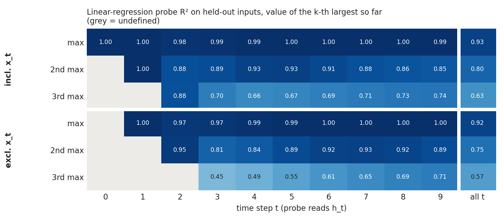
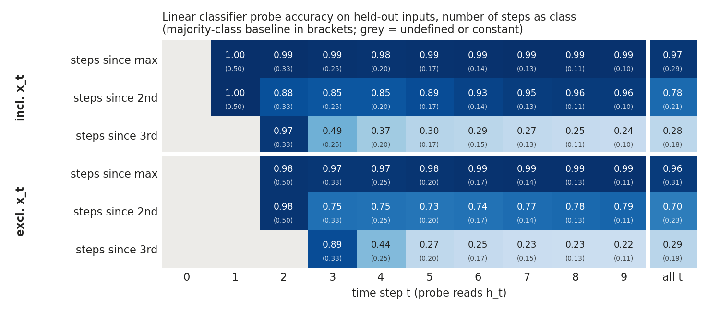

# Linear probes on the hidden state of the second-argmax RNN

## Summary

We trained linear probes on the 16 hidden units of ARC's 432-parameter second-argmax RNN. Each probe reads the hidden state $h_t$ at one time step and predicts one of these:

- the three largest inputs seen so far;
- how many steps ago each of them was seen;
- the same six quantities with the current input $x_t$ left out.

**Main results**

- **The running max is linear in $h_t$.** $R^2$ is 0.97–1.00 at every step.
- **The 2nd max is mostly linear** ($R^2$ 0.81–0.95 after the trivial step $t = 1$).
- **The 3rd max is only partly readable.** Its $R^2$ of 0.45–0.88 is not much better than predicting it from the true max and 2nd max alone, which gives 0.31–0.57.
- **The age of the max is fully present.** A linear classifier gets 97–100% accuracy at every step. This fits the clock-phase encoding described in the colleague's paper, where each age lands in its own region of state space.
- **The age of the 2nd max is mostly present.** At the last step the classifier is 95.7% accurate. That is close to the network's own task accuracy of 95.3%, as expected, since the network's readout is itself a linear classifier for this quantity at $t = 9$.
- **The age of the 3rd max is mostly absent after the first few steps.** Accuracy at $t = 9$ is 24%, against a 10% baseline.

## Setup

**Network.** It is ARC's $M_{16,10}$ second-argmax RNN, with weights from `reverse-engineered-networks/1-algzoo-second-argmax-432/code/m16_10_weights.npz`:

$$h_t = \mathrm{ReLU}(W_{ih}\,x_t + W_{hh}\,h_{t-1}), \qquad h_{-1} = 0, \qquad \ell = W_{out}\,h_9 .$$

It has no biases and a sequence length of 10. Its task is to output the position of the second-largest input.

**Inputs.** Each input is iid $\mathcal N(0,1)$, as in the colleague's analysis. We used 200,000 training sequences and 50,000 held-out test sequences, with seed 0.

**Targets.** At step $t$ the probe reads $h_t$, the state just after the network has read $x_t$. In a given window, let $x_{(1)} > x_{(2)} > x_{(3)}$ be the three largest values, at positions $p_1, p_2, p_3$. "Steps since" is counted from the current step $t$. There are two windows:

| variant | window | value targets | "steps since" targets |
|---|---|---|---|
| including $x_t$ | $x_0,\dots,x_t$ | $x_{(1)}, x_{(2)}, x_{(3)}$ | $a_k = t - p_k \ge 0$ ($0$ means $x_t$ itself) |
| excluding $x_t$ | $x_0,\dots,x_{t-1}$ | $x_{(1)}, x_{(2)}, x_{(3)}$ | $a_k = t - p_k \ge 1$ |

In the excluding variant, a new record at $x_t$ is ignored, so the previous max still counts as the max. A target is undefined when the window holds fewer than $k$ values. It is also left out when it is always the same number: $a_1$ is always 0 at $t = 0$ (including) and always 1 at $t = 1$ (excluding).

**Probes.** We fit one probe per (target, $t$). We also fit one probe per target pooled over all $t$ where the target is defined, shown in the "all $t$" column. The pooled probe is not told $t$, so it tests whether one shared linear readout works at every step.

- *Values:* an affine least-squares fit, $y \approx w^\top h_t + b$, scored by $R^2$ on the test set.
- *Steps since:* multinomial logistic regression on the standardised state $z_t = (h_t - \mu)/\sigma$,
  $$P(a_k = c \mid h_t) = \mathrm{softmax}_c(W z_t + b),$$
  with regularisation strength $C = 10$. It is scored by test accuracy. The baseline is the majority-class accuracy: always guess the most common age at that $t$.

## Results

### Values: $R^2$ of a linear regression



| target | $t=0$ | 1 | 2 | 3 | 4 | 5 | 6 | 7 | 8 | 9 | all $t$ |
|---|---|---|---|---|---|---|---|---|---|---|---|
| max (incl) | 1.00 | 1.00 | 0.98 | 0.99 | 0.99 | 1.00 | 1.00 | 1.00 | 1.00 | 0.99 | 0.93 |
| 2nd max (incl) | – | 1.00 | 0.88 | 0.89 | 0.93 | 0.93 | 0.91 | 0.88 | 0.86 | 0.85 | 0.80 |
| 3rd max (incl) | – | – | 0.88 | 0.70 | 0.66 | 0.67 | 0.69 | 0.71 | 0.73 | 0.74 | 0.63 |
| max (excl) | – | 1.00 | 0.97 | 0.97 | 0.99 | 0.99 | 1.00 | 1.00 | 1.00 | 1.00 | 0.92 |
| 2nd max (excl) | – | – | 0.95 | 0.81 | 0.84 | 0.89 | 0.92 | 0.93 | 0.92 | 0.89 | 0.75 |
| 3rd max (excl) | – | – | – | 0.45 | 0.49 | 0.55 | 0.61 | 0.65 | 0.69 | 0.71 | 0.57 |

- **Max.** It is read almost perfectly in both variants. This fits the paper's "level" direction, which is close to linear in the running max.
- **2nd max.** It is read well. The two variants move in opposite directions with $t$: including $x_t$ falls from 0.93 to 0.85, while excluding $x_t$ rises from 0.81 to 0.93 by $t \approx 7$. At $t = 9$ the excluding variant is the better-read one (0.89 vs 0.85).
- **3rd max.** Some of its $R^2$ comes for free, because order statistics are correlated. As a control, we fitted a linear regression from the true $(x_{(1)}, x_{(2)})$ to $x_{(3)}$, with no access to the network (same data and split as the probes):

| $t$ | from true max and 2nd, incl | probe on $h_t$, incl | from true max and 2nd, excl | probe on $h_t$, excl |
|---|---|---|---|---|
| 3 | 0.43 | 0.70 | 0.31 | 0.45 |
| 5 | 0.52 | 0.67 | 0.48 | 0.55 |
| 9 | 0.57 | 0.74 | 0.57 | 0.71 |

  So $h_t$ holds 0.07–0.27 of extra $R^2$ on the 3rd max (typically about 0.15) beyond what the max and 2nd max imply. That is partial information, not a clean third register. (The same control gives only 0.22–0.40 for predicting $x_{(2)}$ from $x_{(1)}$ alone, or 0.34–0.40 for $t \ge 3$, so the 2nd-max probe is not just riding on the max.)
- **Early steps are trivial.** For example, the 2nd max at $t = 1$ (including $x_t$) is $\min(x_0, x_1)$. Values near 1 there are not evidence of a dedicated mechanism.
- **Pooled probes are lower** (0.57–0.93). Each probe works best at its own step, so the linear readout is not exactly the same across time.

### Steps since: accuracy of a linear classifier



Each cell gives the accuracy, with the majority-class baseline in brackets.

| target | $t=1$ | 2 | 3 | 4 | 5 | 6 | 7 | 8 | 9 | all $t$ |
|---|---|---|---|---|---|---|---|---|---|---|
| $a_1$ (incl) | 1.00 (.50) | .99 (.33) | .99 (.25) | .98 (.20) | .99 (.17) | .99 (.14) | .99 (.13) | .99 (.11) | .99 (.10) | .97 (.29) |
| $a_2$ (incl) | 1.00 (.50) | .88 (.33) | .85 (.25) | .85 (.20) | .89 (.17) | .93 (.14) | .95 (.13) | .96 (.11) | .96 (.10) | .78 (.21) |
| $a_3$ (incl) | – | .97 (.33) | .49 (.25) | .37 (.20) | .30 (.17) | .29 (.15) | .27 (.13) | .25 (.11) | .24 (.10) | .28 (.18) |
| $a_1$ (excl) | – | .98 (.50) | .97 (.33) | .97 (.25) | .98 (.20) | .99 (.17) | .99 (.14) | .99 (.13) | .99 (.11) | .96 (.31) |
| $a_2$ (excl) | – | .98 (.50) | .75 (.33) | .75 (.25) | .73 (.20) | .74 (.17) | .77 (.14) | .78 (.13) | .79 (.11) | .70 (.23) |
| $a_3$ (excl) | – | – | .89 (.33) | .44 (.25) | .27 (.20) | .25 (.17) | .23 (.15) | .23 (.13) | .22 (.11) | .29 (.19) |

($t = 0$ is left out because every target there is undefined or always the same number.)

- **Why classifiers.** The ages are probed as classes, not as numbers, because the network need not hold an age as a linear function of $h_t$. The paper describes the age as the phase of a damped rotation ($42.75^\circ$ per step) that each new record resets. Roughly, the clock sits at $r^{a}(\cos a\theta, \sin a\theta)$, where $\theta$ is the rotation per step and $r$ the damping per step. That is not affine in $a$, but each age lands in its own region, which a classifier can separate. $a_1$ is decoded at 97–100% at every step.
- **$a_2$ including $x_t$, at $t = 9$: 95.7%.** At the final step the task's answer is $9 - a_2$. The network's own readout, $\ell = W_{out} h_9$, is a linear classifier of exactly this target and is right 95.3% of the time. The probe is trained directly on this target and matches it, slightly higher. Accuracy rises from 0.85 at $t = 3$–4 to 0.96 at $t = 8$–9, so the runner-up's age becomes sharper as the network approaches the end of the sequence.
- **Including vs excluding $x_t$ for $a_2$.** The excluding variant tops out near 0.79. When $x_t$ is a new record, the 2nd max excluding $x_t$ is the third-largest value including $x_t$, and the network does not keep that one's age well (next point).
- **$a_3$.** It falls quickly after the first possible step, to about $2\times$ the baseline (0.24 vs 0.10 at $t = 9$). The network keeps little information about where the third-largest value was. This is consistent with what the task needs: when a new record arrives, the old 2nd max becomes the 3rd max and is no longer relevant.
- The first cell in each row is nearly trivial (only two or three possible ages). For example, at $t = 1$ including $x_t$, $a_2 = 1 - a_1$.

## Checks

- **Targets.** An independent loop-based implementation matched the script's targets on all 60,000 cells checked ($500 \text{ sequences} \times 2 \text{ variants} \times 6 \text{ targets} \times 10 \text{ steps}$), including which cells are undefined.
- **$R^2$ values.** We recomputed 16 cells with a different seed, a different forward-pass implementation and a ridge regression with $\alpha = 10^{-6}$. All agreed within 0.007. That forward pass reproduces the network's 95.3% task accuracy, which confirms the hidden states are right.
- **Accuracies.** We recomputed 8 cells with a different seed, our own numpy softmax regression and sklearn. All agreed within 0.02 once the training-set size was matched.
- **Regularisation.** Because some ages are nearly linearly separable, weaker regularisation ($C = 1000$ instead of 10) adds 0.01–0.03 to a few cells. For example, $a_3$ at $t = 3$ (excluding $x_t$) goes from 0.89 to 0.90. The conclusions are unchanged.

## Caveats

- The probes read the post-ReLU state $h_t$ only, not the pre-activations.
- A linear probe shows that information is linearly *available*. It does not show that the network *uses* it. The one case where we know it is used is $a_2$ at $t = 9$, through $W_{out}$.
- All results use Gaussian inputs. This is the task distribution in the colleague's paper, but the original's training notebook used $\mathrm{Unif}(-1,1)$ (see `../replica/README.md`). The network has no biases, so it is scale-equivariant, but it is not equivariant to changes in the shape of the input distribution.

## Reproducing

The scripts are in `../hide/linear-probes-for-every-t/`. Each writes its CSVs there and its figure to this folder. They can be run from any directory.

```
python -B ../hide/linear-probes-for-every-t/linear_probes.py      [n_train] [seed]   # R² figure; about 13 s
python -B ../hide/linear-probes-for-every-t/steps_classifier.py   [n_train] [seed]   # classifier figure; about 4.5 min (process pool)
python -B ../hide/linear-probes-for-every-t/scatter_values.py     [t] [n_train] [seed]   # scatter at step t (default 9)
python -B ../hide/linear-probes-for-every-t/probe_weights.py      [t] [n_train] [seed]   # weights at step t (default 9)
```

The defaults are `n_train` = 200,000 and seed = 0, with a test set a quarter the size of the training set.
