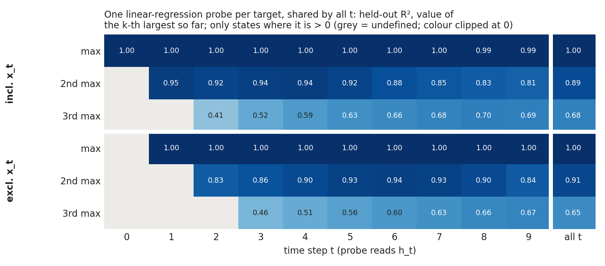
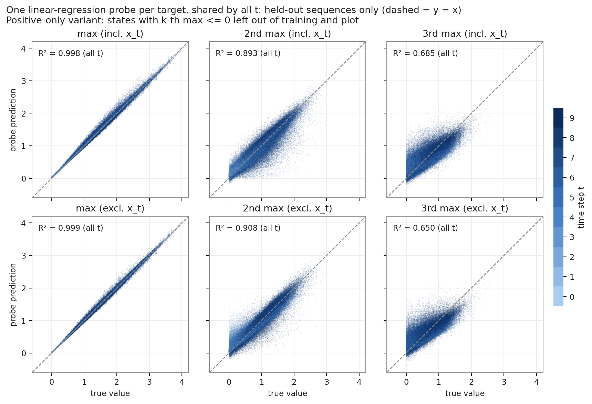
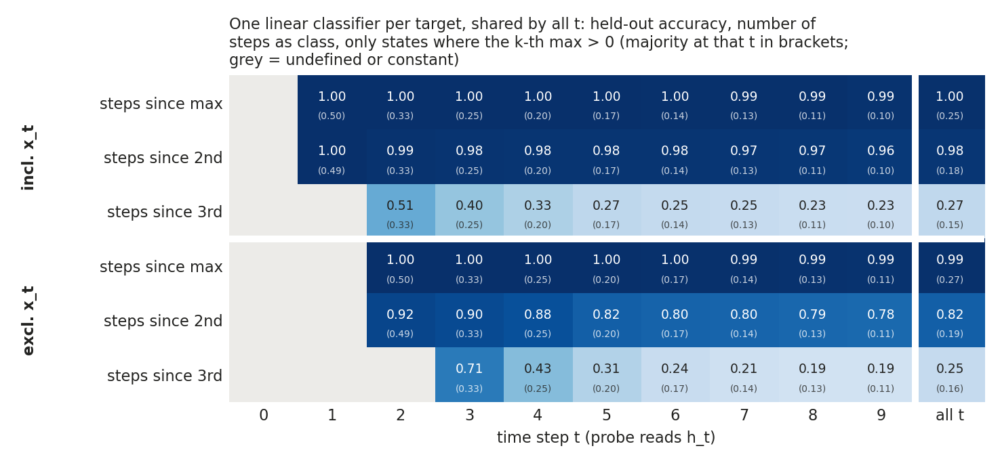
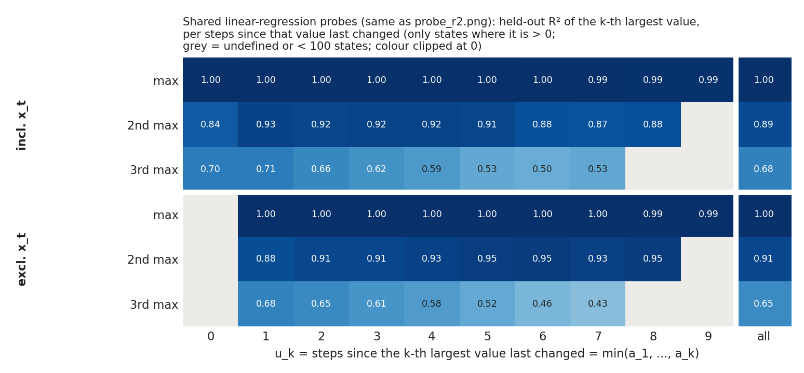
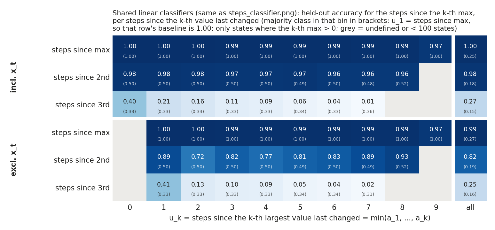
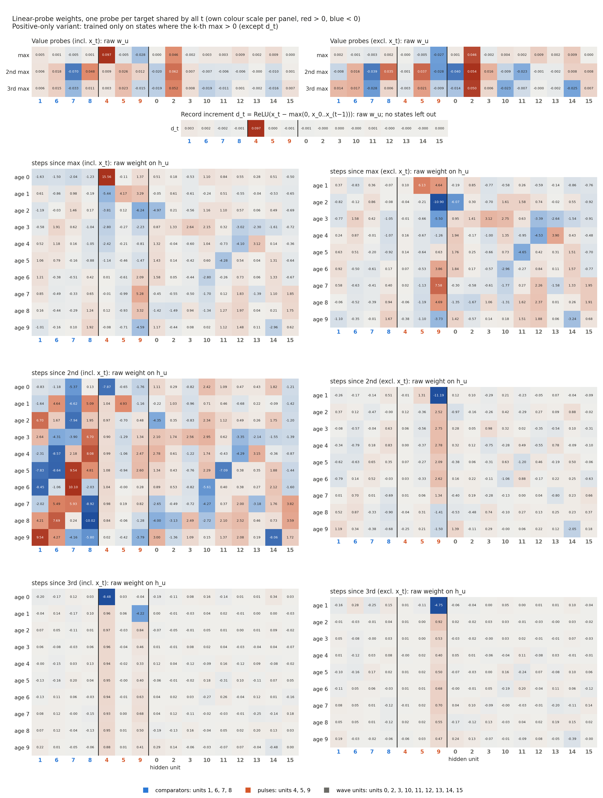
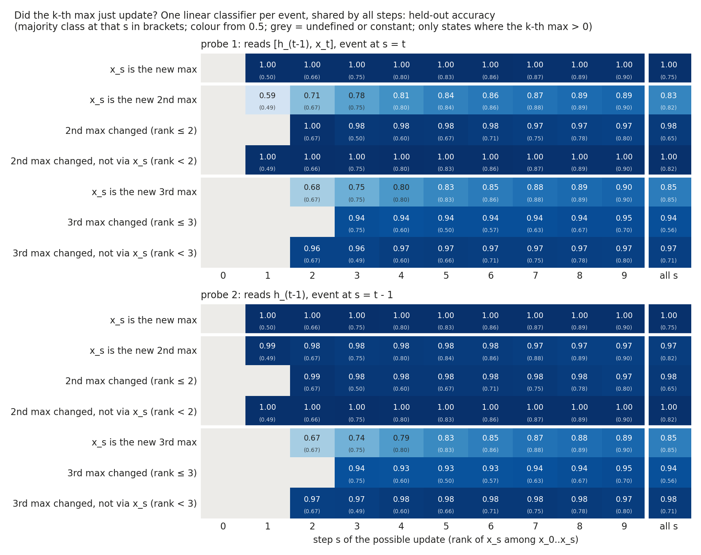
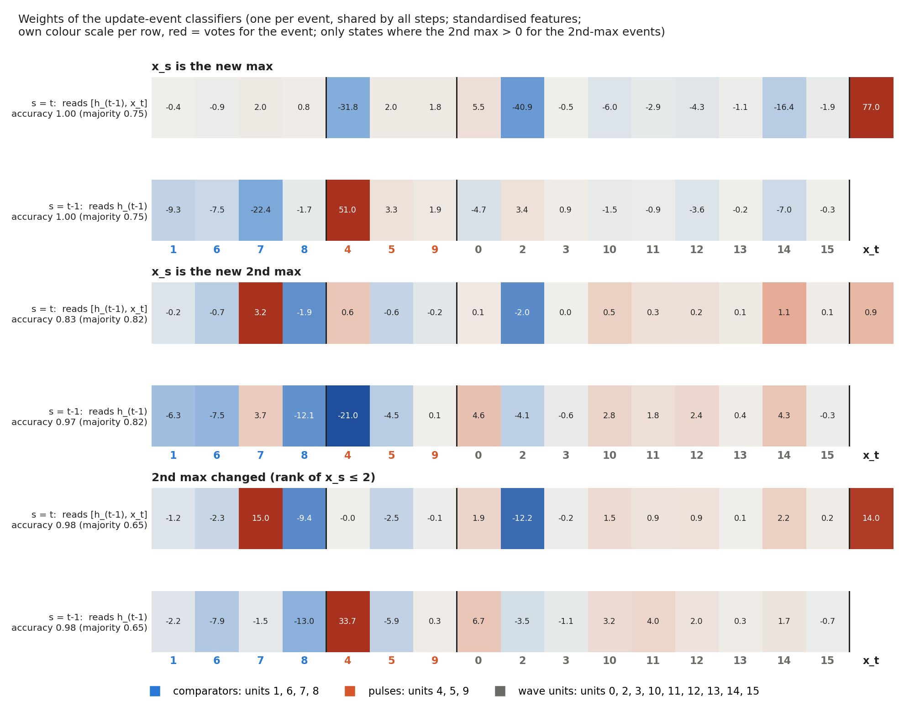
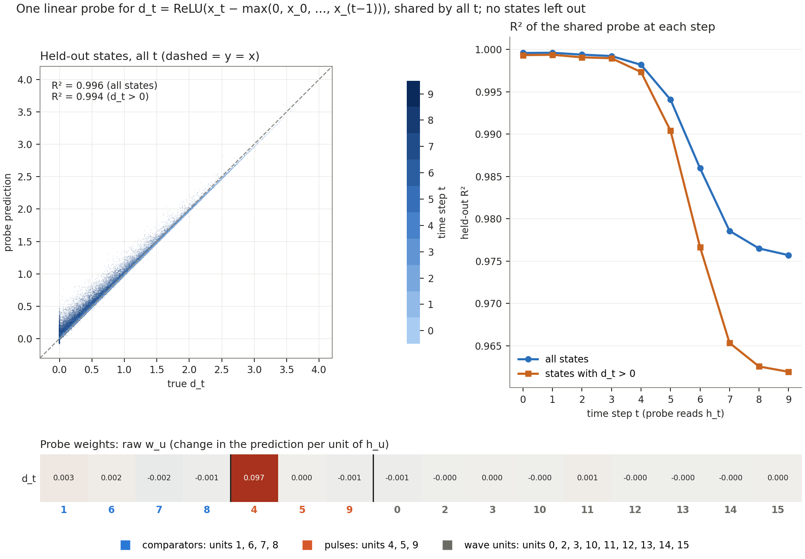

# Linear probes, one per target shared by all time steps: positive values only

This is a variant of `../archived-probed/linear-probes/`. The network, data, targets, probes and scoring are the same. The one change is that **states where the $k$-th largest value is $\le 0$ are left out**, both from training and from scoring, for the probes of the $k$-th value and of its age. The record-increment probe at the end of the results is the one exception: it uses every state.

## Summary

- **Without negative values the max is linear in $h_t$ at every step.** $R^2 \ge 0.993$ at every $t$, against 0.64–0.98 before. Almost all of the earlier error came from negative maxima, which the bias-free ReLU network maps to about 0.
- **The 2nd max is read much better by one shared probe.** $R^2$ is 0.89 (including $x_t$) and 0.91 (excluding) over all $t$, against 0.80 and 0.75 before. It still falls at late $t$ (0.81 and 0.84 at $t = 9$), so its readout still drifts somewhat with $t$.
- **The 3rd max now has a real shared readout.** $R^2$ over all $t$ is 0.68 (including) and 0.65 (excluding). A shared regression on the true max and 2nd max gives only 0.50 and 0.48. Before the filter, the probe was no better than that baseline.
- **The age of the max is decoded almost perfectly:** 0.99–1.00 at every $t$.
- **The age of the 2nd max jumps** to 0.96–1.00 at every $t$ (including $x_t$), against 0.68–0.85 before. Excluding $x_t$ it is 0.78–0.92.
- **The age of the 3rd max stays poor.** It falls to 0.23 (including $x_t$) and 0.19 (excluding) by $t = 9$, against baselines of 0.10 and 0.11.

- **Did the $k$-th max just update?** A new max, and the one-sided events "the $k$-th max changed", are linearly readable from $[h_{t-1}, x_t]$ and from $h_t$ (0.93–1.00). "$x_t$ is the new 2nd max" is readable from $h_t$ (0.97–0.99) but not from $[h_{t-1}, x_t]$, which cannot express an interval in $x_t$. "$x_t$ is the new 3rd max" is not linearly readable from either, although a nonlinear classifier finds it in $h_t$ (about 0.95 against a 0.85 baseline).
- **The size of a new positive record is linear in $h_t$, and unit 4 carries it.** One shared probe for $d_t = \mathrm{ReLU}(x_t - \max(0, x_0, \dots, x_{t-1}))$, with no states left out, reaches $R^2 = 0.996$ over all $t$. Unit 4 alone reaches 0.995.

So a large part of what looked like "drift with $t$" in the unfiltered shared probes was in fact negative values, which the network barely represents.

## What changed relative to `../archived-probed/linear-probes/`

For variant $v$ (including or excluding $x_t$) and rank $k \in \{1, 2, 3\}$, a state $(\text{sequence}, t)$ is kept for the probes of $x_{(k)}$ and $a_k$ only if

$$x_{(k)}(\text{window}) > 0 ,$$

where the window is $x_0,\dots,x_t$ (including) or $x_0,\dots,x_{t-1}$ (excluding). The filter applies to each state separately. A sequence whose first inputs are negative is left out at the early steps but used at later steps, once its $k$-th largest value is positive. The filter is applied to the held-out set the same way, so every score below is on positive values only.

Each rank is filtered on its own value. A state with max 1.3 and 2nd max −0.2 still trains the max probes, but not the 2nd-max probes.

Inputs are iid $\mathcal N(0,1)$, so the window's $k$-th largest value is positive exactly when at least $k$ of its $n$ inputs are positive. The kept fraction is therefore

$$P(\text{kept}) = P\big(\mathrm{Bin}(n, \tfrac12) \ge k\big),$$

with $n = t + 1$ (including $x_t$) or $n = t$ (excluding). In the held-out set this is, for example, 50% for the max at $t = 0$, 12% for the 3rd max at $t = 2$ (including $x_t$) and 95% for the 3rd max at $t = 9$.

Everything else is unchanged: 200,000 training and 50,000 held-out sequences, seed 0. There is one affine least-squares probe per value target and one multinomial logistic regression ($C = 10$, standardised states) per age target, each trained on the stacked states of all $t$ and not told $t$. Per-$t$ scores use only that step's kept states, and $R^2$ uses that step's own variance. The majority baseline is the most common age at that $t$ among the kept training states.

## Results

### Values: $R^2$ of one shared linear regression



| target | $t=0$ | 1 | 2 | 3 | 4 | 5 | 6 | 7 | 8 | 9 | all $t$ |
|---|---|---|---|---|---|---|---|---|---|---|---|
| max (incl) | 1.00 | 1.00 | 1.00 | 1.00 | 1.00 | 1.00 | 1.00 | 1.00 | 0.99 | 0.99 | 1.00 |
| 2nd max (incl) | – | 0.95 | 0.92 | 0.94 | 0.94 | 0.92 | 0.88 | 0.85 | 0.83 | 0.81 | 0.89 |
| 3rd max (incl) | – | – | 0.41 | 0.52 | 0.59 | 0.63 | 0.66 | 0.68 | 0.70 | 0.69 | 0.68 |
| max (excl) | – | 1.00 | 1.00 | 1.00 | 1.00 | 1.00 | 1.00 | 1.00 | 1.00 | 1.00 | 1.00 |
| 2nd max (excl) | – | – | 0.83 | 0.86 | 0.90 | 0.93 | 0.94 | 0.93 | 0.90 | 0.84 | 0.91 |
| 3rd max (excl) | – | – | – | 0.46 | 0.51 | 0.56 | 0.60 | 0.63 | 0.66 | 0.67 | 0.65 |



- **Max.** The points lie on $y = x$ at every $t$. The kink at 0 seen in `../archived-probed/linear-probes/` is gone because those states are excluded, and nothing else was wrong.
- **2nd max.** One readout works well across $t$, with $R^2$ 0.83–0.95 at every step. The late steps are the weakest, by about 0.1.
- **3rd max.** The points form a cloud around $y = x$ with slope below 1, the signature of a partly informative probe. Unlike the 2nd max, its $R^2$ *rises* with $t$, from 0.41 to 0.69–0.70.

**Control for correlated order statistics.** As in `../archived-probed/linear-probes/`, we fit a shared regression from the *true* earlier order statistics, with no access to the network. It uses the same kept states and the same split, and is not told $t$.

| | $t=2$ | 3 | 4 | 5 | 6 | 7 | 8 | 9 | all $t$ |
|---|---|---|---|---|---|---|---|---|---|
| 3rd max (incl): baseline from true max and 2nd | 0.09 | 0.21 | 0.34 | 0.42 | 0.46 | 0.50 | 0.51 | 0.51 | 0.50 |
| 3rd max (incl): probe on $h_t$ | 0.41 | 0.52 | 0.59 | 0.63 | 0.66 | 0.68 | 0.70 | 0.69 | 0.68 |
| 3rd max (excl): baseline from true max and 2nd | – | 0.14 | 0.25 | 0.36 | 0.43 | 0.47 | 0.49 | 0.50 | 0.48 |
| 3rd max (excl): probe on $h_t$ | – | 0.46 | 0.51 | 0.56 | 0.60 | 0.63 | 0.66 | 0.67 | 0.65 |
| 2nd max (incl): baseline from true max | 0.04 | 0.18 | 0.27 | 0.33 | 0.35 | 0.35 | 0.33 | 0.29 | 0.36 |
| 2nd max (incl): probe on $h_t$ | 0.92 | 0.94 | 0.94 | 0.92 | 0.88 | 0.85 | 0.83 | 0.81 | 0.89 |

($t = 1$ for the 2nd max including $x_t$: baseline −0.19, probe 0.95. For the 2nd max excluding $x_t$, the baseline over all $t$ is 0.35 and the probe 0.91.)

- **3rd max.** The probe beats the baseline by 0.16–0.32 at every $t$, and by 0.18 over all $t$ (0.68 vs 0.50). On positive values, $h_t$ carries information about the 3rd max beyond the max and 2nd max, in a direction shared across $t$. In `../archived-probed/linear-probes/` this was hidden: the negative 3rd maxima, which the probe could not follow, pulled its $R^2$ down to the baseline.
- **2nd max.** The probe is 0.5–0.9 above the baseline at $t \ge 2$, and further above it at the first step (1.14 at $t = 1$ including $x_t$).

### Steps since: accuracy of one shared linear classifier



Each cell gives the accuracy, with the majority-class baseline at that $t$ in brackets.

| target | $t=1$ | 2 | 3 | 4 | 5 | 6 | 7 | 8 | 9 | all $t$ |
|---|---|---|---|---|---|---|---|---|---|---|
| $a_1$ (incl) | 1.00 (.50) | 1.00 (.33) | 1.00 (.25) | 1.00 (.20) | 1.00 (.17) | 1.00 (.14) | .99 (.13) | .99 (.11) | .99 (.10) | 1.00 (.25) |
| $a_2$ (incl) | 1.00 (.49) | .99 (.33) | .98 (.25) | .98 (.20) | .98 (.17) | .98 (.14) | .97 (.13) | .97 (.11) | .96 (.10) | .98 (.18) |
| $a_3$ (incl) | – | .51 (.33) | .40 (.25) | .33 (.20) | .27 (.17) | .25 (.14) | .25 (.13) | .23 (.11) | .23 (.10) | .27 (.15) |
| $a_1$ (excl) | – | 1.00 (.50) | 1.00 (.33) | 1.00 (.25) | 1.00 (.20) | 1.00 (.17) | .99 (.14) | .99 (.13) | .99 (.11) | .99 (.27) |
| $a_2$ (excl) | – | .92 (.49) | .90 (.33) | .88 (.25) | .82 (.20) | .80 (.17) | .80 (.14) | .79 (.13) | .78 (.11) | .82 (.19) |
| $a_3$ (excl) | – | – | .71 (.33) | .43 (.25) | .31 (.20) | .24 (.17) | .21 (.14) | .19 (.13) | .19 (.11) | .25 (.16) |

($t = 0$ is not scored. For $a_1$ including $x_t$, $t = 0$ is always age 0, but those states are still in the training set. The "all $t$" accuracy includes them.)

- **$a_1$.** One classifier reads the age of a positive max at 0.99–1.00 at every step. In `../archived-probed/linear-probes/` it was 0.92 at $t = 1$–2. The early errors came from sequences whose max was still negative and had therefore left little trace in the state.
- **$a_2$ including $x_t$: 0.96–1.00 at every step.** This is the largest change from `../archived-probed/linear-probes/` (0.68–0.85) and close to a per-step probe at $t = 9$ (0.96). Once the 2nd max is positive, the network's code for its age is shared across time. The poor shared accuracy before came from states whose 2nd max was negative.
- **$a_2$ excluding $x_t$** is lower (0.78–0.92) and falls with $t$. When $x_t$ is a new record, the "2nd max excluding $x_t$" is the 3rd largest including $x_t$, whose age the network keeps poorly.
- **$a_3$** stays at about twice its baseline at late $t$.

### The same probes, scored by steps since the $k$-th value last changed

The $k$-th largest value changes whenever an input lands at rank $\le k$. Its last change is therefore at the latest of the top-$k$ positions:

$$u_k = t - \max(p_1, \dots, p_k) = \min(a_1, \dots, a_k).$$

So $u_1 = a_1$, $u_2 = \min(a_1, a_2)$ and $u_3 = \min(a_1, a_2, a_3)$. The figures below score **the same shared probes** as above, not refit and still not told $t$ or $u_k$. Held-out states are grouped by the $u_k$ of each probe's own target. Bins with fewer than 100 held-out states are grey. The "all" column equals the "all $t$" column above, as it should.





- **Max:** $R^2$ 0.99–1.00 at every $u_1$. The readout of the max does not degrade with time since it was set.
- **2nd max:** $R^2$ 0.84 (including $x_t$) right after a change ($u_2 = 0$, so $x_t$ is a new max or a new 2nd max), and 0.87–0.93 after that.
- **3rd max: the readout decays with time since the value was set.** $R^2$ falls from 0.70–0.71 at $u_3 \le 1$ to 0.50–0.53 at $u_3 = 5$–7 (including $x_t$), and from 0.68 to 0.43 excluding $x_t$. This matches the paper's picture of a slowly leaking runner-up level: whatever $h_t$ holds about the 3rd max fades as it ages. The decay is not $t$ in disguise: at fixed $t = 9$, $R^2$ falls from 0.73 to 0.53 (including $x_t$) as $u_3$ goes from 0 to 7. And the within-bin variance is flat, while the probe's mean squared error rises (0.039 to 0.070). Per $t$ (above) the decay was hidden, because $u_3$ varies a lot within each $t$.
- **Classifier baselines change meaning here.** Since $u_1 = a_1$, the age of the max is constant within a bin, so its baseline is 1.00. For $a_2$ and $a_3$, the most recent of the top-$k$ positions is about equally likely to be any of the $k$. So $a_k = u_k$ with probability about $1/k$; that is the majority class, which is why the baselines sit near 0.50 and 0.33. Otherwise $a_k > u_k$, spread over several values.
  - **$a_1$:** 0.97–1.00 in every bin.
  - **$a_2$:** 0.96–0.98 in every bin including $x_t$, and 0.72–0.93 excluding $x_t$, against about 0.50.
  - **$a_3$:** falls from 0.40–0.41 in the first bin ($u_3 = 0$ including $x_t$, $u_3 = 1$ excluding), slightly above the 0.33 baseline, to 0.01–0.02 at $u_3 = 7$. From the second bin on it is well *below* its in-bin baseline (0.31–0.36). The probe does not know $u_3$, so in these bins it guesses ages that are typical over all states, not ones consistent with an old 3rd max.

### Probe weights



All panels show raw weights on $h_u$, with no rescaling by the spread of each unit. For the value probes these are $w_u$ in $\hat y = \sum_u w_u h_u + b$. The classifiers were fitted on standardised states, so their raw weights are $W[c, u] / \sigma_u$, with $\sigma_u$ taken over the kept training states. Units are grouped as in the colleague's paper: comparators 1, 6, 7, 8 | pulses 4, 5, 9 | wave units.

- **Max.** Including $x_t$, the largest weight is on unit 4, the record pulse (0.097), followed by unit 2 (0.046). Excluding $x_t$, unit 2 is the largest (0.046) and unit 4 is −0.000. Unit 9 is about −0.03 in both, and the other weights are at most 0.009 in size.
- **Record increment $d_t$** (centred panel in the second row; see "Size of a new positive record". Unlike the other panels, it is fitted on every state). Unit 4 has weight 0.097, and every other weight is at most 0.003 in size.
- **2nd and 3rd max.** These use unit 2 (0.050–0.062) and unit 7 with a negative sign (−0.028 to −0.070). The 2nd max also uses unit 8 (0.035–0.048), unit 5 (0.026–0.037) and unit 0 (−0.020 to −0.040).
- **$a_1$ including $x_t$, age 0.** As before, this row is dominated by unit 4 (+15.6). Its size is set by the regularisation, because the class is nearly separable, so only its sign and dominance mean anything.
- **$a_2$ including $x_t$.** This classifier now uses the comparators 1, 6, 7 and 8 heavily (weights up to about ±10), with smaller contributions from the wave units 0, 10, 11, 12 and 14. That fits the paper's account, where the comparators' clipped waves carry the runner-up's evidence.

### Did the $k$-th max just update?



**Events.** Let $r_s = 1 + \#\{j < s : x_j > x_s\}$ be the rank of $x_s$ among $x_0,\dots,x_s$. For $k = 1, 2, 3$ there are three binary events at step $s$:

| event | definition | meaning |
|---|---|---|
| lands$_k$ | $r_s = k$ | $x_s$ is the new $k$-th largest |
| changed$_k$ | $r_s \le k$ | the value of the $k$-th largest changed |
| shifted$_k$ | $r_s < k$ | it changed, but not because $x_s$ took that place: $x_s$ is a new max ($k = 2$), or a new max or new 2nd max ($k = 3$) |

For $k = 1$, "lands" and "changed" are the same event and "shifted" never happens, so there are 7 distinct events.

**Probes.** Each event gets two binary logistic regressions ($C = 10$, standardised features). Each is shared by all steps and not told $s$:

- **probe 1, "just now":** reads $[h_{t-1}, x_t]$ (17 numbers, with $h_{-1} = 0$) and predicts the event at $s = t$;
- **probe 2, "last round":** reads $h_{t-1}$ and predicts the event at $s = t - 1$. In other words it reads $h_s$, for $s = 0,\dots,9$.

**Filter.** Following this folder's rule, a state is kept for the $k$-th events only if the $k$-th largest of $x_0,\dots,x_s$ is $> 0$, that is, the $k$-th max *after* the possible update. Cells where the event is always true (for example a new max at $s = 0$) are not scored. The baseline is the majority class at that $s$.

Accuracy on held-out sequences, with the majority-class baseline in brackets (ranges over $s$):

| event | probe 1: $[h_{t-1}, x_t]$ | probe 2: $h_{t-1}$ |
|---|---|---|
| $x_s$ is a new max | 1.00 at every $s$ (.50–.90) | 1.00 at every $s$ (.50–.90) |
| $x_s$ is the new 2nd max | .59–.89, at most +0.10 over baseline (.49–.90) | .97–.99 (.49–.90) |
| 2nd max changed ($r_s \le 2$) | .97–1.00 (.50–.80) | .97–.99 (.50–.80) |
| 2nd max changed, not via $x_s$ (= new max) | 1.00 (.49–.90) | 1.00 (.49–.90) |
| $x_s$ is the new 3rd max | .68–.90, at baseline (.67–.90) | .67–.89, at baseline (.67–.90) |
| 3rd max changed ($r_s \le 3$) | .94–.95 (.50–.75) | .93–.95 (.50–.75) |
| 3rd max changed, not via $x_s$ ($r_s \le 2$) | .96–.97 (.49–.80) | .97–.98 (.49–.80) |

The full table per $s$ is in `../hide/linear-probes-positive/update_probes.csv`.

- **A new max is linearly readable in both probes, at 1.00.** For probe 1 this is the threshold test $x_t > M_{t-1}$, with $M_{t-1}$ the max, linear in $h_{t-1}$. For probe 2 the record pulse (unit 4) in $h_s$ marks it directly.
- **"$x_s$ is the new 2nd max" is not linear in $[h_{t-1}, x_t]$, but it is linear in $h_s$.** The event is an interval, $S_{t-1} < x_t < M_{t-1}$, where $S_{t-1}$ is the 2nd max. For fixed $h_{t-1}$, a linear score $w^\top h_{t-1} + w_x x_t + b$ is monotone in $x_t$, so its positive set in $x_t$ is a half-line and can never be that interval. Probe 1 is therefore limited by its form, not by missing information. A nonlinear check confirms this: a gradient-boosted tree classifier on the same $[h_{t-1}, x_t]$ reaches 0.98, in an independent run with a different seed. After one more ReLU step the network has made the event linearly readable: probe 2 reads it from $h_s$ at 0.97–0.99.
- **The one-sided events are linear in both probes.** "Changed" ($x_t > $ the old $k$-th max) and "shifted" ($x_t > $ the old $(k-1)$-th max) are single thresholds. Both probes reach 0.97–1.00 for the 2nd max and 0.93–0.98 for the 3rd.
- **"$x_s$ is the new 3rd max" is not *linearly* readable by either probe.** For probe 1 the reason is the same interval argument. Probe 2 is also at the baseline, so unlike the new 2nd max, $h_s$ does not make this event linearly available. The information is still there: a gradient-boosted tree classifier reaches about 0.95 from $h_s$ and 0.94 from $[h_{t-1}, x_t]$, against a majority baseline of 0.85 (independent run, different seed). So the network does register a new 3rd max, but only nonlinearly.

**Weights of three of these classifiers.**



These are logistic-regression weights on standardised features: the change in log-odds per standard deviation of each feature. Each row has its own colour scale. We refit with two more seeds. Every weight moved by less than 5% of its row's largest $|w|$, except the one noted below.

- **New max, $s = t$:** $x_t$ (+77) against unit 2 (−41) and unit 4 (−32). The probe tests $x_t > M_{t-1}$, with the previous max held in two units:
  - unit 2 is the paper's level for the earlier max;
  - unit 4 is the record pulse, carrying the newest increment when $x_{t-1}$ was itself a record.

  A linear regression of $M_{t-1}$ on $h_{t-1}$ gives $R^2$ 0.65 from unit 2 alone, 0.97 from units 2 and 4, and 0.998 from all 16 units. A probe on only $[u_2, u_4, x_t]$ reaches 0.992, against 0.997 for the full probe.
- **New max, $s = t-1$:** dominated by unit 4 (+51), with unit 7 negative (−22). Unit 7 measures the drop of $x_s$ below the max and is off on a record. The rule $u_4 > 0$ alone is 99.0% accurate.
- **New 2nd max, $s = t$:** the probe cannot express this event (see above), so its small weights have no clear meaning.
- **New 2nd max, $s = t-1$:** unit 4 is the most negative (−21: not a record), followed by comparators 8, 6 and 1 (−12, −7.5, −6). The comparators fire when $x_s$ is below their thresholds, so low comparator activity means "$x_s$ was high". Unit 4 is needed: without it, accuracy drops from 0.97 to 0.89. The smaller weights on units 0, 5, 14 and 2 (about ±4) also contribute.
- **2nd max changed, $s = t$:** unit 7 (+15), $x_t$ (+14), unit 2 (−12) and unit 8 (−9). Together they test $x_t$ against a runner-up threshold. A probe on these four features alone reaches 0.96, against 0.98 for the full probe.
- **2nd max changed, $s = t-1$:** unit 4 is the largest weight (+34). A record pushes the old max into second place, and $u_4 > 0$ almost never happens when the 2nd max did not change (0.01% of states). Because of that near-separation, the regularisation, not the data, sets the size of this weight: it was +13 and +44 with other seeds. Only its sign should be read. Other units carry the same information, so dropping unit 4 costs little (0.981 to 0.978).

### Size of a new positive record

**Target.** How far $x_t$ rises above both 0 and every earlier input:

$$d_t = \mathrm{ReLU}\big(x_t - \max(0, x_0, \dots, x_{t-1})\big), \qquad d_0 = \mathrm{ReLU}(x_0).$$

**Probe.** One affine least-squares probe $\hat d_t = w^\top h_t + b$, shared by all $t$ and not told $t$. **Unlike the other probes in this folder, no state is left out:** all 200,000 training and 50,000 held-out sequences count at every step $t = 0, \dots, 9$. $d_t > 0$ in 22.4% of the held-out states.



Held-out $R^2$, with each step scored against its own variance:

| probe | states scored | $t=0$ | 1 | 2 | 3 | 4 | 5 | 6 | 7 | 8 | 9 | all $t$ |
|---|---|---|---|---|---|---|---|---|---|---|---|---|
| all 16 units | all | 1.000 | 1.000 | 0.999 | 0.999 | 0.998 | 0.994 | 0.986 | 0.979 | 0.976 | 0.976 | 0.996 |
| all 16 units | $d_t > 0$ | 0.999 | 0.999 | 0.999 | 0.999 | 0.997 | 0.990 | 0.977 | 0.965 | 0.963 | 0.962 | 0.994 |
| unit 4 only | all | 1.000 | 1.000 | 1.000 | 0.999 | 0.998 | 0.992 | 0.982 | 0.974 | 0.973 | 0.974 | 0.995 |
| unit 4 only | $d_t > 0$ | 0.999 | 0.999 | 0.999 | 0.999 | 0.996 | 0.985 | 0.967 | 0.954 | 0.952 | 0.953 | 0.991 |
| all but unit 4 | all | 0.079 | 0.185 | 0.221 | 0.240 | 0.238 | 0.202 | 0.161 | 0.115 | 0.053 | −0.232 | 0.216 |
| all but unit 4 | $d_t > 0$ | −0.522 | −0.408 | −0.321 | −0.256 | −0.190 | −0.158 | −0.153 | −0.161 | −0.149 | −0.098 | −0.302 |

- **The increment is linearly readable at every step.** The high score does not come from the many states with $d_t = 0$: on the states with $d_t > 0$ alone, $R^2$ is 0.994 over all $t$ and at least 0.962 at every step. Where $d_t = 0$, the rms prediction is 0.014.
- **Unit 4 carries it.** The fit on unit 4 alone is $\hat d_t = 0.0970\, u_4 - 0.0030$, and the other 15 units add at most 0.011 to $R^2$ at any step on the $d_t > 0$ states. Without unit 4 the probe fails (0.216 on all states, and negative on $d_t > 0$). In the full probe unit 4 has weight 0.097, and every other weight is at most 0.0031 in size.
- **The slope matches the input weight.** $1 / 0.0970 = 10.3$, close to $W_{ih}[4] = 10.157$. At $t = 0$ the match is exact by construction, since $u_4 = W_{ih}[4]\, \mathrm{ReLU}(x_0)$.
- **The readout weakens late in the sequence.** $R^2$ on $d_t > 0$ falls from 0.999 at $t \le 3$ to 0.962 at $t = 9$. The errors also become biased upward: on those states the mean error $\hat d_t - d_t$ goes from $-0.014$ at $t = 0$ to $+0.05$ at $t = 7$–9, where the probe overestimates in 77–80% of states and its rms error is 0.09.

The weights are stable: with two other seeds no weight moved by more than 0.0002. The target matches a brute-force calculation exactly.

## Caveats

- Scoring on positive values only answers a narrower question than `../archived-probed/linear-probes/`. These probes say nothing about how well $h_t$ encodes negative order statistics; it encodes them poorly.
- The kept states are not a random sample of states. Early steps keep only sequences with enough positive inputs, which have a larger max on average.
- The probes read the post-ReLU state $h_t$ only. A linear probe shows that information is *available*, not that the network *uses* it.
- All results use Gaussian inputs. This is the task distribution in the colleague's paper, but the original's training notebook used $\mathrm{Unif}(-1,1)$ (see `../replica/README.md`).

## Reproducing

The scripts are in `../hide/linear-probes-positive/`, and can be run from any directory. They are the same as in `../hide/linear-probes/` except for `positive()` and a per-state `pooled()` in `linear_probes.py`.

```
python -B ../hide/linear-probes-positive/linear_probes.py      [n_train] [seed]   # value probes: R² figure, value_probes.npz; about 6 s
python -B ../hide/linear-probes-positive/steps_classifier.py   [n_train] [seed]   # age classifiers: accuracy figure, age_probes.npz; about 4 min
python -B ../hide/linear-probes-positive/scatter_values.py                        # scatter plot (needs value_probes.npz)
python -B ../hide/linear-probes-positive/probe_weights.py                         # weight figure (needs value_probes.npz, age_probes.npz, increment_probe.npz)
python -B ../hide/linear-probes-positive/update_probes.py    [n_train] [seed]   # update-event classifiers: update_probes.png, update_probes.npz; about 20 s
python -B ../hide/linear-probes-positive/by_update_age.py                        # *_by_update.png: the same probes scored by u_k (needs both .npz files)
python -B ../hide/linear-probes-positive/update_weights.py                       # weight figure for three update events (needs update_probes.npz)
python -B ../hide/linear-probes-positive/increment_probe.py  [n_train] [seed]   # record-increment probe, no states left out: increment_probe.png, .csv, .npz; about 5 s
```
