# Extra figures for the mechanistic report

Twenty figures, made on 2026-11-20 on request, in the style of `../mechanism_summary.png`. Section numbers refer to `../report.md`. Notation as in the report: $M \ge S \ge T$ are the three largest inputs so far, $S^+ = \max(S, 0)$, the gap is $M - S^+$, $w_4 = 10.157$, $z$ is the clock coordinate, $s = U h = V + m$ are the scores, with $V$ the part read through the comparators 1, 6, 7, 8.

Each group of figures is drawn by one script, `../hide/plot_<group>.py` (`python -B hide/plot_<group>.py`, or with `--redraw` to redraw from the cached numbers in `hide/plot_<group>.npz`). Every figure was drawn by one agent and then checked by a second one, who recomputed the plotted numbers with separate code and compared them with the report. The outcome is in the last two sections of this file; the full text of the checks is in `../hide/notes/plots_check_results.md`.

## Contents

| group | figures |
|---|---|
| [1. The update rule](#1-the-update-rule-section-5) | `update_rule_clock.png`, `update_rule_level_runner.png`, `update_rule_check.png` |
| [2. One sequence, step by step](#2-one-sequence-step-by-step-section-55) | `worked_example_timeline.png`, `worked_example_clock.png` |
| [3. The two cancelling waves](#3-the-two-cancelling-waves-sections-34-and-43) | `waves_by_age.png`, `readout_columns.png`, `margin_by_distance.png` |
| [4. Measured laws](#4-measured-laws-section-41) | `clock_laws.png`, `thresholds_by_age.png`, `level_and_unit2.png` |
| [5. Interventions and the feedback experiment](#5-interventions-section-35-and-the-feedback-experiment-section-41) | `intervention_wipe.png`, `intervention_clock.png`, `feedback_by_mode.png` |
| [6. Errors and wave units](#6-errors-and-wave-units-sections-7-and-42) | `errors_by_arrangement.png`, `accuracy_by_gaps.png`, `wave_unit_troughs.png` |
| [7. Modes](#7-modes-sections-2-32-and-43) | `modes_spectrum.png`, `mode_patterns.png`, `gate_patterns.png` |

## 1. The update rule (section 5)

Script: `hide/plot_update_rule.py`.

**`update_rule_clock.png`.** The clock row of the coefficient table as arrows in the complex plane, nothing rescaled: what each term adds to $z$ in one step. Unit 4 writes 1. The four comparator terms are as large and point four ways; laid tip to tail they close to within 0.02 (panel c). Panel d takes the impulse $x = (1, 0, \dots, 0)$ apart: the pulse of unit 9 holds the first step of the clock back to 36.3°, against 42.75° of free rotation.

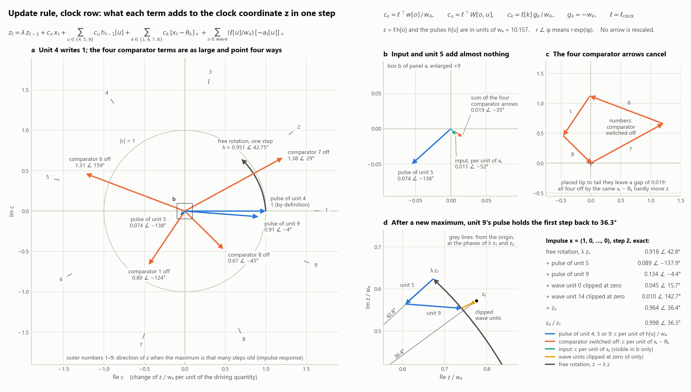

**`update_rule_level_runner.png`.** The level and runner rows of the same table as signed bars (units of $w_4$, separate scales). Unit 4 alone writes the level. Comparators 7, 8 and 1 and unit 5 write the runner coordinate.

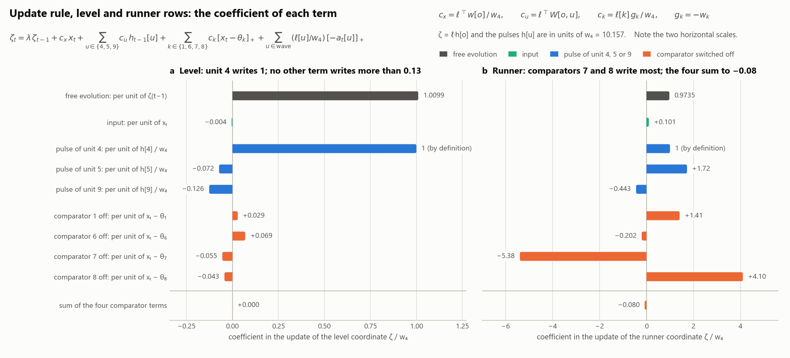

**`update_rule_check.png`.** The rule against data: predicted against actual coordinate for 2,000,000 one-step updates. With all five terms (blue) the error is at most $6 \times 10^{-14}$. With only free evolution, input and pulses (grey) the error is up to 15, in units of $w_4$: these three terms are exact only in the 23% of updates in which no comparator is switched off and no wave unit is clipped.

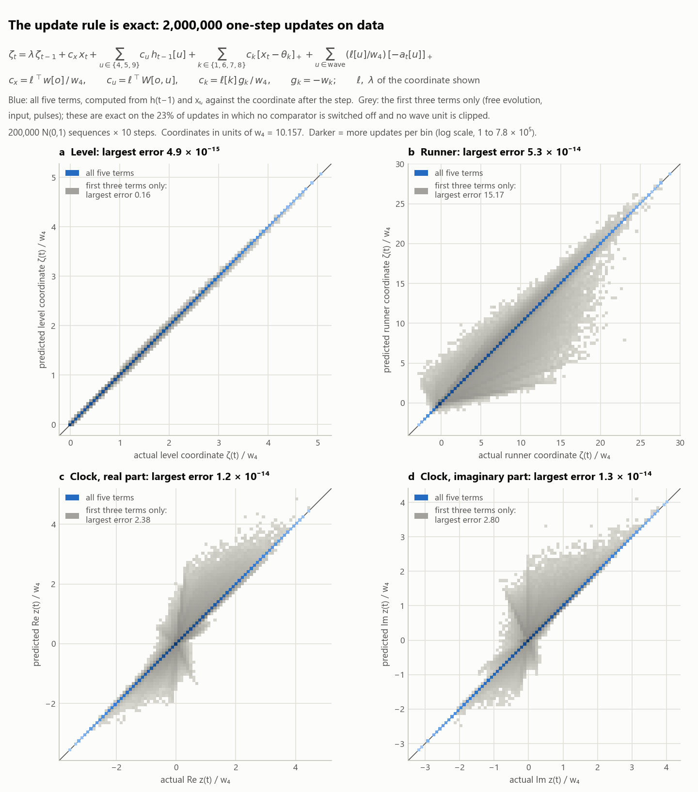

## 2. One sequence, step by step (section 5.5)

Script: `hide/plot_worked_example.py`. The sequence is $x = (0.8, -0.5, 0.3, 1.2, -1.0, 0.9, -0.7, 1.6, -0.2, 0.4)$.

**`worked_example_timeline.png`.** (a) The inputs against the five thresholds they meet. (b) The pulses of units 4, 5, 9. (c) The scores $s_t$, one row per input; the framed top entry is the runner-up so far from step 2 on. (d) The same without the comparators, $m_t$; the top entry among the earlier inputs is the largest of them. Columns of c and d are centred on the mean over the earlier inputs.

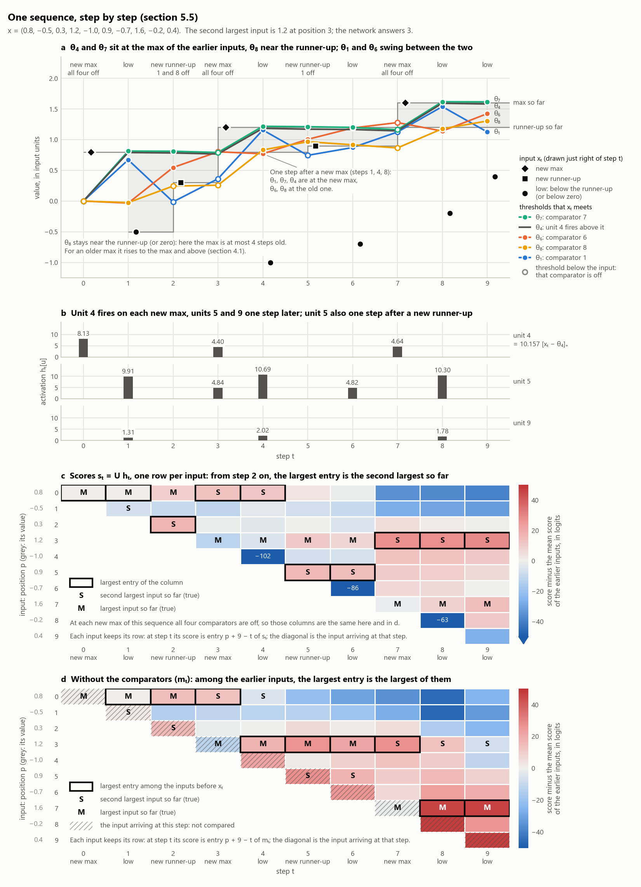

**`worked_example_clock.png`.** The clock coordinate $z / w_4$ after each step, with the phase law $\varphi(a)$ of section 4.1 as rays. One step after each new maximum the clock restarts near 0° and then turns. A new runner-up shortens it and holds it back; the hollow points show where it would be if that input had been $-1$.

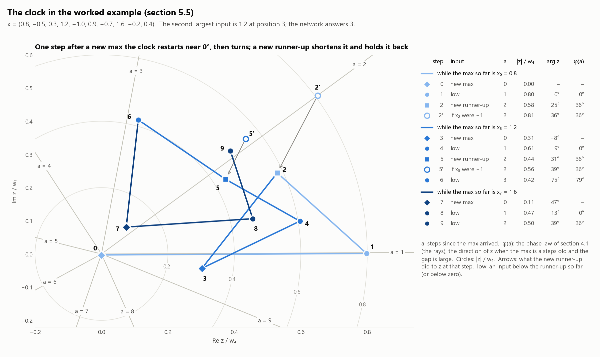

## 3. The two cancelling waves (sections 3.4 and 4.3)

Script: `hide/plot_two_waves.py`.

**`waves_by_age.png`.** Coefficient of the gap $M - S$ in $V$, in $m$ and in their sum at the last step, by age of the maximum (rows) and logit index (columns). $V$ has a trough on the maximum's index (outlined cells, mean $-62$) and $m$ a crest ($+55$); at most 10 logits per unit of gap are left in the sum.

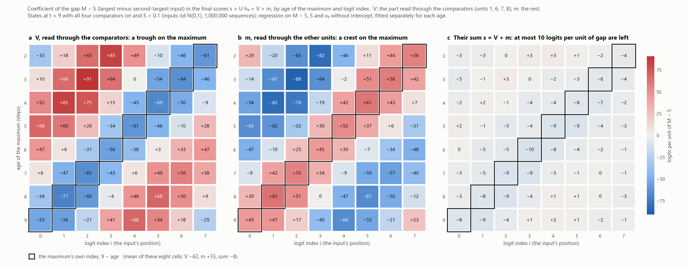

**`readout_columns.png`.** From the weights alone. Left: the readout columns of the four comparators, with sinusoids at the clock's frequency fitted on indices 0–7 ($R^2$ = 0.94–0.99; the legend also gives the fit with the frequency left free, 44°–49° per index). Right: the size of the clock pattern's readout through the comparators, through the wave units, and summed: 5.5% of the two sizes is left.

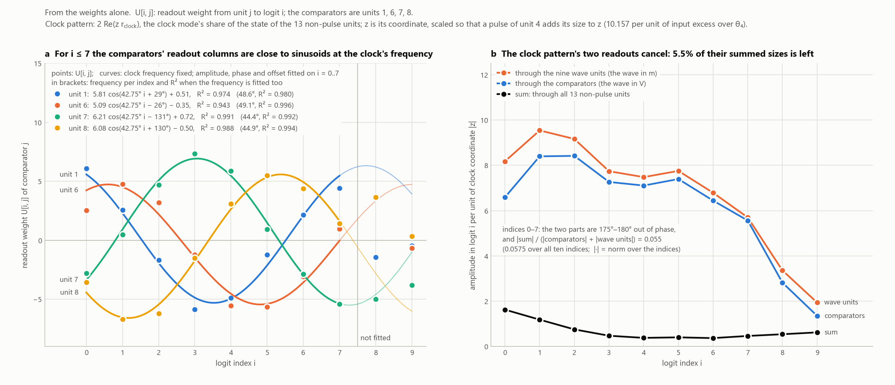

**`margin_by_distance.png`.** Median margin of the runner-up over the maximum at the last step, in units of $M$, with its $V$ part and its $m$ part, against the distance $D$ between the two positions, for four bins of the relative gap. The margin is the small remainder of two parts that grow with the gap. Dashed lines: the two parts without the pairs that include position 8 (an input one step old). Those pairs are half of all pairs at $D = 7$ and all of them at $D = 8$, and they are why the pooled margin keeps rising there.

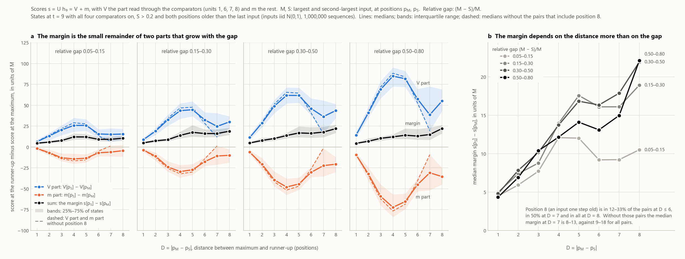

## 4. Measured laws (section 4.1)

Script: `hide/plot_clock_laws.py`.

**`clock_laws.png`.** The law $z \approx w_4\,[\alpha(a)\,e^{i\varphi(a)}\,(M - S^+) + \beta\,S^+]$ on random inputs. (a) The phase $\varphi(a)$: a first step of 36°, then 43° per step. (b) $\alpha(a)$ and the coefficient $c(a)$ of the one-term law $M - c\,S^+$. (c) The lag of $\arg z$ behind $\varphi(a)$ against the relative gap: none one step after a new maximum, up to 28° at ages 2–4. (d) The radius against $S^+/M$: 0.14–0.21 $w_4 M$ is left at a tie.

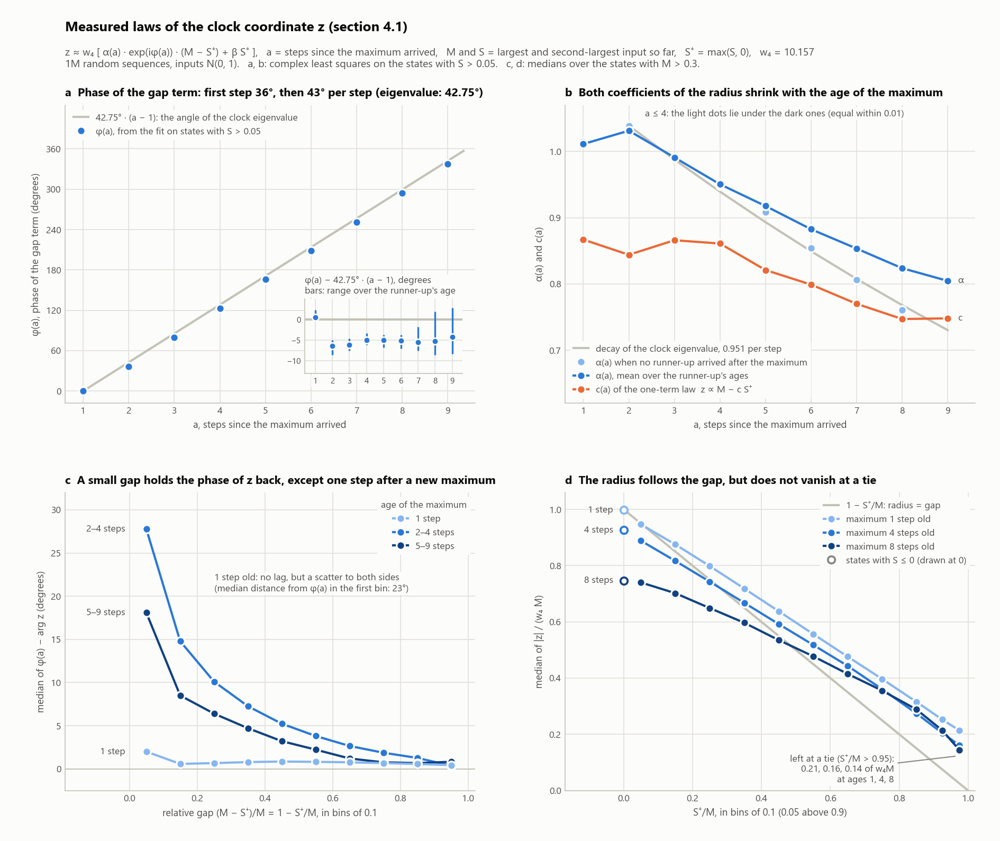

**`thresholds_by_age.png`.** Positions $f = (\theta - S)/(M - S)$ of the five thresholds (comparators 1, 6, 7, 8 and unit 4) by age of the maximum, medians and quartiles on random inputs; 0 is the runner-up and 1 the maximum. Shaded: inputs that are below the maximum but fire unit 4. (The table in section 4.1 is for controlled sequences and differs from these medians by up to 0.08.)

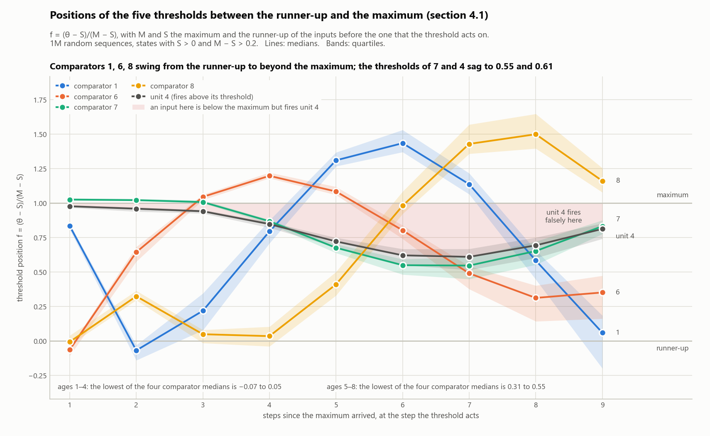

**`level_and_unit2.png`.** (a) The level coordinate against the previous maximum: slope 0.936, $R^2 = 0.993$. (b) Unit 2 holds the same value while the maximum is 1–4 steps old. (c, d) From 5 steps on it sags towards the runner-up, by up to 37% without a positive runner-up and not at all at a tie.

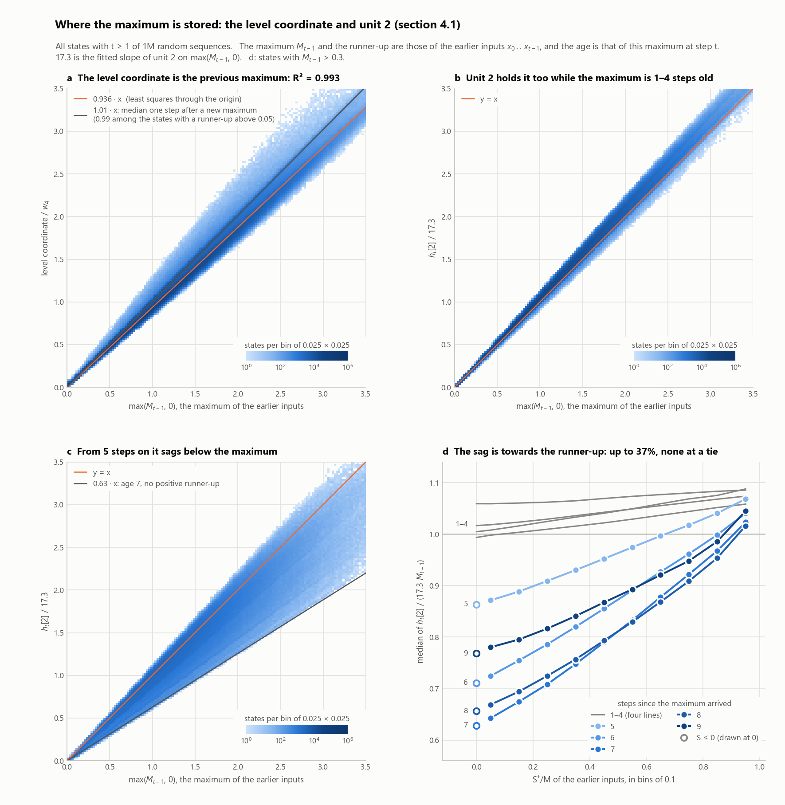

## 5. Interventions (section 3.5) and the feedback experiment (section 4.1)

Script: `hide/plot_interventions.py`.

**`intervention_wipe.png`.** The comparators are set to zero once, at step $t_0$, when the maximum is $k$ steps old. Left: P(answer = maximum) for every $(k, t_0)$. Right: pooled over $t_0 \le 7$, the answer flips from the runner-up (0.967 without the wipe) to the maximum (0.986 with it).

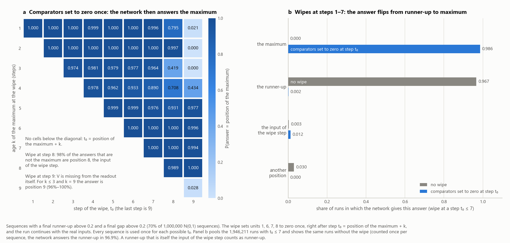

**`intervention_clock.png`.** One step before a new maximum, the clock mode is scaled by $f$. Left: where the answer goes; at $f = 0$ the old maximum is answered in 1.9% instead of 99.1%. Right: removing only the wave units' share of the clock pattern gives 2.2%, although $z$ keeps 92% of its size; removing only the comparators' share gives 99.8%, although $z$ loses half.

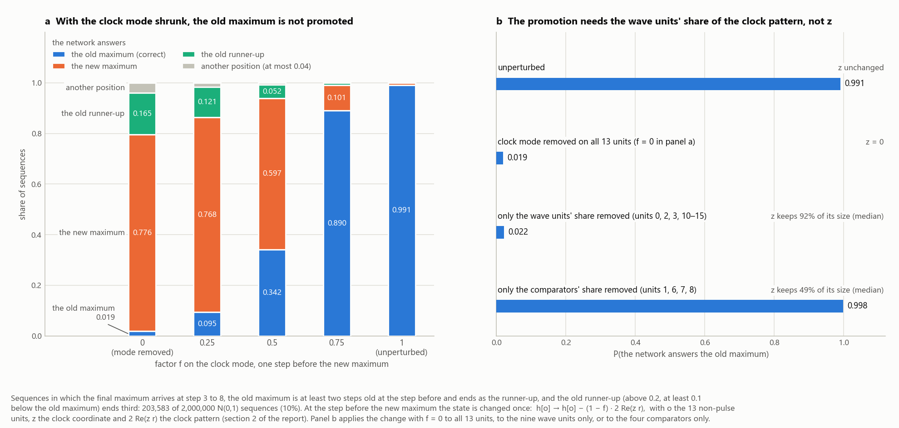

**`feedback_by_mode.png`.** The experiment e29: what the eight wave units other than unit 2 feed into the comparators, split by mode. Left: accuracy with one mode's part removed, against the rms difference that part makes between the four thresholds. Right: the same accuracies, and those with only that one part kept. The level's part costs most (0.598), and no part is enough on its own (0.42–0.60). This is a new sample, so last digits differ from the table in section 4.1.

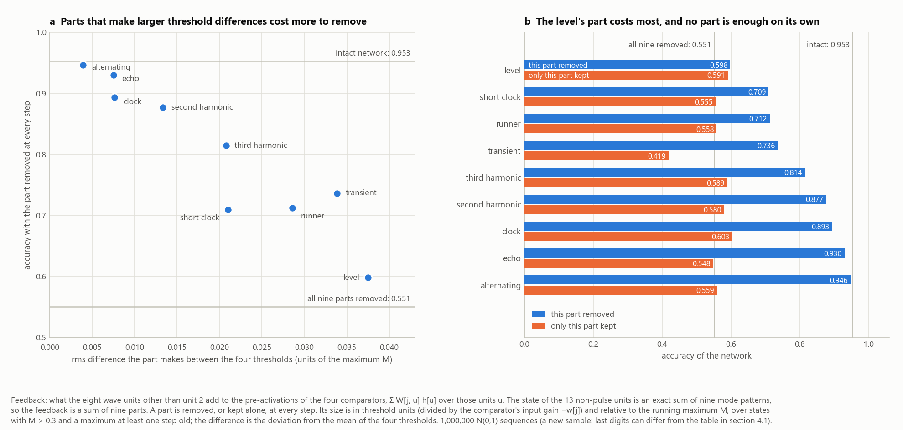

## 6. Errors and wave units (sections 7 and 4.2)

Script: `hide/plot_errors_units.py`.

**`errors_by_arrangement.png`.** Maximum at the last position, third above 0.2: P(answer = third largest) for every placement of the runner-up (rows) and the third (columns), when the third is 3–8% and 8–20% below the runner-up. A few arrangements carry the errors; (0, 7, 9) still fails in 55% at 8–20%.

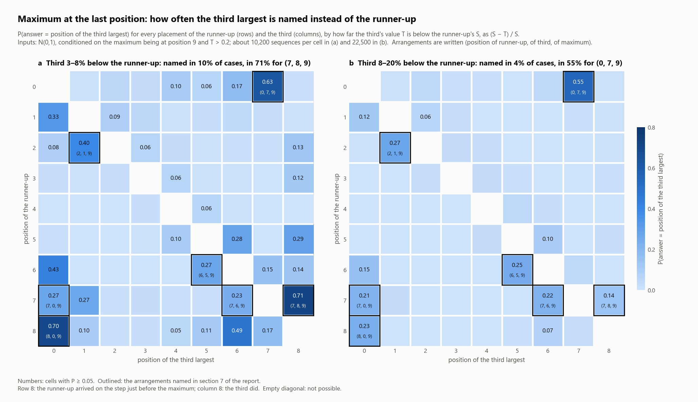

**`accuracy_by_gaps.png`.** (a) Accuracy over the two relative differences $(M - S^+)/M$ and $(S^+ - T^+)/M$, for a positive runner-up. (b) Share of all errors per region: 75% have two of the top three within $0.05\,M$. (c) Accuracy by the number of positive inputs: 0.12, 0.23, then 0.98.

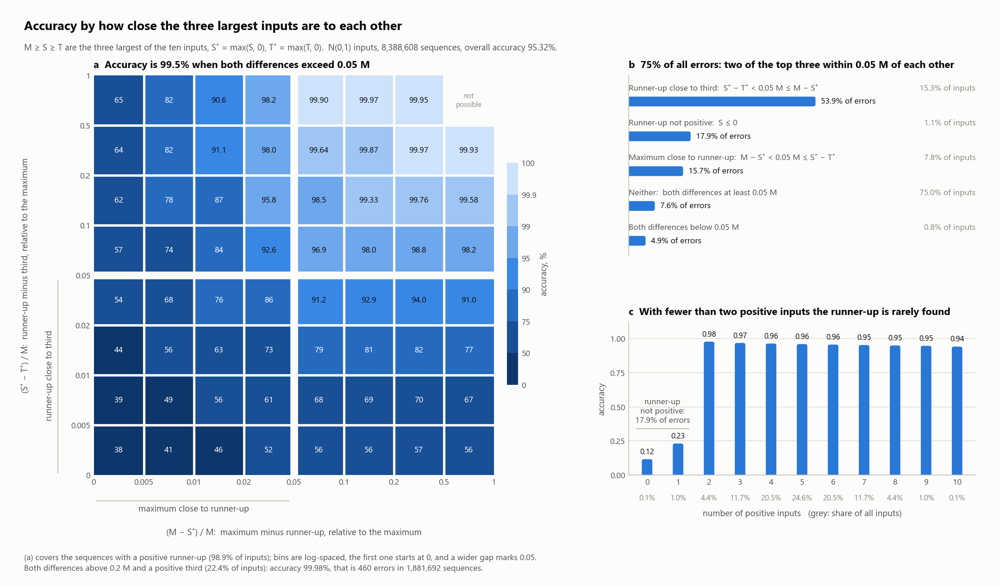

**`wave_unit_troughs.png`.** Median of $h[u]/M$ by age of the maximum, each row coloured relative to its own largest value. Outlined: cells in which the unit is exactly zero in more than 80% of states. Wave units 0, 11, 10 are zero at ages 2, 5, 6; the four comparators are zero at the step at which the maximum arrives.

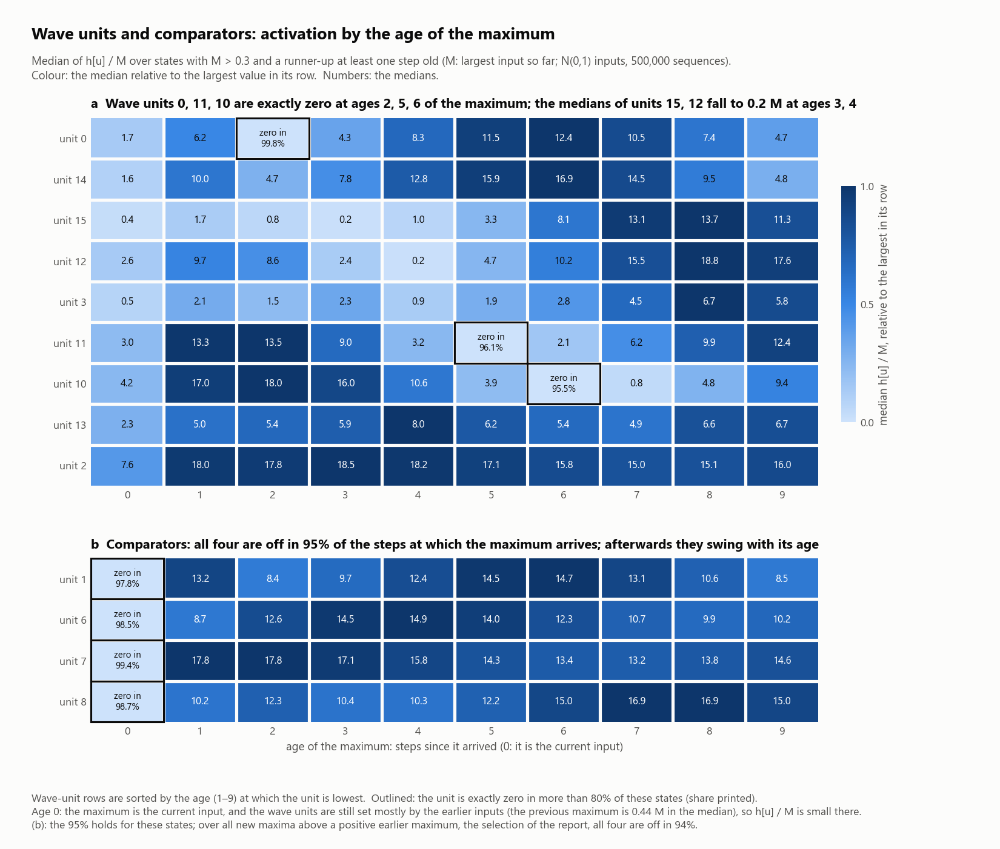

## 7. Modes (sections 2, 3.2 and 4.3)

Script: `hide/plot_modes.py`.

**`modes_spectrum.png`.** Left: the eigenvalues of the resting map $A$ (dots) and of the shift matrix $\Sigma$ (rings). $\Sigma$ has no level, runner, clock or echo. Right: the rms size of each mode's piece of the final logits, and the share of answers that change when the piece is deleted. The pieces cancel: the short clock's alone (87) is larger than all logits together (69).

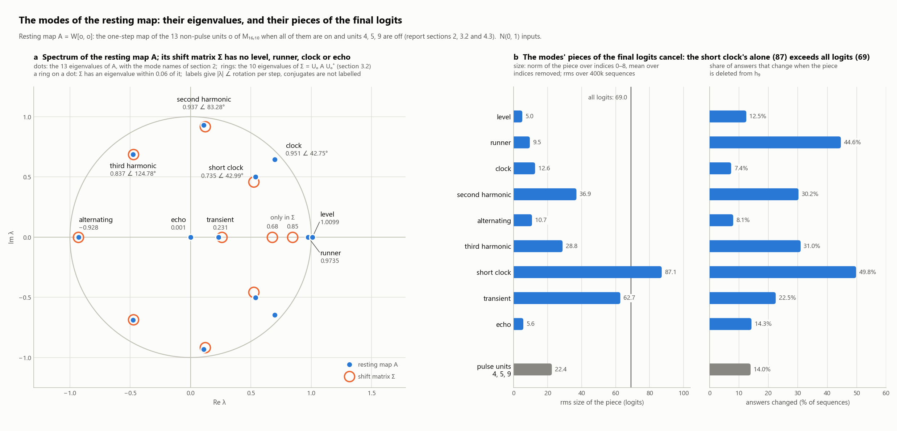

**`mode_patterns.png`.** The patterns $r$ (top) and dual vectors $\ell$ (bottom) of level, runner and clock on the 13 non-pulse units. The level pattern is positive on all 13 units and its dual vector sits on unit 2. The clock's dual vector sits mostly on the comparators. (The entries depend on how the units are scaled; the products $\ell[u]\,r[u]$ do not.)

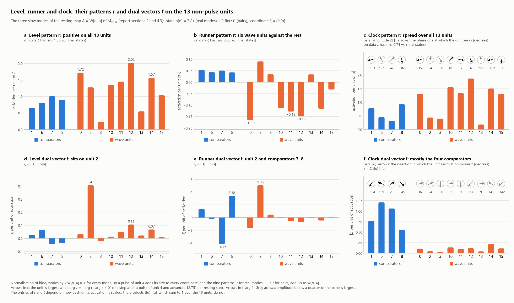

**`gate_patterns.png`.** Left: how often each unit is on, by age of the maximum; the last row is the share of states in the resting pattern (none at ages 0 and 1, 0.005% at age 2, 3–4% at ages 5–6, 54–64% at ages 7–9). Right: cumulative share of steps covered by the most common gate patterns: 10 patterns cover half of all steps, 74–75 cover 90%.

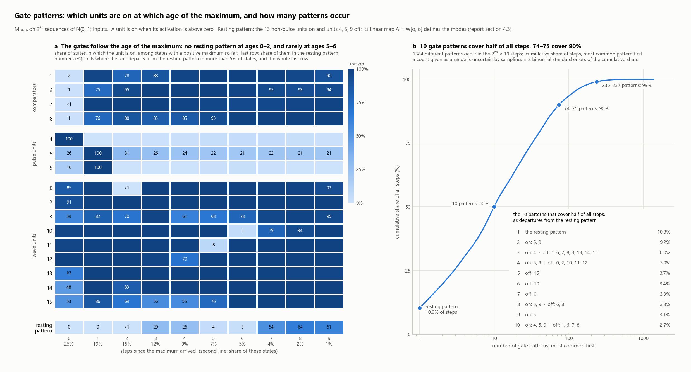

## Check status

No figure has an open fault. "Fixed" means that the checker edited the script and redrew the figure; in every such case the change was to a title, label, note or layout, or added something. No plotted value was wrong.

| figure | outcome | what the checker changed, and caveats |
|---|---|---|
| `update_rule_clock.png` | fixed | A broken arrow and two overprinted labels. Panel d shows the terms of the actual impulse, so unit 5 and unit 9 read 0.089 and 0.134 (the report gives 0.088 and 0.133 per unit of unit 4's pulse); it also shows a small clip of unit 14, and $z_1 = 0.966$, not 1, because comparators 6 and 8 are off at step 1. |
| `update_rule_level_runner.png` | ok | Unchanged. It exposed two rounding errors in the report's table (below). |
| `update_rule_check.png` | ok | Unchanged. The grey layer has no counterpart in the report. |
| `worked_example_timeline.png` | fixed | Panel a's title claimed that $\theta_8$ swings between runner-up and maximum; in this sequence it stays near the runner-up, because the maximum is never more than 4 steps old. Input markers no longer cover threshold markers. |
| `worked_example_clock.png` | fixed | Title only. The hollow points move by about 1° with the low value substituted for the runner-up ($-1$ is used). |
| `waves_by_age.png` | ok | Text added. The title's "at most 10" is the largest single cell; the report's "within 8" is the mean over ages. |
| `readout_columns.png` | fixed | The unit of $z$ is now defined, and the legend gives the fits with the frequency left free. |
| `margin_by_distance.png` | fixed | The dashed lines and the note on position 8 were added by the checker. This changed a reading in the report (below). |
| `clock_laws.png` | fixed | Cosmetic. In (b) the light dots are hidden under the dark ones for $a \le 4$; a note says so. |
| `thresholds_by_age.png` | ok | Unchanged. |
| `level_and_unit2.png` | fixed | Panel a's legend now gives the median one step after a new maximum for both selections (1.01 over all states, 0.99 with a runner-up above 0.05). Not in the report: the sag of unit 2 is deepest at ages 7–8 and smaller again at age 9, and the level coordinate itself does not sag. |
| `intervention_wipe.png` | fixed | A note was extended. The "no wipe" bar is 0.967 because it is counted per run; per sequence it is the report's 96.9%. |
| `intervention_clock.png` | fixed | Labels use the report's terms; the footer states the selection precisely. |
| `feedback_by_mode.png` | fixed | Layout only. |
| `errors_by_arrangement.png` | fixed | The header now defines the binning variable and the triple notation. |
| `accuracy_by_gaps.png` | fixed | The footnote now prints the error count. It says 99.98% where the report says 99.97%: the figure's seeds are a low draw (460 errors in 1.88 million; 48 other seeds give 99.972%), so the report's digit is the better one. |
| `wave_unit_troughs.png` | fixed | The title claimed a low point at a fixed age for every wave unit; that holds for units 0, 12, 11, 10 only. The 95% in panel b is for this figure's selection; the report's 94% is for all new maxima above a positive earlier maximum. |
| `modes_spectrum.png` | fixed | The subtitle now states the criterion for "a ring on a dot" (an eigenvalue of $\Sigma$ within 0.06). |
| `mode_patterns.png` | ok | Unchanged; assertions added to the script. |
| `gate_patterns.png` | fixed | Counts now carry their sampling range (74–75 patterns for 90%, 236–237 for 99%). |

## What the figures changed in the report

Where a figure and the text disagreed, I recomputed the number myself (`../hide/e30_after_figures.py`, output in `../hide/outputs/e30_after_figures.txt`) and corrected the report. None of this changes the mechanism.

Three readings:

1. *Margin and distance (sections 3.4 and 6).* The report said that the runner-up's margin over the maximum grows with the distance between them. Without the pairs that include the input before last it follows the wave: it peaks at $D = 4$–5 (12–18 $M$) and is 8–13 $M$ at $D = 7$, and the $V$ part at $D = 7$ is 0.22–0.25 of its value at $D = 4$, where $1 - \cos(42.75°\,D)$ gives 0.26.
2. *Phase lag of the clock (sections 1, 4.1, 8).* The phase of $z$ lags behind $\varphi(a)$ at small gaps only from age 2 on (signed median 6–13° for relative gaps of 0.1–0.3). One step after a new maximum it deviates by as much to either side.
3. *"Troughs that matter" (section 4.2).* Of the four further pairs of unit and age named there, unit 15 at age 7 and unit 13 at age 4 are not low values: they are rising and vote for the old maximum's index with positive weights ($U[2,15] = +2.62$, $U[5,13] = +2.09$). The test shows that their high value is needed.

Statements that were not exact:

- Section 4.3 said that no sequence has more than four consecutive resting steps. About 1 in 20,000 has five to seven.
- Section 4.3 said that the resting pattern never holds when the maximum is 1 or 2 steps old. It never holds at ages 0 and 1, and holds in 0.005% of states at age 2. At ages 5 and 6 it holds in 4% and 3% of states, not 2% (2.4% and 2.2% among states with a runner-up above 0.05).
- Section 3.5 said that after a wipe at step 8 every answer that is not the maximum is position 8. It is 98–99% of them.

Numbers:

- Section 5, coefficient table, "comparator 7 off": level $-0.05$ (was $-0.06$) and runner $-5.38$ (was $-5.39$); the exact values are $-0.0548$ and $-5.3848$.
- Section 4.1: $\alpha(9) = 0.80$ (was 0.81; $0.8048 \pm 0.0004$), and the radius at a tie at age 8 is $0.14\,w_4 M$ (was 0.15; 0.144–0.145).
- Section 4.1: the level one step after a new maximum is 0.98–1.01 $w_4 M$ depending on the selection (was 0.99, which holds among states with a runner-up above 0.05).
- Section 7: (2, 1, 9), (6, 5, 9), (7, 6, 9) have 0.27, 0.25, 0.22 in the third bin (was 0.23–0.25), and nine other rates moved by 0.01 or less with a larger sample.

Conditions now stated:

- Section 3.4: the sinusoid fits of the readout columns have the frequency fixed at the clock's. Left free, the best frequencies are 48.6°, 49.1°, 44.4°, 44.9° per index.
- Section 3.5: in the second intervention the old maximum is at least two steps old one step before the new maximum (three at the new maximum).
- Section 7: the third is required to be above 0.2, and "maximum last" meant a maximum that arrives after both candidates at any position (0.21, 0.051, 0.017, 0.004). With the maximum at position 9, as in `errors_by_arrangement.png`, the rates are 0.28, 0.10, 0.040, 0.010.
- Section 3.2: the echo mode (0.001) is absent from $\Sigma$ too, as `modes_spectrum.png` shows.
