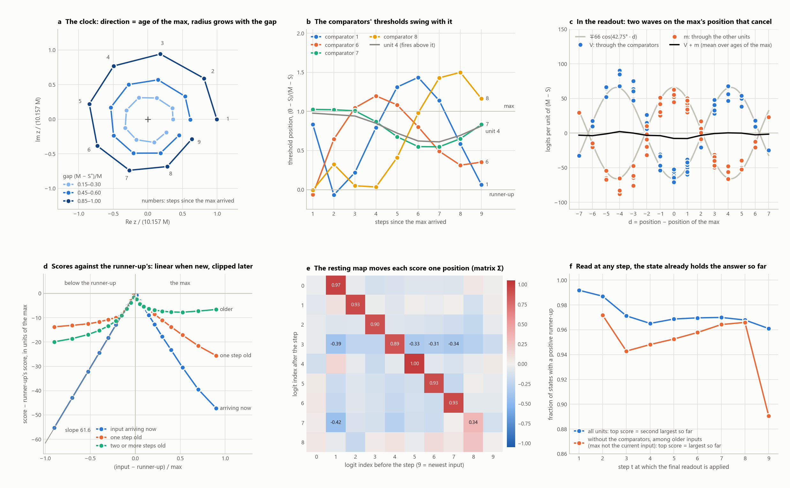

# How the 432-parameter second-argmax RNN works

Mechanistic report on ARC's AlgZoo model $M_{16,10}$ (`example_2nd_argmax()`), 19 November 2026.

Every number below was computed from the weights with the scripts in `hide/`. Other people's write-ups were used as hypotheses only; section 11 says who found what first. The claims were then given to eight independent verifiers, who recomputed them with their own code and tried to break the interpretation. All numbers reproduced. Several readings did not survive as I had first worded them, and the text below is the corrected version. Section 9 lists the evidence and the outcome of the checks for each claim. Section 10 lists what remains uncertain.

Twenty further figures are in `plots/`; `plots/index.md` shows them with captions. Each was checked independently on 20 November, and those checks corrected about a dozen numbers and three readings in this text (section 9, round 5).

## 1. Summary

Notation: $w = W_{ih}$, $W = W_{hh}$, $U = W_{out}$. $M_t$ and $S_t$ are the largest and the second-largest of the inputs $x_0..x_t$; the second-largest is called the *runner-up*. Without a subscript, $M$ and $S$ mean $M_t$ and $S_t$. $S^+ = \max(S, 0)$. The *gap* is $M - S^+$, and the *relative gap* is $(M - S^+)/M$.

The network runs an online algorithm. It does not look back at earlier inputs and it does not know the step number. Its state after step $t$ is exactly the state it would have at the end of a sequence that starts with $9 - t$ zeros. So the final readout can be applied at any step, and it then names the runner-up so far (96–99% of the states whose runner-up is positive, with the answer restricted to the inputs so far).

**What the 16 units hold after step $t$.**

1. *Unit 4*: $10.157\,[x_t - \theta_4]_+$, the excess of the input over a threshold a little below $M_{t-1}$.
2. *Units 1, 6, 7, 8 (the comparators)*: $g_j\,[\theta_j - x_t]_+$ with $g_j = -w_j > 0$, how far the input is below four thresholds. Every threshold is a linear function of the previous state. The four lie between about $S$ and somewhat above $M$, and they swing with the number of steps since the maximum arrived.
3. *Unit 2*: the previous maximum, $17.3\,\max(M_{t-1}, 0)$.
4. *Units 5 and 9*: one-step registers. Unit 5 fires by how far the previous input exceeded a threshold $\Theta_5 \approx 0.75\,S$. Unit 9 fires one step after a new maximum.
5. *Units 0, 3, 10–15*: the scores of the earlier inputs.

Read as a whole, the state holds two things.

- *Scores.* $s_t = U h_t$ has one entry per input so far. The entry at index $9 - a$ belongs to the input that arrived $a$ steps ago, and the largest entry marks the runner-up. On steps with an input below the runner-up, the entries that are at least two steps old move one index per step. The newest entry is a comparison by value: $s_t[9] - s_t[\text{runner-up}] \approx 61.6\,(x_t - S)$ for an input below the runner-up.
- *Three linear coordinates of the state that set the thresholds* (defined in section 2). The *level* is the previous maximum. The *runner* coordinate holds the runner-up's value and sets $\Theta_5$. The *clock* is a complex number $z$. Its angle is the number of steps since the maximum arrived, at about 43° per step. Its modulus is close to the gap: it is proportional to $M - c\,S^+$ with $c$ between 0.75 and 0.87. This is the circle of your hypothesis.

**How it is updated** is one exact rule (section 5). At every step each coordinate is multiplied by its eigenvalue, and it receives a term from the input, a term from last step's pulses of units 4, 5 and 9, a term for every comparator that the input has switched off, and a term for every wave unit that is clipped at zero. An input below all thresholds changes almost nothing. A new runner-up switches off the comparators whose thresholds it exceeds. A new maximum switches off all four and fires unit 4, whose pulse adds its size to every coordinate.

**How the pieces fit.** Split the scores as $s = m + V$, where $V$ is the part of the readout that passes through the four comparators and $m$ is the rest. The clock appears in both parts as a wave over the indices $i \le 7$, with opposite signs ($i_M$ is the index of the maximum):

$$V[i] \approx -66\,(M - S^+)\cos\!\big(42.75°\,(i - i_M)\big) + \dots,\qquad m[i] \approx +63\,(M - S^+)\cos\!\big(42.75°\,(i - i_M)\big) + \dots$$

The dots stand for terms that do not contain the gap. The two waves cancel to within 8 logits per unit of gap (panel c of the figure). Three things follow.

- $m$ alone ranks the maximum first among the older inputs (89–99% of states while the maximum is 1 to 8 steps old). $V$ takes that lead away. The runner-up is on top only in the sum.
- A new maximum exceeds all four comparator thresholds in 94% of cases: in 97–99% when the old maximum is at most three steps old, and in 75–89% when it is four to eight steps old (also less often when the excess is small). All four comparators then switch off, so $V_t = 0$ and $s_t = m_t$. On the older inputs $m_t$ is close to $m_{t-1}$ moved one index (this is measured, not an identity), and $m_{t-1}$ had the old maximum on top. So the old maximum, which has just become the runner-up, is on top of $s_t$ (96–99.5% of new maxima).
- Unit 4's pulse then starts the rotation again for the new maximum. On average the new radius is its excess over $\theta_4$ (1.04 times); case by case it is 0.86 to 2.3 times that, because part of the old clock is still in the wave units.

So the clock is a correction held in reserve, from the second step after a new maximum on. Its half in the other units says "the maximum is at this index". Its half in the comparators cancels that for as long as the maximum stands.

Two interventions separate the halves.

- While a maximum stands, remove only the comparators' share of the clock. The network then answers the maximum in 94–100% of sequences (maximum 2 to 7 steps old). Setting the four comparators to exactly zero once, two or more steps before the end, does the same (98.6% in sequences whose runner-up and gap both exceed 0.2; the runner-up is answered in 0.2%), but an exact zero also acts like a new maximum of zero excess.
- One step before a maximum is overtaken, remove the wave units' share of the clock only. The old maximum is then answered in 2% of cases instead of 99%. Removing the comparators' share instead changes nothing (99.8%).

**Your hypothesis** (section 8) is right in substance.

- The directions of the circle have a fixed meaning. The phase of $z$ is 0°, 36°, 79°, 123°, 166°, 209°, 251°, 294°, 338° when the maximum is 1..9 steps old and the gap is large (within about 3° for a relative gap above 0.6). From age 2 on it lags, by 6–13° when the relative gap is 0.1–0.3; one step after a new maximum it deviates by as much (9°), to either side.
- The centre is set by the stored maximum and the radius by the gap.
- The network has no bias, and by homogeneity no unit can hold a constant. So the centre has to be a stored value. Unit 2 feeds $0.05\,h_t[2] \approx 0.85\,M$ into each of the four comparator thresholds at every step. It has to, because the comparators cannot hold their own level: an input changes the four comparator activations in proportion to their input weights, and the comparators' weights on each other are arranged so that such a change leaves no trace one step later ($W[\mathrm{C},\mathrm{C}]\,w[\mathrm{C}] \approx 0$ for $\mathrm{C} = \{1, 6, 7, 8\}$; section 4.1).

Three refinements. The circle is read out at every step, but as two halves of opposite sign that cancel while the maximum stands (6% is left); the half in the wave units is used in full only when the maximum is overtaken. What the swing of the thresholds does for the comparisons themselves is not shown, and its share in $\theta_4$ is a cost (section 7). In the comparators the offset is the threshold itself, so the ReLU boundary is where a new maximum resets the rotation; in the wave units the orbit touches zero at fixed ages of the maximum. And the radius is not exactly the gap: about a fifth of it remains when the runner-up ties with the maximum, and a runner-up that arrives five or more steps after the maximum often leaves the radius unchanged.

**What I could not reduce to a mechanism.** The six units that carry maximum, increment and clock (2, 4, 1, 6, 7, 8) do not run on their own. With the other ten units' weights into them cut, accuracy falls from 95.3% to 51%. Among the ten, the eight wave units feed small corrections into the thresholds (0.003 to 0.175 $M$ on average, depending on the threshold and on the age of the maximum). A first decomposition says these are those eight units' share of every mode of the dynamics, the level first (section 4.1); why the thresholds need each of them to within a few percent, I cannot derive. Also, every margin in the final logits is a small remainder of large terms that cancel, so approximate formulas for the parts do not reproduce the answers: with $V$ replaced by its best cosine formula, the runner-up is found in 63% of sequences instead of 97%.

**Errors.** The network is wrong on 4.7% of inputs. 18% of the errors have a runner-up that is not positive (zero is the network's reference; negative values are not stored). About three quarters have two of the top three within 5% of $M$ of each other. With a positive third and both of those differences above $0.2\,M$ the accuracy is 99.97%.

Section 5.5 follows one sequence step by step.

*Figure. (a) The clock coordinate $z$ divided by $10.157\,M$: medians by age of the maximum (the numbers), for three sizes of the relative gap. (b) Positions of the four comparator thresholds and of unit 4's threshold between runner-up (0) and maximum (1): medians by age of the maximum, for states with $S > 0$ and $M - S > 0.2$. (c) Coefficient of the gap in $V$ (blue) and in $m$ (orange) at $t = 9$, against the distance from the maximum's index; one dot per age of the maximum and index; black: their sum. (d) Score minus the runner-up's score, in units of $M$, against the input's value relative to the runner-up, by the input's age. (e) Rows 0–8 of the matrix $\Sigma$ that maps the scores to the scores one resting step later (section 3.2). (f) Fraction of the states with a positive runner-up in which the largest entry of $s_t$ is the runner-up so far (blue); and, among those states whose maximum is not the current input, the fraction in which the largest entry of $m_t$ among the inputs before $x_t$ is the maximum so far (orange).*

## 2. Setting, notation and exact facts

$$h_t = \mathrm{ReLU}(w\,x_t + W h_{t-1}),\qquad h_{-1} = 0,\qquad \text{logits} = U h_9 .$$

Here $w = W_{ih}$ (16 numbers), $W = W_{hh}$ ($16\times16$) and $U = W_{out}$ ($10\times16$). Inputs are iid $\mathcal N(0,1)$ unless stated.

**Conventions.**

- $h_t[j]$ is unit $j$ after step $t$.
- $M_t \ge S_t \ge T_t$ are the three largest of $x_0..x_t$. $M$ and $S$ without a subscript mean $M_t$ and $S_t$. Where the current input is compared with what was stored, I write $M_{t-1}$ and $S_{t-1}$.
- A *new maximum* is an input above all earlier ones. A *new runner-up* is an input between $S_{t-1}$ and $M_{t-1}$.
- At step $t$ the input that arrived at step $p$ has *age* $a = t - p$ and sits at *index* $i = 9 - a = p + 9 - t$ of the score vector $s_t = U h_t$. Its *position* $p$ is fixed. Index and position agree only at $t = 9$. I write $p_M$, $p_S$ for the positions of the maximum and of the runner-up, and $i_M$ for the maximum's index.
- When something is tabulated by the *age of the maximum*, the age is $t - p_M$ at the step concerned. For a threshold this is the step at which it acts.
- Centred $R^2 = 1 - \mathrm{SSE}/\sum(y - \bar y)^2$; uncentred $R^2 = 1 - \mathrm{SSE}/\sum y^2$. $R^2$ without a qualifier is centred.

**Unit groups** (names from earlier work): *comparators* 1, 6, 7, 8 (input weights $-10.57, -11.00, -13.17, -12.31$; I write $g_j = -w_j$); *pulse units* 4 ($w_4 = +10.157$), 5, 9; *wave units* 0, 2, 3, 10–15 ($|w| \le 0.3$, except unit 14 with $-1.32$). I call units 2, 4, 1, 6, 7, 8 the *core* and the other ten (wave units 0, 3, 10–15 and pulse units 5, 9) the *satellites*.

**Three facts hold exactly.**

1. *Piecewise linear, no constants.* $h_t = G_t(w x_t + W h_{t-1})$ with $G_t$ the 0/1 matrix of active units, so $h_t = \sum_p J_{t,p}\,x_p$ with $J_{t,p} = G_t W G_{t-1} W \cdots G_p\,w$. Scaling all inputs by a positive factor scales every $h_t$ by the same factor. So no direction of state space can hold a constant, and every offset has to be a stored input value.
2. *Thresholds.* For a comparator, $h_t[j] = g_j\,[\theta_j(t) - x_t]_+$ with $\theta_j(t) = (W h_{t-1})_j / g_j$. For unit 4, $h_t[4] = w_4\,[x_t - \theta_4(t)]_+$ with $\theta_4(t) = -(W h_{t-1})_4 / w_4$. The thresholds are linear functions of the previous state, in input units: $\theta(t)$ is computed from $h_{t-1}$ and acts on $x_t$.
3. *Zero prefix.* Zero inputs leave the zero state at zero, so $h_t(x_0, \dots, x_t) = h_9(0, \dots, 0, x_0, \dots, x_t)$. The recurrence does not know $t$, and the same $U$ is applied whatever came before. So $U h_t$ can be read at any step, its index $9 - a$ means "the input of age $a$", and what it returns is the network's answer for the zero-prefixed sequence.

**Mode coordinates.** Let $o$ be the 13 non-pulse units and $A = W[o,o]$, the *resting map*: the exact one-step map of these units when all 13 are on and units 4, 5, 9 are off. Let $A\,r_m = \lambda_m r_m$, and let $\ell_m$ be the dual vectors, $\ell_m^\top r_{m'} = \delta_{mm'}$. The coordinate of mode $m$ is

$$\zeta_m(t) = \ell_m^\top h_t[o] .$$

It is defined in every state, whatever the gates, and $h_t[o] = \sum_{\text{real } m} \zeta_m r_m + \sum_{\text{pairs}} 2\,\mathrm{Re}(\zeta_m r_m)$. This is your $c_m = \ell_m^\dagger h$ in another normalisation: here $\ell_m^\top W[o,4] = 1$ for every $m$, so a pulse of unit 4 adds its size to every coordinate one step later. I quote coordinates in units of $w_4 = 10.157$, which is the coordinate that one unit of input excess over $\theta_4$ produces.

| mode | eigenvalue $\lambda_m$ | your name |
|---|---|---|
| level | 1.0099 | max level |
| runner | 0.9735 | runner-up level |
| clock | $0.951\,e^{\pm i\,42.75°}$ | main clock |
| second harmonic | $0.937\,e^{\pm i\,83.28°}$ | harmonic |
| alternating | $-0.928$ | alternating mode |
| third harmonic | $0.837\,e^{\pm i\,124.78°}$ | harmonic |
| short clock | $0.735\,e^{\pm i\,42.99°}$ | short-lived clock |
| transient | 0.231 | fast decay |
| echo | 0.001 | null |

I write $z = \zeta_{\text{clock}}$ (the member of the pair with the positive angle). $z$ is not an orthogonal projection onto a plane: $\ell_{\text{clock}}$ sits mostly on the comparators, while $r_{\text{clock}}$ is spread over all 13 units. The *clock pattern* is the 13-vector $2\,\mathrm{Re}(z\,r_{\text{clock}})$. Its *comparators' share* is its entries on units 1, 6, 7, 8, and its *wave units' share* the other nine. "Clock mode times $f$" means $h[o] \to h[o] - (1 - f)\,2\,\mathrm{Re}(z\,r_{\text{clock}})$; removing a share subtracts only those entries.

The resting gate pattern itself holds in only 10% of states (section 4.3). The coordinates are used as a basis in every state, and the laws stated for them below are measured on all states.

**How often the gates are in each configuration** (measured): all four comparators are on in 66% of all steps (50% at $t = 0$, 82% at $t = 9$), all four are off in 22% (new maxima), and one to three are on in 12% (mostly new runners-up).

## 3. What the state means: provisional scores

### 3.1 The state holds a running answer

Take the provisional scores $s_t = U h_t$, pick the largest entry among the indices of inputs that exist ($9 - t \le i \le 9$), and convert it to a position.

| $t$ | 1 | 2 | 3 | 4 | 5 | 6 | 7 | 8 | 9 |
|---|---|---|---|---|---|---|---|---|---|
| P(it is the runner-up of $x_0..x_t$), given $S_t > 0$ | 0.992 | 0.987 | 0.971 | 0.966 | 0.969 | 0.970 | 0.970 | 0.967 | 0.961 |
| the same over all states | 0.688 | 0.676 | 0.777 | 0.839 | 0.893 | 0.927 | 0.945 | 0.953 | 0.953 |

- By fact 3 of section 2, this is the network's accuracy on zero-prefixed inputs when its answer is restricted to the real inputs. Unrestricted, the largest logit is on one of the zeros in 6%, 5%, 2%, 1% of these states at $t = 1..4$, and the first row would read 0.932, 0.940, 0.951, 0.958 there. From $t = 5$ on the two differ by at most 0.003.
- The second row is lower at early steps because the runner-up is then often negative, and the network does not store negative values (section 7). For $S_t \le 0$ the rate is 0.22–0.59.
- It does not depend on how old the runner-up is: at $t = 9$ the rate is 0.949–0.971 for every age of the runner-up.
- It is not special to this network. Of 672 retrained bias-free networks of the same architecture (the sweep in `replica/`), 379 reach an accuracy of 0.90, and in 354 of those the running answer at step 4 is within 0.03 of the final accuracy. So the running answer is not evidence for a particular mechanism. It is the reason for describing the state through $s_t$.

### 3.2 Scores older than one step move one index per step

Take real steps on which the input is below the runner-up. Then

$$s_t[i-1] \approx s_{t-1}[i]\qquad\text{for } i \le 8 :$$

every entry that is at least two steps old after the step has moved one index down, nearly unchanged. The ratio of new to old value is 0.96–1.18 and their correlation 0.87–0.99, depending on the age. Over all such entries, $R^2$ of $s_t$ against the shifted $s_{t-1}$ is 0.50, 0.56, 0.74, 0.89, 0.93, 0.94, 0.96 for $t = 3..9$. Two entries do not follow the shift.

- *The entry that was newest* ($i = 9$). One step after arrival, its score relative to the runner-up's has shrunk from about $-50\,M$ to $-12\,M$ (ratio 0.24, correlation 0.40). The comparison made on arrival is mostly lost, unless unit 5 fires for that input one step later and writes a score for it. I call that a *written score* (section 5.2).
- *The maximum's own entry.* It settles over its first two steps: $-21.7 \to -14.2 \to -4.2$ (units of $M$, relative to the runner-up).

The answer is held over empty steps: after four random inputs and then six equal fillers at or below half the runner-up, the top entry is the runner-up in 0.978–0.992 of sequences at each of the six steps.

In the weights, the shift is a property of the resting map $A$ of section 2. Let $U_o$ be the columns of $U$ for the 13 non-pulse units. Then

$$U_o A \approx \Sigma\,U_o,\qquad \Sigma = U_o A\,U_o^{+} .$$

- $\Sigma[i, i+1] = 0.97, 0.93, 0.90, 0.89, 1.00, 0.93, 0.93$ for $i = 0..6$ (panel e); every other entry in rows 0–6 is at most 0.39 in size. Without the pseudo-inverse: the cosine between row $i$ of $U_o A$ and row $i+1$ of $U_o$ is 0.968–0.995 for $i = 0..6$, with mean 0.987. In five kinds of random control (random or rotated $A$, random, permuted or rotated $U_o$; 300 draws each) that mean never exceeds 0.65.
- The relative error of $\Sigma U_o$ against $U_o A$ is 0.027 for rows 0–8. Row 9 is not usable: it rides on the smallest singular direction of $U_o$ (the sum of all logits), and its relative error is 0.71.
- The resting map gives the shift for $i \le 7$ only: $\Sigma[7,8] = 0.34$ and $\Sigma[8,9] \approx 0$. The moves from index 9 to 8 and from 8 to 7 are made by units 4 and 5 (sections 5.2 and 6).
- The eigenvalues of $\Sigma$ are $-0.93$, $0.93\,e^{\pm i\,82.6°}$, $0.83\,e^{\pm i\,124.6°}$ and $0.69\,e^{\pm i\,41.2°}$, plus three real ones (0.85, 0.68, 0.26). The first three match the alternating mode and the two harmonics of $A$, the fourth is close to its short clock, and 0.26 is close to its transient; 0.85 and 0.68 have no counterpart in $A$. The three slowest modes of $A$ (level, runner, clock) are absent from $\Sigma$, and so is its echo mode (0.001).

Limits of this picture.

- The resting gate pattern (13 units on, pulses off) holds in 10% of states. The resting map alone predicts the real next scores poorly ($R^2$ below 0 for $t \le 5$, 0.56–0.86 for $t = 6..9$). With the pulse units' contribution added it does as well as the plain shift.
- The scores are not ten independent numbers. Five principal components hold 95% of their variance at $t = 9$. Overwriting one old input changes the entry of the next-newer input by 0.42 of the change of its own entry.
- A shift structure is also common among the retrained networks: 292 of the 379 have a shift cosine of at least 0.9. $M_{16,10}$ is among the 7 cleanest.

### 3.3 What a score says about its input

Scores are taken relative to the runner-up's score and in units of $M$; $v = (x_p - S)/M$ is the input's value relative to the runner-up (panel d).

**The newest input is compared by value.** With the 13 non-pulse units on, the derivative of $s_t[9] - s_t[i]$ with respect to $x_t$ is $(U[9] - U[i])\cdot w = 61.0$ to $62.1$ for every $i \le 8$: the input changes index 9 by $+57.2$ per unit and every other index by about $-4.5$. Of the 57.2, the comparators give $5.01 + 7.38 + 49.90 - 4.04 = 58.25$, and unit 7 alone 49.9. Measured on data, the slope is $61.9 \pm 0.4$ per state, and the two scores are equal at $x_t = S - 0.013\,M$ (median; standard deviation $0.03\,M$). So

$$s_t[9] - s_t[\text{runner-up}] \approx 61.6\,(x_t - S)\qquad\text{for } x_t < S .$$

The slope is the same under six other input distributions (61.5–62.0). For a new maximum the score falls again, through unit 4: $U[9,4]\,w_4 = -50.70$ per unit of excess over $\theta_4$.

**One step later the comparison survives only near the runner-up.** Unit 5 fires by 18.01 per unit of the previous input above its threshold $\Theta_5 \approx 0.75\,S$, and $U[8,5] = 3.398$. The product is 61.19 logits per unit of input: the same exchange rate as for the newest input, so the scores from the two routes can be compared. Inputs below $\Theta_5$ get no written score.

**Older entries are clipped comparisons.** Within about $0.15$–$0.2\,M$ below the runner-up the slope is 60–80 per unit. Further below, the entry sits at a floor that depends on the order of arrival and not on the value: about $-15\,M$ for an input that arrived after both of the top two, $-25\,M$ for one that arrived between them, $-33\,M$ for one that arrived before both. For entries at least two steps old that are neither maximum nor runner-up, the input's own value explains 16.5% of the variance of the score; the configuration (step, age of the entry, of the maximum and of the runner-up) explains 46.6%.

| input | score minus the runner-up's score, in units of $M$ (medians) |
|---|---|
| arriving now, below the runner-up | $61.6\,v$, linear over the whole range ($-55$ at $v = -0.9$) |
| arriving now, a new maximum | about $-60$ times the excess for a small excess; $-47$ at $v = 0.9$ |
| one step old, below the runner-up | $60\,v$ for deficits below 0.15, then $-10$ to $-18$ (median $-12$) |
| two or more steps old, below | slope 60–80 near zero, then a floor of $-15$ to $-33$ by order of arrival |
| the maximum, two or more steps old | $-5$ to $-14$ by age of the maximum ($-4$ to $-24$ by distance from the runner-up, section 6), almost independent of the gap unless the relative gap is below 0.05 |

### 3.4 Two score vectors that cancel

Split the readout: $V_t = U[:,\mathrm{C}]\,h_t[\mathrm{C}]$, with $\mathrm{C} = \{1, 6, 7, 8\}$, is the part that passes through the comparators, and $m_t = s_t - V_t$ is the rest.

**Both carry a wave centred on the maximum, with opposite signs.** At $t = 9$, on steps where all four comparators are on and $S > 0.1$, regress each entry of $V$ and of $m$ on $(M - S,\; S,\; x_9)$, separately for each age of the maximum. For indices $i \le 7$ the coefficient of $M - S$ depends on $i$ only through $\Delta = i - i_M$, the distance from the maximum's index (negative: inputs that arrived before the maximum). In logits per unit of gap (panel c):

| $\Delta$ | −7 | −6 | −5 | −4 | −3 | −2 | −1 | 0 | 1 | 2 | 3 | 4 | 5 | 6 | 7 |
|---|---|---|---|---|---|---|---|---|---|---|---|---|---|---|---|
| coefficient in $V$ | −33 | +14 | +61 | +82 | +59 | +7 | −42 | −62 | −48 | −6 | +40 | +60 | +47 | +14 | −25 |
| coefficient in $m$ | +29 | −17 | −62 | −80 | −59 | −10 | +38 | +55 | +40 | +3 | −40 | −59 | −47 | −16 | +23 |
| sum | −3 | −4 | −1 | +2 | 0 | −3 | −4 | −8 | −8 | −3 | −1 | 0 | 0 | −3 | −2 |

A cosine fitted to the first row has amplitude 66.2 with its trough at $\Delta = +0.09$; fitted to the second row, amplitude 62.6 with its crest on the maximum. Sequence by sequence the cancellation is rougher. Fit $|Z|\cos(42.75°\,i + \arg Z)$ plus a constant to indices $i = 0..7$ of $V$ and of $m$: the ratio $Z_m/Z_V$ of the two complex amplitudes has a median real part of $-1.03$, but the median of $|Z_m + Z_V|/|Z_V|$ is 0.36.

What is informative here, and what is not:

- *The cosine shape is not.* The readout columns of the four comparators are sinusoids over indices 0–7 at the clock's frequency: $U[i,j] \approx u_j\cos(42.75°\,i - \varphi_j) + \bar u_j$ with $u = 5.81, 5.09, 6.21, 6.08$, $\varphi = -29°, 26°, 131°, -130°$ and $R^2 = 0.974, 0.943, 0.991, 0.988$ for units 1, 6, 7, 8. (The frequency is fixed at the clock's here. Left free, the best fits are at 48.6°, 49.1°, 44.4° and 44.9° per index, with $R^2 = 0.980, 0.996, 0.992, 0.994$.) So $V$ over indices 0–7 is a sinusoid for any comparator state (97.6% of its variance for random states).
- *The phase is.* The trough of $V$ is within one index of the maximum in 93–99.6% of states (maximum 2 to 8 steps old). With the ages of the maximum shuffled, the coefficients in the table collapse to between 0.5 and 8.5.
- *The amplitude is.* It follows the gap, not $M$: the $R^2$ of the fit over indices 0–7 is 0.44–0.49 with $M$ as the regressor, 0.71–0.92 with $M - S$, and 0.81–0.96 with $M - S$ and $S$ separately. The coefficient of $S$ in $V$ is a wave of the same shape with amplitude 7, so the best single law for $V$ is $-66\,(M - 0.89\,S)\cos(42.75°\,\Delta)$. By age of the maximum the amplitude is 53–78 and the factor in front of $S$ is 0.84–0.95.
- At the newest index, $V[9] \approx 58.2\,x_9 - 57\,S - \eta\,(M - S)$ with $\eta$ between 35 and 59 depending on the age of the maximum: the current input's own score.

**$m$ ranks the maximum first, and the runner-up exists only in the sum.** Among the inputs older than the current one, the largest entry of $m_t$ is the maximum in 0.972, 0.942, 0.948, 0.953, 0.958, 0.964, 0.966, 0.891 of states for $t = 2..9$ (given $S_t > 0$ and a maximum that is not the current input). By age of the maximum 1..9 the rate is 0.96, 0.99, 0.89, 0.92, 0.995, 0.99, 0.99, 0.99, 0.30. The exceptions:

- a maximum at position 0 read at $t = 9$ (age 9): 0.30; $m$ prefers position 1 there;
- a maximum 3 or 4 steps old with a relative gap below 0.05: 0.51 and 0.53;
- the current input: if index 9 is allowed, it is the top of $m$ in 46–99% of states, because its negative score is in $V[9]$.

Now remove the maximum's entry and ask which vector puts the runner-up first among the remaining older inputs (at $t = 9$): $s$ does in 97.7% of sequences, $m$ in 42%, $V$ in 13% (chance is 12.5%). So $m$ is not a ranking with the maximum first and the runner-up second. $V$ does not know the runner-up, and $m$ knows it only partly (92% when it is next to the maximum, 16–59% otherwise).

**The margin between runner-up and maximum is a small remainder.** At $t = 9$, with $D = |p_M - p_S|$ the distance between the two, medians in units of $M$:

| $D$ | relative gap | $V[p_S] - V[p_M]$ | $m[p_S] - m[p_M]$ | sum: runner-up's margin |
|---|---|---|---|---|
| 3 | 0.05–0.15 | 20.3 | −12.8 | 7.8 |
| 3 | 0.15–0.30 | 32.8 | −24.1 | 8.8 |
| 3 | 0.30–0.50 | 49.0 | −39.3 | 10.2 |
| 3 | 0.50–0.80 | 68.7 | −58.7 | 10.5 |
| 4 | 0.30–0.50 | 61.7 | −47.7 | 13.7 |
| 1 | 0.30–0.50 | 11.4 | −6.2 | 4.8 |

For $D \le 6$ the margin is positive in at least 99.7% of cases for relative gaps between 0.05 and 0.8, in 98.6–100% above 0.8, and in 85–96% below 0.05. For $D = 7$ and 8 it is positive in 99.4–99.6% at relative gaps of 0.05–0.15 and in 84% and 80% below 0.05. It depends on the distance between the two positions more than on the gap: 4.8, 7.8, 10.2, 13.7, 16.8, 16.4, 17.9, 21.9 for $D = 1..8$ at relative gaps of 0.3–0.5. The rise at $D = 7$ and 8 comes from pairs that include position 8, an input one step old: these are half of the pairs at $D = 7$ and all of them at $D = 8$ (12–33% for $D \le 6$). Without them the margin follows the wave. It peaks at $D = 4$–5 (12–18 in the four gap bins of the table) and is 8–13 at $D = 7$; at relative gaps of 0.3–0.5 it is 4.8, 7.3, 10.1, 13.4, 15.6, 14.0, 13.4 for $D = 1..7$. The $V$ part at $D = 7$ is then 0.22–0.25 of its value at $D = 4$, where $1 - \cos(42.75°\,D)$ gives 0.26.

Because the margin is the remainder of two terms up to six times its size, a formula for $V$ is useful only if it is accurate to a few percent. With $V$ replaced by $-66\,(M - 0.89S)\cos(42.75°\,\Delta)$, the runner-up is the top entry in 63% of sequences (with the true $V$: 97.4%). Even the exact sinusoidal part of each sequence's own $V$ gives only 80%: the 3% of $V$ that is not a sinusoid over the indices is needed. A regression fitted per cell of (age of maximum, age of runner-up) reaches 96.4%. The cosine law explains why the maximum is demoted. It does not explain how the runner-up comes first.

**At a new maximum, $s$ becomes $m$.**

- All four comparators are exactly zero in 94% of new maxima over a positive old maximum (rates by age of the old maximum and by size of the excess are in section 5.4). Then $V_t = 0$ and $s_t = m_t$.
- The new scores of the older inputs follow the previous step's $m$, moved one index: $R^2$ = 0.96, 0.77, 0.77, 0.88, 0.91, 0.89, 0.87 for $t = 3..9$, against at most 0.29 for the previous step's $s$. Part of this is a smooth profile that depends only on $t$, the old maximum's age and $M$; with that profile removed from both sides, $R^2$ is 0.65–0.86. A shift by zero or by two indices gives much less.
- The old maximum is then the top entry among the older inputs in 96.4–99.5% of cases. When the old top two had a relative gap below 0.05 this is 86%, against 65% in the shifted $m_{t-1}$, so the step itself improves on $m$.
- $V = 0$ is not required. When a comparator stays on at the new maximum, an old maximum that ends as the runner-up is still answered in 94.5% of cases, against 97.7% when all four are off.

### 3.5 Interventions on the scores

Two interventions test the two halves of the wave separately. They use the clock pattern and its two shares, as defined in section 2.

**1. While the maximum stands, remove the comparators' half: the network answers the maximum.** At a step $t_0$ with no new maximum, set $h_{t_0}[1,6,7,8] = 0$ (the *wipe*) and continue with the real inputs. The numbers are for sequences with a final runner-up above 0.2 and a final gap above 0.2 (70% of all sequences); $k$ is the age of the maximum at the wipe.

- For $t_0 \le 7$ the network answers the *maximum* in 0.999, 1.000, 0.975, 0.941, 0.992, 1.000 of sequences for $k = 1..6$. Pooled over $t_0 \le 7$ and all $k$, it answers the maximum in 98.6% and the runner-up in 0.2%. Without the wipe it answers the runner-up in 96.9%. Over all sequences with a positive maximum, the wipe at $t_0 \le 7$ gives the maximum in 94.4% and the runner-up in 2.0%.
- For $t_0 = 8$ the rates are 0.80, 1.00, 0.42, 0.71, 0.93, 1.00; 98–99% of the other answers are position 8, the input of the wipe step (92–100% by $k$). A wipe at the last step removes $V$ from the final readout directly, and the network then answers position 9 for $k \le 3$.
- It is specific. Of all 1820 sets of four units, the comparators are the best. No other set reaches 50% for every $k$, and sets without a comparator reach at most 46% for any $k$ (median 0.1–2%).
- The part that matters is the comparators' share of the clock pattern. Removing only that share, with the rest of their state intact, gives the maximum in 0.997, 0.977, 0.968, 0.983, 0.964, 0.943 of sequences for $k = 2..7$ (at $k = 1$ only 0.32), with a monotone dose-response (0.19–0.32, 0.63–0.77, 0.91–0.95 for three quarters, half and a quarter of the share left). Removing their share of the level mode gives the maximum in up to 0.43, and of any other mode in at most 0.2.
- The rest of the comparators' state is the comparison of the current input with the thresholds. Keeping only the clock share makes the network answer the input of the wipe step (95–99%).
- A caveat on the full wipe: it works for $k \le 4$ only at exactly zero. With 2% of the comparators' activity left, the maximum is answered in 10–32% of sequences and the wipe-step input in most of the others. An exact zero makes unit 9 fire at the next step, as after a real new maximum, and that cancels the score which unit 5 writes for the wipe-step input.
- The lasting effect sits in the comparators themselves. If their state one step after the wipe is put back to its unperturbed value, the effect is gone (at most 0.5%). If that state is copied from the wiped run into an unperturbed run, the effect is there (94–100%). The same patching of the wave units or of the pulse units does neither.

**2. Before a maximum is overtaken, remove the wave units' half: it is not promoted.** Take sequences in which the final maximum arrives at a step $t_r$ from 3 to 8, the old maximum is at least two steps old one step before $t_r$ and ends as the runner-up, and the old runner-up (above 0.2 and at least 0.1 below the old maximum) ends third. These are 10% of sequences; unperturbed, the network is correct in 99.1% of them. Change the state one step before $t_r$.

- Clock mode times 0, 0.25, 0.5, 0.75, 1: the old maximum is answered in 1.9%, 9.5%, 34%, 89%, 99.1% of cases. At 0 the network answers the new maximum itself in 78% and the old runner-up in 16%. (Factors above 1 give states the network cannot reach: 95–100% have negative activations.)
- Removing only the wave units' share of the clock pattern: 2.2%, although the coordinate $z$ keeps 92% of its size. Removing only the comparators' share: 99.8%, although $z$ loses half of its size. Moving only the comparators until $z$ is exactly zero: 98.7%. So what waits for the next maximum is the wave units' share of the pattern. The comparators' share is what keeps it hidden, and it is irrelevant once a new maximum follows.
- Timing. Removing the clock mode 1 to 3 steps before the new maximum: 2–7%. Removing it at the step of the new maximum: 96.5%. By then the comparators are zero and the wave units' share stands alone. In mode coordinates such a pattern is only partly clock mode (about half of $|z|$ is left, section 5.4), and removing that part changes little.
- With no new maximum following, removing the clock mode leaves accuracy at 0.91–0.95, against 0.95–0.97, when the maximum is 2–7 steps old. One step after a new maximum the clock mode is not silent: removing it lowers accuracy from 0.97 to 0.56.
- Size of the bump. Relative to the run without the clock mode, the old maximum's logit is higher by $85.5\,(M_0 - S_0)$ at factor 1 and by $45.5\,(M_0 - S_0)$ at factor 0.5 ($M_0$, $S_0$: the old top two).
- Phase. After a rotation of the clock mode by $k$ steps ($z \to z\,e^{ik\,42.75°}$), the peak of that bump is $k$ indices away in 74–93% of sequences. The answer follows less often, because the bump is broad: 36% and 40% for one step either way, among the cases in which the target exists and is not the old runner-up. Rotating all five oscillating modes by $k$ of their own steps moves the answer in 91–96% (76–95% with the state clipped at zero). So the clock is the largest single carrier of the old maximum's position, and the harmonics are needed to move the answer reliably.
- Specificity. Perturbations of the same size as the clock removal leave 33–51% correct (a random direction 44%; the removal of the second harmonic scaled up to that size 38%), against 2%. Removing another oscillating mode at its own size, which is 2 to 11 times smaller, leaves 83–97%.
- The two slow modes matter too, for other reasons. Removing the runner mode leaves 22%, and 55% then answer the new maximum; putting unit 5 back to its unperturbed value for two steps restores 72%, so most of this goes through $\Theta_5$. Removing the level leaves 30%. That is not a threshold effect: restoring the comparators and the pulse units does not help (20–38%), while restoring the wave units does (77%). It is the loss of the offset (section 8).

## 4. Where it is stored

Overview by unit; the subsections give the evidence.

| units | what they hold after step $t$ |
|---|---|
| 2 | the maximum of the earlier inputs: $h_t[2] \approx 17.3\,\max(M_{t-1}, 0)$ |
| 4 | the excess of the current input over its threshold: $h_t[4] = 10.157\,[x_t - \theta_4]_+$, with $\theta_4$ a little below $M_{t-1}$ |
| 1, 6, 7, 8 | $h_t[j] = g_j\,[\theta_j - x_t]_+$: how far the current input is below four thresholds; the thresholds carry the level and the comparators' share of the clock pattern |
| 5 | $18.0\,[x_{t-1} - \Theta_5]_+$: the previous input's excess over a threshold near $0.75\,S$ (a larger pulse one step after a new maximum) |
| 9 | a pulse one step after a new maximum |
| 0, 3, 10–15 | the scores of the earlier inputs, as a superposition of rotating modes; most of the wave units' share of the clock pattern (unit 2 has the rest); low values at fixed ages of the maximum |

### 4.1 The core: maximum, increment and clock

For the core, the recurrence can be rewritten in terms of the thresholds. This is an identity, by fact 2 of section 2:

$$\boxed{\;\theta(t+1) = B_c\,\big[\theta(t) - x_t\mathbf 1\big]_+ + b_2\,h_t[2] + b_4\,h_t[4] + \varepsilon(t)\;}$$

with $\theta = (\theta_1, \theta_6, \theta_7, \theta_8)$, $B_c[j,k] = W[j,k]\,g_k/g_j$, $b_2[j] = W[j,2]/g_j$, $b_4[j] = W[j,4]/g_j$, and $\varepsilon$ the contribution of the ten satellites. From the weights:

$$B_c = \begin{pmatrix} 0.409 & 1.036 & -1.306 & -0.140\\ -0.130 & 0.361 & -0.151 & -0.092\\ -0.081 & -0.152 & 0.078 & 0.156\\ 0.544 & 0.000 & -1.170 & 0.615 \end{pmatrix}$$

$$b_2 = (0.048, 0.049, 0.051, 0.051),\qquad w_4 b_4 = (0.838, -0.044, 1.016, -0.034)$$

The other two core units obey, up to terms from the satellites and the comparators,

$$h_{t+1}[2] = 0.969\,h_t[2] + 1.731\,h_t[4] + \dots$$

$$h_t[4] = 10.157\,[x_t - \theta_4(t)]_+,\qquad \theta_4(t+1) = 0.0485\,h_t[2] + 0.0970\,h_t[4] + \dots$$

Four properties of these numbers carry the mechanism.

**1. The comparator block forgets a common shift of its input.** $B_c\mathbf 1 = (-0.001, -0.012, 0.001, -0.011)$; in terms of the weights, $W[\mathrm C,\mathrm C]\,w[\mathrm C] \approx 0$. As long as all four comparators stay on, an input shifts all four entries of $[\theta - x_t\mathbf 1]_+$ by the same amount, and that changes nothing one step later.

- This is not a generic property. $|B_c\mathbf 1| / (|B_c|\,|\mathbf 1|) = 0.0036$, against a median of 0.48 for random $4\times4$ matrices. By the corresponding measure for any four units, the comparators are the best of all 1820 four-unit subsets (0.0038; the next is 0.064).
- It holds in the running network with all side paths included. With all four comparators on and unit 4 silent, $|\partial\theta_j(t+1)/\partial x_t|$ is 0.001–0.011 on average and at most 0.016. A common shift of the four thresholds, applied by hand, leaves 0.8–1.4% of itself one step later; a difference pattern of the same size leaves 133%.
- The input itself is not lost to the network. Through the 13 non-pulse units it reaches unit $u$ at step $t+1$ as $x_t\,W[u,o]\cdot w[o]$. This is $+18.0\,x_t$ for unit 5, $+84.3\,x_t$ for unit 9 and at most $0.43\,|x_t|$ for any other unit. Almost all of it passes through the comparators: the cosine between $W[u,\mathrm C]$ and $w[\mathrm C]$ is within $\pm0.04$ of zero for 14 units, and is 0.74 and 0.69 for units 5 and 9.
- It needs all four comparators on. When one to three are off, a common shift persists (about 0.5 of it after one step) and the input does enter the thresholds. That is how a new runner-up is written (section 5.3).

**2. What is left is a rotation.** The eigenvalues of $B_c$ are $0.9375\,e^{\pm i\,42.56°}$ and a pair of size 0.043. So $B_c$ rotates the *differences* between the thresholds by 42.6° per step and shrinks them by 6%. To test this in the running network, let $\zeta_\theta(t) = \ell_B^\top\theta(t)$, with $\ell_B$ the left eigenvector of $B_c$ for the rotating pair. On steps with all four comparators on and no new maximum, a fit $\zeta_\theta(t+1) \approx L\,\zeta_\theta(t) + K\,M$ gives $L = 0.943\,e^{i\,41.6°}$. By age of the maximum $|L|$ runs from 0.86 to 1.02 and $\arg L$ from 36.8° to 47.8°, mostly through the loop via the wave units.

Several rotation factors appear in this report. They belong to different objects:

| object | factor per step |
|---|---|
| threshold differences under $B_c$ alone (eigenvalue) | $0.9375\,e^{i\,42.56°}$ |
| threshold differences in the running network (the fit above) | $0.943\,e^{i\,41.6°}$ |
| clock coordinate $z$ under the resting map (eigenvalue) | $0.951\,e^{i\,42.75°}$ |
| $z$ on data, steps that are exactly linear | $0.952\,e^{i\,42.8°}$ |
| $z$ on data, steps on which some unit is clipped | $0.936\,e^{i\,44.2°}$ |

$B_c\mathbf 1 \approx 0$ concerns the input side of the block. Its output side is different. The mean of the four thresholds obeys

$$\bar\theta(t+1) = \tfrac14\,\mathbf 1^\top B_c\,[\theta(t) - x_t\mathbf 1]_+ + \bar b_2\,h_t[2] + \dots,\qquad \mathbf 1^\top B_c = (0.74, 1.24, -2.55, 0.54).$$

Because $B_c\mathbf 1 \approx 0$, the first term depends only on the differences between the thresholds. It swings with the clock (from $-0.31\,M$ to $+0.12\,M$, by age of the maximum) and cannot remember a level. With it removed, accuracy is 71.8%. A level that persists has to come from outside the block.

**3. Unit 2 supplies the level.** It does so at every step: $b_2\,h_t[2] \approx 0.05 \times 17.3\,M$, measured as 0.83–0.89 $M$ for each threshold. The weights are matched for this: $W[j,2]$ is $-0.048, -0.049, -0.051, -0.051$ times the input weight $w_j$, so unit 2 moves all four thresholds by nearly the same amount.

- It is indispensable. With unit 2's weights into the comparators and into unit 4 set to zero, accuracy is 19% (into the comparators only: 28%). With those weights scaled by 0.9 or by 1.1, it is 86%.
- Unit 2 integrates unit 4's pulses (0.969 on itself, 1.731 from unit 4) and has an input weight of 0.015. So it holds the maximum of the *earlier* inputs: $h_t[2] \approx 17.3\,\max(M_{t-1}, 0)$, with $R^2 = 0.974$ over all states.
- For a maximum older than four steps it sags towards the runner-up: $h_t[2] \approx 17.3\,[M - \kappa_2\,(M - S^+)]$ with $\kappa_2$ = 0.21–0.40 (at age 7: $10.5\,M + 6.9\,S^+$).
- The supply is not exactly uniform, and the non-uniform part is used. Making $b_2$ exactly uniform changes four weights by 2–4% and lowers accuracy to 65.7%; a common shift of the same size costs 2 points. The non-uniform part pushes the clock coordinate by $0.08\,M$ per step (at 354°). The other wave units push it by $0.074\,M$ at 196°, so the two mostly cancel (net $0.039\,M$): with both supplies made uniform accuracy is 74.2%, against 65.7% and 58.0% for one at a time.

**4. A new maximum launches the rotation with the size of its increment.** If $x_t$ exceeds $\theta_4$ by $d$, unit 4 fires $w_4 d$, and the comparators are zero. The comparator term of the boxed equation then vanishes, so one step later

$$\theta(t+1) = b_2\,h_t[2] + b_4\,h_t[4] + \varepsilon(t)$$

exactly. Unit 2 gives about 0.83–0.93 of the old maximum $M_0$, unit 4 gives $(0.84, -0.04, 1.02, -0.03)\,d$, and the satellites add 0.05–0.14 $M_0$, close to the most they ever add. In the example of section 5.5 at step 4 ($M_0 = 0.8$, $d = 0.43$):

| | $\theta_1$ | $\theta_6$ | $\theta_7$ | $\theta_8$ |
|---|---|---|---|---|
| from unit 2 | 0.69 | 0.70 | 0.74 | 0.74 |
| from unit 4 | 0.36 | −0.02 | 0.44 | −0.01 |
| from the satellites | 0.10 | 0.09 | 0.04 | 0.11 |
| sum | 1.16 | 0.77 | 1.22 | 0.83 |

So $\theta_1$ and $\theta_7$ sit near the new maximum (1.2), and $\theta_6$ and $\theta_8$ near the old one (0.8), which is now the runner-up; the latter two reach it only with the satellites' term. The spread between the two pairs is $d$, and $B_c$ rotates this spread from then on. That is why the radius of the rotation is close to the gap. It is not exactly the gap, because $d$ is measured against $\theta_4$ and not against the old maximum: $\theta_4$ is 0.98 of the old maximum when that is young and sags to 0.84 when it is 6–7 steps old.

**The core is not a closed subsystem.** I first believed it was, on this evidence: simulating only the six core units on the same inputs, with the satellites' feedback replaced by a fixed multiple of unit 2, reproduces their activations with $R^2$ = 0.989–0.995. The verification showed that this number says little and that the functional claim is false.

- A model with no dynamics at all (every threshold a fixed multiple of the running maximum) already reaches $R^2$ = 0.82–0.997 for the six activations.
- Cut the 60 weights from the ten satellites into the six core units in the real network. Accuracy falls from 95.3% to 50.6% (49.0% with the fixed multiple of unit 2 as replacement). On easy inputs ($S > 0.3$, and $M - S$ and $S - T$ both above $0.2\,M$), where the intact network scores 99.8%, it is 63%.
- Most of the damage is in the comparator thresholds. Cutting only the eight wave units' weights into the comparators gives 54.9%. Their weights into unit 2 alone give 76.7%, into unit 4 alone 92.4%, and those of units 5 and 9 into the core 84.6%. Unit 4's firing suffers too in the full cut: 9% of its firings are then false (27% at the last step).
- What the eight wave units add to a threshold is small: 0.04–0.11 $M$ on average, and between 0.003 and 0.175 $M$ depending on the threshold and on the age of the maximum. But it is not more level: unit 2 explains only 23–66% of it. Keeping only the part common to the four thresholds gives 58.0% accuracy; keeping only the differences, 83.1%. Wave units 14, 0 and 10 carry most of it.
- The network is about ten times more sensitive to errors in the threshold differences than to errors in their common level (random patterns of equal size added to the thresholds: 55% against 91% accuracy).

What is this feedback? A first look (lead experiment e29, done after the verification and not independently checked). The state of the 13 non-pulse units is exactly a sum of nine mode patterns (section 2), so the feedback of the eight wave units other than unit 2 is a sum of nine parts, one per mode. Remove one part at every step:

| part removed | level | transient | runner | short clock | third harmonic | second harmonic | clock | echo | alternating |
|---|---|---|---|---|---|---|---|---|---|
| its mean contribution to a threshold, in $M$ | +0.125 | −0.031 | −0.031 | −0.005 | +0.019 | +0.007 | +0.010 | +0.003 | +0.004 |
| rms difference it makes between the four thresholds, in $M$ | 0.037 | 0.034 | 0.029 | 0.021 | 0.021 | 0.013 | 0.008 | 0.008 | 0.004 |
| accuracy without it | 0.598 | 0.736 | 0.712 | 0.709 | 0.813 | 0.877 | 0.894 | 0.930 | 0.947 |

With all parts removed accuracy is 0.550, and no part is enough on its own (0.42–0.60 with one part kept; 0.80 with the level, runner and clock parts kept). So the feedback is not one extra signal. It is these eight units' share of every mode, and the cost of removing a share follows the size of the differences it makes between the four thresholds.

- The largest share belongs to the level mode. The level is a loop through all 13 units: unit 2 on its own decays by 0.969 per step ($W[2,2]$), and the eigenvalue 1.0099 exists only through the other units. These eight units' share of the level mode adds $0.125\,M$ to the thresholds on average, and not equally to the four.
- The runner mode's share is about $-0.04\,S^+$ per threshold: one way in which the runner-up's value reaches the thresholds.
- The shares of the short clock and of the transient mode are tied to recent events.

So the thresholds are made of four things: a level from unit 2, a rotation by the comparator block, a launch by unit 4, and the other wave units' share of every mode. Why each of those shares is needed to within a few percent, I cannot derive (section 10, item 1).

**Measured positions of the thresholds** (panel b shows the same quantity as medians over random inputs). With $f_j = (\theta_j - S)/(M - S)$, so that 0 is the runner-up and 1 the maximum, the mean over 240 controlled sequences ($S = 0.5$, $M = 1.5$, all other inputs $-1$; every placement of the two and of the step at which the thresholds act) is:

| age of the maximum | 1 | 2 | 3 | 4 | 5 | 6 | 7 | 8 | 9 |
|---|---|---|---|---|---|---|---|---|---|
| unit 1 | 0.81 | −0.08 | 0.23 | 0.81 | 1.30 | 1.41 | 1.12 | 0.61 | 0.14 |
| unit 6 | −0.11 | 0.64 | 1.04 | 1.19 | 1.08 | 0.80 | 0.50 | 0.35 | 0.41 |
| unit 7 | 1.02 | 1.02 | 1.01 | 0.87 | 0.68 | 0.56 | 0.56 | 0.68 | 0.85 |
| unit 8 | −0.05 | 0.30 | 0.01 | 0.02 | 0.41 | 0.96 | 1.39 | 1.46 | 1.15 |
| unit 4 | 0.98 | 0.97 | 0.95 | 0.86 | 0.74 | 0.64 | 0.63 | 0.72 | 0.83 |

The positions depend on the age of the maximum and little on anything else (spread over the runner-up's age and the step: about $\pm0.1$). Units 7 and 4 follow nearly the same law, close to $M$ while the maximum is young. Units 1, 6, 8 swing between about $S$ and well above $M$. While the maximum is 1–4 steps old, at least one threshold sits near $S$. At ages 5–8 none does (the lowest is at 0.35–0.56).

**Measured laws of the three coordinates** (level, runner and clock, as defined in section 2).

- *Level* $\approx 0.936\,w_4\,\max(M_{t-1}, 0)$, with $R^2 = 0.993$ over all states with $t \ge 1$. It lags the maximum by one step: at a new maximum it still reads the old one. One step after a new maximum it is 0.98–1.01 $w_4 M$ (1.01 over all such states, 0.98–0.99 among those with a runner-up above 0.05), and from age 2 on 0.92–0.94 $w_4 M$. It grows by 1% on a step without pulses (the eigenvalue 1.0099) and falls by 2% after a pulse of unit 5 or 9.
- *Runner* $\approx w_4\,(1.9\,M + 5.5\,S^+)$, roughly ($R^2$ 0.89). It sets unit 5's threshold (section 5.2).
- *Clock* $z \approx w_4\,\big[\alpha(a)\,e^{i\varphi(a)}\,(M - S^+) + \beta\,S^+\big]$, where $a$ is the age of the maximum, $\alpha$ is real and $\beta$ is complex.
  - $\varphi(a)$ = 0°, 36°, 79°, 123°, 166°, 209°, 251°, 294°, 338° for $a = 1..9$: a first step of 36° and then 42.3°–43.9° per step. Across the ages of the runner-up $\varphi$ varies by $\pm1.3°$ to $\pm1.7°$ for $a \le 6$ and by up to $\pm5.5°$ for $a = 8, 9$.
  - $\alpha(a)$ = 1.01, 1.03, 0.99, 0.95, 0.92, 0.88, 0.85, 0.82, 0.80. If no runner-up has arrived since the maximum, it decays like the eigenvalue (0.949 per step).
  - $\beta$ has its own phase and a modulus between 0.02 and 0.38. For a runner-up that arrived after the maximum, $|\beta|$ is largest just after its arrival (0.30) and decays with its age (0.05 at age 8).
  - Because the term in $S^+$ has its own phase, the phase of $z$ itself equals $\varphi(a)$ only for a large gap. Its median distance from $\varphi(a)$ is 0.6–2.6° for a relative gap above 0.6, 3–7° for 0.3–0.6, 8–15° for 0.1–0.3 and 18–33° below 0.1. From age 2 on this deviation is a lag (the inner ring of panel (a) is behind the outer one): the signed median of $\varphi(a) - \arg z$ is 6–13° for relative gaps of 0.1–0.3 and 2.5–6° for 0.3–0.6. One step after a new maximum there is no lag: the deviation has the same size (medians 9° and 3°) and no preferred sign (signed median below 2°).
  - As a one-term law the best fit is $M - c\,S^+$ with $c$ = 0.87, 0.84, 0.87, 0.86, 0.82, 0.80, 0.77, 0.75, 0.75 for $a = 1..9$.
  - For $S < 0$ the radius follows $M$ alone, hence $S^+$. Near a tie ($S/M > 0.95$) the radius is still $0.21\,w_4 M$ at age 1 and $0.14\,w_4 M$ at age 8.
  - Fit quality in the 81 cells of (age of maximum, age of runner-up): $R^2$ has median 0.967 and minimum 0.79. The low cells have a maximum at least 7 steps old and a recent runner-up. (The uncentred $R^2$ is at least 0.946 everywhere, but "$M$ alone" already scores 0.81–0.85 on that measure.)
  - The law holds equally well in the 90% of states that are not in the resting gate pattern.

### 4.2 The satellites

The eight wave units other than unit 2 hold the scores of section 3, and they feed back into the thresholds (section 4.1). Unit $u$'s *vote* for index $i$ is its term $U[i,u]\,h[u]$ in the score. Three properties are worth knowing.

**1. Zeros that travel with the age of the maximum.** Three wave units are at zero at one particular age of the maximum, for every age $\ge 1$ of the runner-up (maximum above 0.3): unit 0 at age 2 (98–100% of states), unit 11 at age 5 (95–99%; 74% when the runner-up is the current input), unit 10 at age 6 (88–99%). It also happens when the maximum is the first positive input (100%, 88%, 95%), and for $x = (1, 0, \dots, 0)$. Each has its most negative readout weight at the maximum's index at that age: $U[7,0] = -2.90$, $U[4,11] = -4.56$, $U[3,10] = -3.87$. A unit at zero casts no vote, so its zero spares the maximum a negative vote.

- Only unit 0 is clipped deeply (median pre-activation $-2.95\,M$). Units 11 and 10 graze zero (median $-0.46\,M$ and $-0.47\,M$, for swings of 10–12 $M$). Unit 12 has a trough at ages 3–4 but is not clipped: at age 4 it is exactly zero in 14% of final states.
- The clipping matters for unit 0. Letting a single unit go negative instead of zero lowers accuracy by 19.0 points for unit 0, 7.3 for unit 15, 1.0 for unit 3, 0.9 for unit 10, and 0.3 or less for units 11, 14, 12, 13, 2.
- The low values are needed when a new maximum arrives; the exact zeros are not. If the unit keeps the value it had one step earlier (3 to 6 $M$) at that step and the run continues, the probability that the old maximum is answered falls from 0.978 to 0.039 (unit 0, old maximum 2 steps old), from 0.976 to 0.292 (unit 11, 5 steps) and from 0.970 to 0.085 (unit 10, 6 steps). With the unit at 5% of that value it stays at 0.96–0.98, and with the ReLU of that unit removed at that step (a negative value instead of zero) it is 0.997, 0.982 and 0.982. At the step of a new maximum, units 11 and 10 are in fact exactly zero in only 59% and 83% of cases. Other pairs of unit and age matter as much in the same test, and not all of them are low values. Unit 12 at age 3 (0.171) and unit 14 at age 8 (0.475) are falling at that step (medians 9.6 to 3.2 $M$ and 15.4 to 7.2 $M$). Unit 15 at age 7 (0.246) and unit 13 at age 4 (0.672) are rising (8.5 to 13.2 $M$ and 6.1 to 8.2 $M$) and vote for the old maximum's index with positive weights, $U[2,15] = +2.62$ and $U[5,13] = +2.09$; for these two the test shows that the high value is needed.
- When no new maximum arrives, the votes at the maximum's index are irrelevant: changing them at the final readout moves the rate of correct answers by less than 0.01.
- "In $m$, the maximum's index is the one that is not voted against" is true while the maximum is 1, 2, 5 or 6 steps old (93–99.8% of sequences). At ages 3, 4, 7, 8 the maximum's index receives as many negative votes as the others and wins through positive votes (unit 15 and unit 12 at ages 7–8, units 13 and 0 at age 4).

**2. How the swings scale.** In the comparators the swing over the ages follows $M - c\,S$ with $c$ = 0.79–0.95: between 5% and 21% of it remains as $S$ approaches $M$. In the wave units more remains (20–59%). The wave units also carry a second wave, of size about $S$, whose phase follows the runner-up's age. It is the sum of the modes that carry the runner-up's written score (section 8), not a second clock. The comparators do not carry it.

**3. Written scores are dips.** Unit 5 writes into the wave units with negative weights ($W[0,5] = -0.91$, $W[15,5] = -0.66$, $W[3,5] = -0.52$, $W[14,5] = -0.42$), and the readout reads those units negatively at the matching index, which gives a positive score. A dip needs a positive baseline. The level, proportional to $M$, is that baseline.

### 4.3 The same thing in mode coordinates

For each of the nine modes of section 2, the table gives what its coordinate holds on data, the rms size of its piece of the final logits (indices 0–8, mean over indices removed, on data), and the share of answers that change when that piece is deleted from $h_9$. The last two do not change if the units are rescaled ($h[u] \to \sigma_u h[u]$ with $\sigma_u > 0$, and $W$, $w$, $U$ adjusted so that the network is the same). For comparison, the full logits have rms 69.0.

| mode | what it holds on data | rms of its piece | answers changed |
|---|---|---|---|
| level | $0.936\,w_4\max(M_{t-1},0)$ | 5.0 | 12.4% |
| runner | about $w_4\,(1.9\,M + 5.5\,S^+)$ | 9.5 | 44.5% |
| clock | gap × phase of the maximum's age | 12.6 | 7.4% |
| second harmonic | the scores written by unit 5 | 36.9 | 30.4% |
| alternating | the scores written by unit 5 | 10.8 | 8.1% |
| third harmonic | the scores written by unit 5 | 28.7 | 31.1% |
| short clock | recently written scores; plus a part locked to the clock, 0.14–0.23 of the gap | 87.1 | 49.8% |
| transient | one-step event flag | 62.5 | 22.5% |
| echo | the current input | 5.6 | 14.2% |
| (pulse units 4, 5, 9) | | 22.5 | 14.0% |

The pieces cancel strongly (the short clock's piece alone is larger than the total), so the last column is an upper bound on what each mode contributes on its own.

Five points.

- **The level vector is positive on all 13 units** ($r_{\text{level}}$ relative to its entry on unit 2: 1.35, 0.51, 1, 0.19, 0.63, 0.79, 0.70, 1.06, 1.14, 1.59, 0.43, 1.23, 0.81 for units 0, 1, 2, 3, 6, 7, 8, 10, 11, 12, 13, 14, 15), although $A$ has 67 negative entries of 169.
- **The input direction is the echo mode.** One unit of input on a resting step adds $-15.3$ to the echo coordinate (in units of $w_4$), $+0.10$ to the runner coordinate and at most 0.05 in size to any other.
- **Where the coordinates are read from.** $\ell_{\text{clock}}$, and the dual vectors of the short clock and the transient, sit mostly on the comparators; $\ell_{\text{level}}$ sits on unit 2. For the other modes the split depends on how the units are scaled. On data, write $z = z_c + z_w$ for the parts of $\ell_{\text{clock}}^\top h[o]$ read from the comparators and from the wave units. $z_c$ alone explains 78–83% of $\sum|z|^2$ (that is, $1 - \sum|z - z_c|^2/\sum|z|^2$), and the median of $|z_w|/|z|$ grows from 0.23 one step after a new maximum to 0.6–0.7 at ages 7–9. The two numbers do not add to 1: they are different measures, and $z_c$ and $z_w$ are partly opposed.
- **The clock pattern is nearly invisible to the readout.** $r_{\text{clock}}$ is nearly in the kernel of $U_o$: the sum of the 13 units' contributions to the logits is 3% of their sizes added. So any split of the units gives two parts that cancel. For the split into comparators and wave units, the two parts have sizes 5.6–8.4 and 5.7–9.5 per unit of clock coordinate (indices 0–7), are 175°–180° out of phase, and their sum is 0.4–1.6: 5.5% of the two sizes added (5.75% over all ten indices). This is the smallest ratio of all 715 splits of the 13 units into 4 and 9 (the others give 0.061–0.26), and it does not depend on the scaling of the units. For random vectors in place of $r_{\text{clock}}$ the ratio has a median of 0.75, and the smallest of 20,000 is 0.22. On data the two halves have rms 108.6 and 118.9 and their sum 12.6. The comparators' half is the wave in $V$, the other half the wave in $m$ (section 3.4). That this split is the meaningful one follows from the interventions of section 3.5, not from the ratio.
- **"Nearly" is not "not".** Deleting the clock's piece from the final state changes 7.4% of answers, and accuracy peaks at the actual amplitude (clock × 0.5 or × 1.5: 93.7%). In a regression of the runner-up's margin over the maximum on $M - S$, $S$ and $x_9$, the clock's contribution has a slope of $-6.3$ logits per unit of $M - S$ ($+74.2$ through the comparators, $-80.5$ through the wave units), growing from 0.0 when the maximum is 2 steps old to $-12.8$ at 9. The short clock offsets it with $+11.3$. The total slope is $+10.3$ at fixed $S$; at fixed $M$ the margin hardly depends on the gap (it is about $8.9\,M + 1.4\,(M - S)$).

The modes are those of the gate pattern "13 units on, pulses off". That exact pattern holds in 10% of all states (29% at the last step). It never holds while a positive maximum is the current input or one step old, holds in 0.005% of states at age 2, and in 4% and 3% of states at ages 5 and 6 (2.4% and 2.2% among states with a runner-up above 0.05). Runs of resting steps are short: 2.7% of sequences have three or more in a row, and about 1 in 20,000 has five or more (at most seven). About 1400 different gate patterns occur in $2^{20}$ sequences; 10 of them cover half of all steps and 75 cover 90%. The laws of section 4.1 survive this: see the table of rotation factors there.

## 5. How it is updated

**The update rule.** Take the mode coordinates $\zeta_m = \ell_m^\top h[o]$ of section 2, and let $a_t = w\,x_t + W h_{t-1}$ be the pre-activations. Every coordinate obeys, exactly,

$$\begin{aligned}\zeta_m(t) ={}& \lambda_m\,\zeta_m(t-1) + (\ell_m^\top w[o])\,x_t + \sum_{u \in \{4,5,9\}} (\ell_m^\top W[o,u])\,h_{t-1}[u]\\ &+ \sum_{k \in \{1,6,7,8\}} \ell_m[k]\,g_k\,[x_t - \theta_k(t)]_+ + \sum_{u\,\in\,\text{wave}} \ell_m[u]\,[-a_t[u]]_+ .\end{aligned}$$

The five terms are: free evolution; the input; last step's pulses; the comparators that the input has switched off; and the wave units that are clipped at zero. For the three coordinates that set the thresholds, with coordinates and pulses in units of $w_4$, the coefficients are:

| term | level | runner | clock |
|---|---|---|---|
| free evolution, $\lambda_m$ | 1.0099 | 0.9735 | $0.951\,e^{i\,42.75°}$ |
| input, per unit of $x_t$ | −0.004 | +0.101 | $0.011\,e^{-i\,52°}$ |
| pulse of unit 4 | 1 | 1 | 1 |
| pulse of unit 5 | −0.072 | +1.72 | $0.074\,e^{-i\,138°}$ |
| pulse of unit 9 | −0.126 | −0.44 | $0.91\,e^{-i\,4°}$ |
| comparator 1 off, per unit of $x_t - \theta_1$ | +0.03 | +1.41 | $0.80\,e^{-i\,124°}$ |
| comparator 6 off, per unit of $x_t - \theta_6$ | +0.07 | −0.20 | $1.31\,e^{i\,159°}$ |
| comparator 7 off, per unit of $x_t - \theta_7$ | −0.05 | −5.38 | $1.38\,e^{i\,29°}$ |
| comparator 8 off, per unit of $x_t - \theta_8$ | −0.04 | +4.10 | $0.67\,e^{-i\,45°}$ |

How to read it:

- An input below all thresholds enters through the input term only: 0.004, 0.10 and 0.011 per unit.
- A new maximum writes its excess $d = x_t - \theta_4$ into every coordinate through unit 4. The four comparator terms cancel when all four are switched off by the same amount: their sums are 0.00, −0.08 and 0.02. This is $B_c\mathbf 1 \approx 0$ of section 4.1 in mode coordinates.
- A new runner-up writes through the comparators it switches off, and one step later through unit 5's pulse.
- The pulses of units 5 and 9 that follow a new maximum take a little off the level and turn the clock back.

The rest of this section goes through the events one by one. Every input is compared with seven thresholds that the state supplies. Five act at once: $\theta_4$, a little below $M_{t-1}$, and the four comparator thresholds (table in section 4.1). Two act one step late: $\Theta_5 \approx 0.75\,S$ for unit 5, and a threshold for unit 9 that follows $\theta_4$ while the maximum is young and lies above it later. For units 4, 1, 6, 7, 8 the threshold is the identity of section 2 (no mismatch in $5 \times 10^7$ evaluations). For units 5 and 9 it is a measured property of the previous input: with the rest of the sequence fixed, the unit is off at step $t+1$ below one value of $x_t$ and on above it (no exception in $2 \times 10^7$ steps). Which gates switch depends only on which thresholds the input exceeds; the sizes of the changes depend on by how much.

| input $x_t$ | share of steps 1–9 | what fires | what changes |
|---|---|---|---|
| below $\Theta_5(t)$ | 53% | nothing | nothing lasting |
| between $\Theta_5(t)$ and $S_{t-1}$ | 4% | unit 5 at $t+1$ | a score is written for it |
| between $S_{t-1}$ and $M_{t-1}$ (new runner-up) | 21% | comparators with a threshold below $x_t$ are off at $t$; unit 5 at $t+1$ | its score ends above the old runner-up's; runner coordinate raised; clock radius reduced if a comparator was off |
| above $M_{t-1}$ (new maximum) | 21% | unit 4 at $t$, the comparators off; units 5 and 9 at $t+1$; unit 0 clipped at $t+2$ (unless $x_{t+1}$ is another new maximum) | old maximum promoted; level raised; clock restarted |

The shares of new maxima and new runners-up are $1/(t+1)$ each at step $t$. Unit 4 fires on 99.9% of positive new maxima and never on a negative one; 3.7% of its firings are for an input that is not a new maximum (a *false firing*, section 7). Unit 5 fires after 99.9% of positive new maxima and positive new runners-up, and after 6.5% of inputs below the runner-up.

### 5.1 An input below everything

All four comparators stay on and hold $g_j(\theta_j - x_t)$. By property 1 of section 4.1 this leaves almost nothing in the thresholds one step later, and at most 0.43 per unit of input in any unit other than 5 and 9. Those two receive $+18.0\,x_t$ and $+84.3\,x_t$ on top of large negative terms from the state, and stay off. What remains is the input term of the update rule: per unit of input, $-0.004\,w_4$ in the level and $+0.10\,w_4$ in the runner coordinate, a tenth of what a new maximum writes.

The input's own score exists for one step only, at index 9: $s_t[9] \approx s_t[\text{runner-up}] - 61.6\,(S - x_t)$. One step later its entry is at the floor of an input without a written score, 10 to 18 $M$ below the runner-up (median 12).

Tested by resampling: replacing one input that is below $S/2$ by another such value changes the answer in 0.55% of cases and the margin of the answer by a median of 0.13 logits (the median margin is 8.5). Resampling all such inputs of a sequence at once (3.9 on average) changes 1.3% of answers. What a low input leaves in the 13 non-pulse units is 2–3% of its direct effect. The network's boundary for "low" is $\Theta_5$, not $S$: resampling an input within $(0.7\,S, S)$ changes 5.5% of answers.

### 5.2 An input just below the runner-up: unit 5 is a fifth comparator

Write $a_{t+1}[5]$ for unit 5's pre-activation at step $t+1$. Whenever unit 4 is silent at step $t$, exactly

$$\begin{aligned}a_{t+1}[5] ={}& 18.009\,\big(x_t - \Theta_5(t)\big) - 10.462\,[x_t - \theta_8]_+ - 7.813\,[x_t - \theta_7]_+ + 0.167\,[x_t - \theta_6]_+\\ &- 0.005\,[x_t - \theta_1]_+ - 0.281\,x_{t+1} + (\text{wave units clipped at step } t).\end{aligned}$$

This identity defines $\Theta_5(t)$, a linear function of $h_{t-1}$. In mode coordinates

$$\Theta_5 = 0.01265\,\zeta_{\text{runner}} - 0.02872\,\zeta_{\text{level}} + (\text{the other seven modes}) + (\text{pulse terms}).$$

Three to six steps after a new maximum the first two terms give 91–95% of the variance of $\Theta_5$ (85% and 78% at seven and eight steps). The other seven modes contribute at most $0.02\,M$ each in the median. One and two steps after a new maximum the pulses of units 4, 5, 9 add about $0.1\,S$ and $0.4\,S$. On data $\Theta_5 \approx (0.70\text{–}0.86)\,S + \nu\,M$ with $\nu$ between $-0.07$ and $+0.05$ (positive only two steps after a new maximum), and it does not see the clock (at most 0.037 of the gap). This is the job of the runner coordinate: it holds the runner-up's value as the threshold of unit 5. Unit 5 fires after 0.1% of negative inputs, 51% of inputs with $x/S \in [0.7, 0.8)$, 89% for $[0.8, 0.9)$ and 99.5% for $[0.9, 1)$.

Its pulse, about $18.0\,(x_t - \Theta_5)$, is read directly at index 8 ($U[8,5] = 3.40$, so 61.2 logits per unit of $x_t$). It is also written into the wave units, where it becomes a bump at index 8 that then moves one index down per step and ends at position $t$ of the final logits: about $+3.3$ per unit of pulse at its own index and $-0.4$ to $-0.7$ at the runner-up's. This is the *written score* of that input.

Written scores keep the score linear in the value near the runner-up. For inputs just below the runner-up they cost accuracy, because such an input gets a score only slightly below the runner-up's. Forcing unit 5 off after every input below the runner-up raises accuracy from 95.3% to 95.9%; almost all of the gain comes from inputs with $0.9 \le x/S < 1$.

### 5.3 A new runner-up

Take $S_{t-1} < x_t < \theta_4$. Three things happen. The numbers of point 1 were measured on events followed by negative inputs only; the measured rises of point 2 and the radius changes of point 3 on events at $t \le 7$ followed by two negative inputs.

**1. Its score.** At step $t$ its score at index 9 is above the old runner-up's. At $t+1$ unit 5 fires (99.9% of cases), with slope 18.0 per unit of $x_t$ if no comparator is off and $18.0 - 10.5 = 7.5$ if comparator 8 is off (the identity of section 5.2). The result is a bump for this input of $+42$ to $+48$ per unit of $x_t$ when the maximum is 1–4 steps old, and $+57$ to $+61$ when it is 5–8 steps old. Of this slope unit 5 supplies 58–85% at ages 1–4 (the comparators that are off add 15–24 per unit) and all of it at ages 5–8. The old runner-up's entry falls by 9–23 per unit. The final margin of the new over the old runner-up is $(58\text{–}72)\,(x_t - S_{t-1})$, with no separate term in $S$ or $M$. Over all continuations the bump is smaller at ages 1–4 (24–42 per unit; 54–61 at ages 5–8).

**2. The stored runner-up value.** The runner coordinate is raised by two terms of the update rule. At step $t$, comparator 8 adds $4.10\,w_4\,(x_t - \theta_8)$ if it is off, and comparator 1 adds $1.41\,w_4\,(x_t - \theta_1)$. At step $t+2$ unit 5's pulse adds 1.72 times its size, which is $3.1\,w_4$ per unit of $x_t$ if no comparator was off and $1.3\,w_4$ if comparator 8 was. Measured, the runner coordinate rises by $(5.7\text{–}6.5)\,w_4\,(x_t - S_{t-1})$ when the maximum is 1–4 steps old, when $\theta_8$ or $\theta_1$ is near $S$, and by $(2.6\text{–}3.8)\,w_4\,(x_t - S_{t-1})$ when it is older and only unit 5 acts. $\Theta_5$ follows with a gain of 0.58–0.73 at ages 1–4 and only 0.36–0.41 at ages 5–6.

**3. The clock.** The comparators whose thresholds lie below $x_t$ are off, and each adds its term of the update rule to $z$. Which ones are off depends on the age of the maximum, because the thresholds swing (table in section 4.1).

- A positive new runner-up switches off three, two or one comparators in 11%, 47% and 29% of cases, and none in 14%. When the maximum is 1 or 2 steps old it always switches off at least one (at ages 3 and 4: in 93% and 90% of cases). When the maximum is 5, 6, 7, 8 steps old it switches off none in 53%, 65%, 59%, 43% of cases, because the lowest threshold is then a median 0.15–0.19 $M$ above $S$ (0.07 $M$ at age 8).
- When comparators are off, the clock radius falls by $(0.84, 0.83, 0.75, 0.53)\,w_4\,(x_t - S_{t-1})$ at ages 1–4, and the phase is held back: the advance of that step is cut from 43° to 30° and 19° when the gap shrinks to about 0.18 and 0.05 of its size. Seen over all new runners-up, the radius follows the new gap about halfway: its one-step factor is $0.51\,q + 0.49$, where $q$ is the ratio of new to old gap.
- When none is off, the radius keeps the old gap, and it does not catch up later.
- At ages 5–8 it is therefore unit 5, and not a comparator, that registers the new runner-up. Unit 5 switches on, one step later, for inputs above a point a little below $S$ at every age of the maximum.

So "radius = gap" holds at the launch (up to the sag of $\theta_4$) and afterwards only for runners-up that arrive within about four steps of the maximum. In a fit $z \propto b_M M + b_S S$ the ratio $b_S/b_M$ is $-0.90$ to $-0.94$ when the runner-up arrived one step after the maximum and $-0.88, -0.83, -0.72, -0.50, -0.38, -0.28$ for 2 to 7 steps after. In the data a missing update has no visible cost: in final states whose runner-up switched off no comparator, accuracy is 94.5%, against 96.2% for the others, and the same or better when the two groups are matched on the runner-up's lead over the third. (This compares two groups; it is not an intervention.)

A controlled sweep shows the three effects in one sequence, $x = (0.5, b, 1.5, b, b, b, y, b, b, b)$ with $b = -1$ and a variable input $y$ at step 6. Before $y$ arrives the thresholds are $\theta_8 = 0.555$, $\theta_1 = 1.274$, $\theta_4 = 1.366$, $\theta_7 = 1.381$, $\theta_6 = 1.673$. (This pattern, one threshold at $S$ and three near or above $M$, belongs to a maximum that is 4 steps old.)

| $y$ | comparators off | $h_6[4]$ | $h_7[5]$ | clock radius at $t = 9$ ($/w_4$) | answer |
|---|---|---|---|---|---|
| $\le 0.29$ | none | 0 | 0 | 0.90 | 0, correct |
| 0.45 | none | 0 | 2.8 | 0.92 | 0, correct (margin 1.7) |
| 0.55 | none | 0 | 4.6 | 0.93 | 6, correct |
| 0.85 | 8 | 0 | 6.9 | 0.77 | 6, correct |
| 1.15 | 8 | 0 | 9.1 | 0.61 | 6, correct |
| 1.30 | 1, 8 | 0 | 10.3 | 0.52 | 6, correct |
| 1.45 | 1, 7, 8 | 0.85 (a false firing) | 11.9 | 0.18 | 6, correct (margin 13.9) |
| 1.55 | 1, 7, 8 | 1.86 | 13.0 | 0.07 | 2, correct: new maximum |
| 1.80 | all | 4.40 | 16.0 | 0.40 | 2, correct |

The nine values step over two narrow windows in which the network is wrong: it answers 6 for $0.476 \le y < 0.5$ (the runner-up is still at position 0) and for $1.5 < y \le 1.512$ (the runner-up is now at position 2). Over all 240 placements of the three values, the network is wrong on 1.9% of the range of $y$ on average.

### 5.4 A new maximum

Let a new maximum $M_n$ arrive at step $t_r$ over a positive old maximum $M_0$, with old runner-up $S_0$. The sequence of gates is fixed. The percentages for steps $t_r+1$ and $t_r+2$ are for new maxima at $t_r = 2..6$ that are followed by inputs below $M_0$.

**Step $t_r$.** Unit 4 fires, $h_{t_r}[4] = w_4\,d$ with $d = x_{t_r} - \theta_4$. All four comparators are off in 94% of new maxima. The rate depends on how long the old maximum has stood: 0.99, 0.99, 0.97, 0.89, 0.83, 0.77, 0.77, 0.75 for an old maximum 1..8 steps old. It also depends on the excess, as in the last rows of the sweep: with an excess of at most 5% over $M_0$, all four are off in about 70% of cases when the old maximum is 1–2 steps old, in 43% at 3 steps and in under 10% when it is older (42% overall); with an excess above 30%, in at least 99.8%. Three consequences follow at once.

- $V = 0$, so the scores of the older inputs are the previous $m$, moved one index (section 3.4). In the final logits, relative to the other old positions, the old maximum then stands 28 higher than in a run without the new maximum: 41.8 against 13.5, while the old runner-up stands at 15.9 against 20.1 (new maximum at steps 3–9, old maximum at least 2 steps old). In an exact decomposition of that rise, the removal of the comparators' share of the clock accounts for $+28.0$ of $+28.3$ on average. The other terms ($-6.1$, $+1.0$, $+5.4$) cancel, and per sequence the rise and the clock term correlate with $r = 0.76$. From the weights alone, a clock pattern with its comparators' share set to zero has its largest logit exactly at the old maximum's index for every age 2–9 and every number of later steps 0–6 (35 of 35 cases), 4.0–10.6 logits per unit of clock radius.
- The new maximum's own score is low: $U[9,4]\,w_4 = -50.7$ per unit of $d$.
- Part of the old clock *coordinate* is removed at once, because $z$ is read mostly from the comparators: a median of 36–69% of $|z|$ is left at this step, and 5–35% of it two steps later (old maximum 2–5 steps old). The wave units' share of the old pattern is still in the state. It is now uncancelled in the logits, and that is the rise of 28.

**Step $t_r+1$.** The comparators are back on. Their thresholds are unit 2's level plus unit 4's write plus the satellites' term (section 4.1, property 4): $\theta_7 \approx 1.02\,M_n$, $\theta_4 \approx 0.985\,M_n$, $\theta_1 \approx 0.83\,M_n + 0.16\,M_0$, $\theta_6 \approx 0.98\,M_0$, $\theta_8 \approx 1.07\,M_0$. Units 5 and 9 fire (100%, 99.7%), because the comparators that normally hold them down were zero:

$$h_{t_r+1}[5] \approx 12.2\,(M_n - M_0) + 10.4\,M_0 - 5.8\,S_0^+,\qquad h_{t_r+1}[9] \approx 1.56\,(M_n - M_0) + 1.77\,M_0 - 0.43\,S_0^+,$$

pooled over the age of the old maximum (for unit 5 the coefficients of $M_0$ and $S_0^+$ range over 9–20 and $-4$ to $-14$ by age). The exact parts are $W[5,4]\,w_4 = 12.06$ and $W[9,4]\,w_4 = 1.48$. At this step the clock radius is 0.86 to 2.3 times unit 4's excess $d$ (10–90% range, median 1.15), because part of the old clock is still in the wave units.

**Step $t_r+2$.** By the update rule, unit 4's pulse has now entered every mode with coefficient 1: level, runner, clock, and the modes that hold the scores. In the scores this is a negative bump at the new maximum's index. Unit 5's pulse arrives one step behind and is largely its mirror image there: in the modes that hold the scores, its write is 168°–189° away from unit 4's (rotated by one step) and of similar size, and it puts almost nothing into level or clock. Unit 0 is clipped at this step through its weights from unit 5 ($-0.913$) and unit 9 ($-1.424$), which contribute $-12.9$ and $-3.3$ to its pre-activation on average. This happens in 99.7% of the cases in which $x_{t_r+1}$ is not itself a new maximum. It is one after 14% of new maxima, and the sequence then restarts; over all new maxima unit 0 is clipped at $t_r+2$ in 87%. After this step the excess $d$ is held in the level ($0.92\,w_4 d$), the runner coordinate ($2.2\,w_4 d$), the clock ($1.04\,w_4 d$ at phase 36°) and the short clock ($0.27\,w_4 d$; the clipping of unit 0 adds to it). Relative to its free evolution, 4%, 11% and 8% of unit 4's write remain in the second harmonic, the alternating mode and the third harmonic, and 37% in the short clock, which the readout sees most strongly (section 10, item 5).

**Step $t_r+3$ onward.** No special gates. The level is $0.92\,w_4 M_n$: one step after the new maximum it was about $1.0\,w_4 M_n$; by the update rule it then grew by 0.01, the pulses of unit 5 and unit 9 took off 0.087 and 0.019, and the clipping of unit 0 gave back about 0.015. The clock turns about 43° per step. Its first step is 36°, because of the two pulses and the clipping of unit 0. For the part of $z$ driven by unit 4's pulse, the factor from $t_r+1$ to $t_r+2$ is

$$\begin{aligned}&\underbrace{0.951\,e^{i\,42.75°}}_{\lambda_{\text{clock}}} + \underbrace{0.088\,e^{-i\,137.9°}}_{\text{unit 5}} + \underbrace{0.133\,e^{-i\,4.4°}}_{\text{unit 9}} + \underbrace{0.045\,e^{i\,15.7°}}_{\text{unit 0 clipped}}\\ &= 1.00\,e^{i\,36.0°}.\end{aligned}$$

The first three terms are exact (the pulse coefficients of the update rule times $W[5,4]$ and $W[9,4]$); the fourth uses the measured size of the clip. Unit 5's term points against the clock and only shortens it; unit 9's term lags it by 47° and turns it back. Measured on $x = (1, 0, \dots, 0)$: $0.998\,e^{i\,36.3°}$.

**Two ways of splitting the logits.** Section 3.4 split the logits by the unit that is read: $s = m + V$. The statements that follow, and those of section 6, split them by the event that caused them. With $P = \{4,5,9\}$ and the clips $\chi_t = [-a_t[o]]_+$,

$$h_9[o] = \sum_{t=0}^{9} A^{9-t}\big(w[o]\,x_t + W[o,P]\,h_{t-1}[P] + \chi_t\big),\qquad \text{logits} = U_o\,h_9[o] + U[:,P]\,h_9[P],$$

exactly. Every logit is then a sum over inputs, pulses and clips, each propagated by $A$ and read through all columns of $U$. The two splits must not be added: a pulse of unit 9 or a clip of unit 0 reaches the logits through the comparator columns too, so part of what section 3.4 books as $V$ is booked here as "unit 9" or "clip of unit 0". Both are identities, and the interventions agree with both. I have not reduced one to the other.

In the split by source, two things about the sequence above were not obvious and were tested.

- **Unit 5's pulse after a maximum prepares that maximum for being overtaken later.** Removing only the pulse that followed the *old* maximum's arrival drops the probability that it is answered after being overtaken from 0.967 to 0.020, although the later new maximum still raises its score by the same 28. Without that pulse, and if it were not overtaken, its final logit would be 12.6 below the other old positions instead of 12.3 above. Removing the pulse after the *new* maximum costs little when the answer is the overtaken maximum (0.973 to 0.927). If the runner-up arrives later, removing the final maximum's pulse costs 10 points (0.960 to 0.860).
- **Unit 9 and the clipping of unit 0 keep the standing maximum below the runner-up.** With unit 9 forced off after the final maximum, the network answers the maximum itself in 30% of sequences: 52% when the runner-up is the overtaken old maximum, and 11% when the runner-up arrives later. With unit 0 forced on two steps after every new maximum, 66% of the changed answers are the maximum. With units 5 and 9 both off it never answers the maximum. So unit 5 raises the maximum's own score, and unit 9 with unit 0 lower it again.

**New maxima at the last two steps** have no time for this sequence. At $t_r = 9$ everything is read directly: unit 4 through $U[9,4] = -4.99$, and the comparators that are off through the absence of their vote (reading them as if they were on flips the choice among the old positions from the old maximum, 95.2%, to the old runner-up, 91.4%). At $t_r = 8$ units 5 and 9 are read directly ($U[8,5] = +3.40$, $U[8,9] = -1.66$), with the same signs that their writes produce later. The old maximum is answered in 94.3% and 97.3% of these two cases. A new maximum at the last step is also where the confusions between runner-up and third concentrate (section 7).

### 5.5 One sequence, step by step

$x = (0.8, -0.5, 0.3, 1.2, -1.0, 0.9, -0.7, 1.6, -0.2, 0.4)$. The second largest is 1.2 at position 3, and the network answers 3. The thresholds are those that $x_t$ meets. "Top of $s_t$" and "top of $m_t$" are the positions of the largest entries (for $m_t$, among the inputs before $x_t$). The clock is $|z|/w_4$ and the phase of $z$ after the step.

| $t$ | $x_t$ | event | $\theta_4$ | $\theta_1$ | $\theta_6$ | $\theta_7$ | $\theta_8$ | comparators off | $h_t[4]$ | $h_t[5]$ | $h_t[9]$ | clock after | top of $s_t$ | top of $m_t$ |
|---|---|---|---|---|---|---|---|---|---|---|---|---|---|---|
| 0 | 0.8 | new max | 0 | 0 | 0 | 0 | 0 | all | 8.13 | 0 | 0 | 0.00 | 0 | |
| 1 | −0.5 | low | 0.79 | 0.67 | −0.03 | 0.81 | −0.03 | none | 0 | 9.91 | 1.31 | 0.80 at 0° | 0 | 0 |
| 2 | 0.3 | new runner-up | 0.78 | −0.01 | 0.55 | 0.81 | 0.24 | 1, 8 | 0 | 0 | 0 | 0.58 at 25° | 2 | 0 |
| 3 | 1.2 | new max | 0.77 | 0.36 | 0.80 | 0.79 | 0.26 | all | 4.40 | 4.84 | 0 | 0.31 at −8° | 0 | 0 |
| 4 | −1.0 | low | 1.18 | 1.16 | 0.77 | 1.22 | 0.83 | none | 0 | 10.69 | 2.02 | 0.61 at 9° | 0 | 3 |
| 5 | 0.9 | new runner-up | 1.17 | 0.74 | 1.00 | 1.21 | 0.97 | 1 | 0 | 0 | 0 | 0.44 at 31° | 5 | 3 |
| 6 | −0.7 | low | 1.17 | 0.87 | 1.19 | 1.20 | 0.92 | none | 0 | 4.82 | 0 | 0.42 at 75° | 5 | 3 |
| 7 | 1.6 | new max | 1.14 | 1.12 | 1.28 | 1.16 | 0.87 | all | 4.64 | 0 | 0 | 0.11 at 47° | 3 | 3 |
| 8 | −0.2 | low | 1.59 | 1.54 | 1.14 | 1.62 | 1.18 | none | 0 | 10.30 | 1.78 | 0.47 at 13° | 3 | 7 |
| 9 | 0.4 | low | 1.58 | 1.13 | 1.42 | 1.62 | 1.30 | none | 0 | 0 | 0 | 0.50 at 39° | 3 | 7 |

What to read from it:

- From step 2 on, the top of $s_t$ is the second largest so far at every step (positions 2, 0, 0, 5, 5, 3, 3, 3). At step 1 the true runner-up is negative and is not found.
- The top of $m_t$ is the largest of the inputs before $x_t$ (0, 0, 0, 3, 3, 3, 3, 7, 7). At each new maximum (steps 3 and 7) the top of $s_t$ becomes what the top of $m$ was one step earlier.
- One step after each new maximum (steps 1, 4, 8) two comparator thresholds sit at the new maximum ($\theta_7$, $\theta_1$, with $\theta_4$) and two at the old one ($\theta_6$, $\theta_8$): 0.8 and 0; 1.2 and 0.8; 1.6 and 1.2. Units 5 and 9 fire at those steps.
- Unit 4's pulse is $10.157\,(x_t - \theta_4)$: 4.40 at step 3 is $10.157 \times (1.2 - 0.77)$. The threshold 0.77 is a little below the old maximum 0.8, and 1.14 at step 7 is below 1.2.
- The new runners-up at steps 2 and 5 exceed two thresholds and one threshold, and the clock's radius drops (0.80 to 0.58; 0.61 to 0.44). Unit 5 fires one step later (4.84 at step 3 for $x_2$, 4.82 at step 6 for $x_5$) and writes their scores.
- The clock restarts one step after each new maximum and then turns: 0° and 25° after the maximum at 0; 9°, 31°, 75° after the one at 3; 13° and 39° after the one at 7. The law of section 4.1 is 0°, 36°, 79°. The 9° and 13° one step after the second and third maximum, and the radii there (0.61 and 0.47, against an excess $d$ of 0.43 and 0.46), come from what is left of the previous clock. The 25° and 31° at steps 2 and 5 come from the new runners-up: without them the phases are 36° and 39°.

## 6. How the answer comes out

The final readout is nothing special: it is the same reading of the scores that gives the running answer at every earlier step. Three points complete the picture.

**The two newest inputs are scored by separate routes, at the same exchange rate.** For the last input the logit is exactly

$$s_9[9] = -49.90\,[\theta_7 - x_9]_+ - 7.38\,[\theta_6 - x_9]_+ - 5.01\,[\theta_1 - x_9]_+ + 4.04\,[\theta_8 - x_9]_+ - 50.70\,[x_9 - \theta_4]_+ + \rho,$$

where $\rho$ collects the wave units and units 5 and 9. This is a tent in $x_9$. It rises by 61.0–62.1 per unit relative to every other logit while $x_9$ is below the thresholds, and falls by 54.6–57.8 per unit once $x_9$ is above all of them. In 96% of prefixes there are values of $x_9$ for which the network answers 9; they form one interval in 99.7% of these prefixes and two intervals in 0.3%. In the other 4% it never answers 9. The lower edge of the interval is the stored runner-up (slope 1.01 against the true one, $R^2 = 0.99$) and its upper edge is the stored maximum (slope 0.998, $R^2 = 0.996$). The input before last is scored through unit 5: $h_9[5]$ rises by 18.0 per unit of $x_8$ and $U[8,5] = 3.40$, which gives 61.2 logits per unit. Setting $U[8,5]$ to zero drops the accuracy for a runner-up at position 8 from 0.944 to 0.017. Setting $U[9,7]$ to zero drops overall accuracy to 0.548.

**The runner-up beats the maximum by a margin that depends on their distance, not on the gap.** The runner-up's score exceeds that of a maximum two or more steps old by about 4–5 $M$ when the two are adjacent, by 6–14 $M$ at distances 2–4 and by 6–24 $M$ at distances 5–8 (medians per distance and gap). The largest values, at distances 7 and 8, belong to pairs in which the runner-up is the input before last. Among pairs in which both are older, the margin peaks at distances 4–5 (12–18 $M$) and is 8–13 $M$ at distance 7 (section 3.4). At fixed $M$ it hardly grows with the gap (the margin is about $8.9\,M + 1.4\,(M - S)$), unless the relative gap is below 0.05 (section 3.4). A maximum that is only one step old is different: its deficit grows with the gap, from about 5 $M$ to 28 $M$.

In the split by source of section 5.4, the maximum's side of this margin is the balance of the writes at its own index, followed by the troughs of the wave units at fixed ages (section 4.2). When the runner-up arrived after the maximum, the margin over the maximum is carried by the maximum's own marks (unit 4 plus the wave-unit clips: $+67$ on average, positive in 99.7% of sequences) against unit 5's writes ($-32$), the inputs and comparator terms ($-15$) and unit 9 ($-3$); the total is $+17$. When the runner-up is an overtaken maximum, it is carried by the comparators that were switched off at the moment of overtaking ($+26$).

**The runner-up beats the third by a comparison of values.** The coefficients of $S$ and $T$ in the margin between their logits are nearly equal and opposite: $+70$ to $+80$ and $-69$ to $-80$ for near ties, and the margin is linear in $S - T$ while $|S - T| < 0.15\,M$. What the slope depends on is not settled. One sub-investigation groups by order of arrival: 77 per unit when the third arrived before the maximum; 50 when the order is maximum, third, runner-up (the third then had a score written by unit 5 before the runner-up arrived); 64–66 when the third arrived last. Another finds the same typical size (70–79) but attributes the variation to the ages of the two: 24–46 for adjacent old pairs, 100–155 for old pairs about four positions apart. How the comparison is made depends on the order.

- *At least one of the two arrived after the maximum.* The later one was scored against the stored runner-up when it arrived (sections 5.2 and 5.3). The mixed orders, with one before and one after the maximum, were not examined separately.
- *Both arrived before the maximum.* Then the runner-up is an overtaken maximum and the third is the previous runner-up, and the comparison is made at the moment of overtaking. Before the new maximum the old runner-up's score leads the old maximum's in 99.5% of cases; after it the old maximum leads in 97.2%. The new lead is $C\,(M_0 - S_0) + C_0\,M_0$, where $M_0$ and $S_0$ are the old top two and $C_0$ is a small offset. The numbers here are for overtakings in which the old maximum is at least two steps old (80% of them).
  - This is the wave of section 3.4 with the comparators removed. At the overtaking $V = 0$, so the lead is $m[i_{M_0}] - m[i_{S_0}] \approx 63\,(M_0 - S_0)\,[1 - \cos(42.75°\,D)]$ plus terms without the gap, where $D$ is the distance between the two positions.
  - Measured, $C$ depends on the ages of the two at that step and not on the step itself. If the old runner-up is at least two steps old (76% of cases), $C \approx K\,[1 - \cos(42.75°\,D)]$ with $K$ = 65.7 if the old runner-up is the older of the two and $K$ = 42.5 if it is the younger. I do not know why the two differ. Pooled, $C/[1 - \cos(42.75°\,D)]$ is 45.0, 52.9, 54.2, 54.9, 53.1, 51.7, 49.7 for $D = 1..7$.
  - If the old runner-up arrived on the step just before the new maximum (24% of cases), $C$ = 34.5, 32.9, 39.3, 41.8, 51.1, 63.6, 55.9, 54.6 for $D = 1..8$: no cosine shape.
  - If the old maximum itself arrived on the step just before the new one (the other 20% of overtakings), $C$ is 20–102 depending on the old runner-up's age, and I have no law.
  - The lead is carried mainly by the clock mode. Scaling that mode by 0, 0.5, 1, 1.5 one step earlier gives $K$ = −7.8, 27.6, 57.6, 73.2 (one amplitude fitted for both orders; the factor 1.5 gives states the network cannot reach). Scaling the second harmonic, the third harmonic or the alternating mode changes $K$ by less than 3%; the short clock changes it by 10–18% and the runner mode by 4–7%. Scaling the level also lowers it (12.7 at factor 0).

No single part of the state holds the answer. In the split by source, dropping any one class of sources changes many answers (without unit 9's pulses: 88.6% agreement with the network; without the wave-unit clips: 45.6%; without unit 5: 11.8%). Each margin is a small remainder of large terms.

## 7. Where it fails

Accuracy is $0.9529 \pm 0.0002$ on $2^{21}$ sequences. Of the errors, 63.6% name the third largest, 20.2% the maximum and 16.2% a smaller input. 92.4% of all errors fall in two classes.

**(1) The runner-up is not positive (17.8% of errors).** The state starts at zero and all thresholds are exactly zero at the first step, so zero is the network's reference. Negative inputs are summed weakly, not stored as values. Accuracy is 0.119 with no positive input, 0.231 with one and 0.979 with two. The limit is soft: a runner-up at $S = \sigma M$, with a clearly negative third, is found with probability 0.15, 0.31, 0.51, 0.83, 0.93, 0.96 for $\sigma$ = −0.25, −0.10, −0.05, 0, 0.05, 0.10. The same reference explains what happens when a constant $\mu$ is added to all inputs: accuracy 0.116, 0.134, 0.547, 0.859, 0.953, 0.952, 0.940, 0.912, 0.881 for $\mu$ = −3, −2, −1, −0.5, 0, 0.5, 1, 2, 3. Negative shifts make the runner-up negative; positive shifts shrink the differences between the top three relative to $M$.

**(2) Two of the top three within $0.05\,M$ of each other (74.6% of errors).** That is, $M - S^+ < 0.05\,M$ or $S^+ - T^+ < 0.05\,M$ (with $T^+ = \max(T, 0)$): runner-up close to third 54.1% of errors, maximum close to runner-up 15.7%, both 4.9%. With a positive third and both differences above $0.2\,M$ the accuracy is 99.97%. Four things are known about these errors.

- *The zero of the value comparison is displaced.* Call the two inputs that compete for second place the candidates. A later candidate takes over from an earlier one when it exceeds it by $\delta^{\ast} M$, with quartiles of $\delta^{\ast}$ at −0.010, −0.001, +0.011. 70% of the variance of $\delta^{\ast}$ is a fixed function of the three positions (earlier candidate, later candidate, maximum), and inputs in which all but three values are a low filler reproduce it ($r = 0.91$). So most confusions of runner-up and third are systematic and tied to positions, not noise from the other inputs.
- *They concentrate in particular arrangements.* Take sequences in which the maximum arrives after both the runner-up and the third, and four bins of $(S - T)/S$: up to 3%, 3–8%, 8–20%, 20–50%. The third is required to be above 0.2.
  - Two kinds of arrangement carry most of the errors: the maximum arrives at the last step (30% of arrangements), or the runner-up arrived on the step just before the maximum (15%). Together they are 42% of arrangements and carry 65%, 83%, 84%, 92% of the errors in the four bins. The rate of answering the third is 0.32, 0.10, 0.035, 0.008 inside this group and 0.125, 0.016, 0.005, 0.001 outside it.
  - Write an arrangement as (position of runner-up, of third, of maximum). Among those with the two candidates 7 or 8 positions apart, the worst are (0, 7, 9) with 0.63, 0.62, 0.55, 0.37 in the four bins; (8, 0, 9) with 0.86, 0.70, 0.23, 0.005; and (7, 0, 9) with 0.26, 0.27, 0.21, 0.01. Others are as bad at small differences: (7, 8, 9), where the third arrives just before a last-step maximum, has 0.96, 0.72, 0.14, 0.001, and (2, 1, 9), (6, 5, 9), (7, 6, 9) have 0.27, 0.25, 0.22 in the third bin. Only (0, 7, 9) stays above 6% in the last bin: with the runner-up at position 0, the third at 7 and the maximum at 9, the network names the third in more than a third of cases even when it is 20–50% smaller.
  - For (0, 7, 9) and (7, 0, 9) the law of section 6 gives part of the reason. Seven positions are nearly a full period of the wave (8.4 positions), so the coefficient $C$ is small (21.6 and 29.3), and the offsets $C_0$ are negative ($-4.0$ and $-1.7$); for (0, 7, 9) the old maximum takes the lead only when $(M_0 - S_0)/M_0$ exceeds 18%. For (8, 0, 9) the coefficient is large (63.2) and the offset is $-5.5$. I have no derivation of the offsets.
  - The distance between the two positions as such explains little: 8–19% of the variance of the error rate between arrangements, against 57–94% for the pair of ages.
  - With the maximum before both candidates there is no excess at distances 7 and 8, but confusions are no rarer overall: 0.31, 0.086, 0.022, 0.004 in the four bins, against 0.21, 0.051, 0.017, 0.004 with the maximum after both. (The latter is for a maximum at any position; with the maximum at the last step the rates are 0.28, 0.10, 0.040, 0.010.) The weak spot there is a maximum at position 0 with the runner-up at position 7.
- *Written scores the network does not need.* An input slightly below the runner-up fires unit 5 and gets a score slightly below the runner-up's (section 5.2). Forcing unit 5 off after every input below the runner-up raises accuracy to 0.959 and removes 41% of the errors in the class "runner-up close to third, runner-up first".
- *Unit 4's threshold sags.* $M - \theta_4 = e(a)\,M + \kappa_4(a)\,(M - S^+)$ with $\kappa_4$ = 0.20, 0.26, 0.25 when the maximum is 5, 6, 7 steps old as the input arrives. The slow part of $\theta_4$ is only $0.82\,M + 0.16\,S^+$, and its clock term (0.16 of the clock radius) is negative at those ages. Unit 4 then fires for 19%, 28%, 29% of new runners-up (false firings). Removing these false firings raises accuracy to 0.9563 and repairs 64% of the errors in the class "maximum close to runner-up, maximum first". The damage is limited because the rest of the network is calibrated to the sag: the level at which a later input is treated as the new maximum stays within about 2% of $M$. For the same reason, replacing unit 4 by an exact detector of new maxima *lowers* accuracy to 0.9314. The network's own pulse is $10.157\,(x - \theta_4)$, the increment plus the sag, and that sum is what resets the thresholds: $\theta_4 \leftarrow \theta_4 + 0.986\,(x - \theta_4)$.

Both repairs together give 0.9621. The remaining errors include the mirror cases (the later input is the larger one), which neither repair touches.

Accuracy is not lower for an old runner-up (0.958–0.965 at ages 5–8). It is lowest when the maximum is the last input (0.935) or the first (0.931).

## 8. Your hypothesis, point by point

> The age of the current max is stored in a circle, where the directions have a fixed meaning, but the centre and radius of the circle depend on the current max and second max values. Probably because (a) the circle has to be off-centre, to not be cut off by ReLUs; (b) to rotate around a point off centre, you need a bias; (c) the network has no bias, so it makes an ersatz bias from the values it has stored.

**Verdict: right in substance. The sharper statements follow.**

**The directions have a fixed meaning.** The part of the clock coordinate that is proportional to the gap has the phase $\varphi(a)$ of section 4.1: 0° when the maximum is one step old, 36° at two, then about 43° more per step. This is the same for every age of the runner-up (within $\pm2°$ up to age 6 and $\pm6°$ at ages 7–9) and independent of $M$. The coordinate also has a smaller part proportional to $S^+$ with a phase of its own, so from age 2 on the phase of $z$ itself lags when the gap is small: by 2.5–6° for relative gaps of 0.3–0.6 and by 6–13° for 0.1–0.3 (signed medians). One step after a new maximum it deviates by 3° and 9° in the median, to either side. The age can be decoded from the angle alone in 85% of states: in 100%, 94%, 72%, 42% for relative gaps above 0.6, of 0.3–0.6, of 0.1–0.3 and below 0.1.

It is causal. Multiplying the clock coordinate by $e^{ik\,42.75°}$ at some step makes all five thresholds follow the law of a maximum $k$ steps older (mean deviation 0.030, against 0.331 from the law of the true age). If that maximum is later overtaken, the bump that promotes it sits $k$ indices away in 74–93% of runs, and the answer moves by exactly one position in 36–40% of the runs where a one-step shift can show (section 3.5).

**The centre is set by the maximum, with a second term in $M$ and $S$ that is smaller in norm.** In mode coordinates the part of the state that does not rotate is

$$w_4\,\big[\,0.936\,\max(M_{t-1}, 0)\;r_{\text{level}} + (1.9\,M + 5.5\,S^+)\;r_{\text{runner}}\,\big],$$

with $r_{\text{level}}$ and $r_{\text{runner}}$ the right eigenvectors of section 2. In this normalisation $|r_{\text{runner}}| = 0.076\,|r_{\text{level}}|$, so the second term has about 0.15 of the norm of the first at $S = 0$ and 0.6 at $S = M$. $r_{\text{level}}$ is positive on all 13 units. $r_{\text{runner}}$ has mixed signs: per unit of $S$ it lowers units 0, 10, 11, 12, 14 by 5–10 (unit 15 by 2–5) and raises unit 2, the comparators and units 3 and 13.

- For the impulse input of your `rotate/` analysis, the plane's offset from the origin (34.99) is the level mode: the cosine between the orbit's centre and the level eigenvector is 0.983. The in-plane rotation (radius 22.1) is the clock mode.
- On random inputs, take as the centre the mean state at a given age of the maximum, averaged over the ages. It is the level eigenvector only roughly (cosine 0.85–0.91). After subtracting the level pattern, 41–60% of the centre's norm is left; after the runner pattern as well, 16–28%. The rest is mostly the direct effect of the current input.

**The radius is set by the gap, approximately.** At launch it is unit 4's pulse, $M_n - \theta_4 \approx M - S$, because unit 4 feeds two of the four thresholds and not the other two. Afterwards $z/w_4 \approx \alpha(a)\,e^{i\varphi(a)}\,(M - S^+) + \beta\,S^+$ with $\alpha$ falling from 1.0 to 0.8 and $|\beta|$ between 0.02 and 0.38 (section 4.1), so the radius is not the gap alone. The second term has two sources: part of the previous clock survives a new maximum, and a runner-up that arrives five or more steps after the maximum often leaves the radius at the old gap (section 5.3). Two exact examples: $x = (1,0,0,0,2,0,\dots)$ gives 1.22 times, and $x = (2,0,0,0,1,0,\dots)$ 1.51 times, the radius that a lone maximum with the same gap would have.

How the radius gets close to the gap is known: the launch by unit 4, and the comparators that a new runner-up switches off. That it has to be the gap is not shown. A runner-up that leaves it at the old gap has no visible cost (section 5.3), and scaling the clock by 0.5 or 1.5 at the final readout costs 1.6 points (section 4.3). What the radius does set is the size of the two cancelling waves of section 3.4 and, at an overtaking, the old maximum's lead over the old runner-up (section 6).

**(a) Off-centre because of the ReLUs: yes for the comparators. In the wave units the orbit touches the boundary.**

- In the comparators the offset is the threshold itself. $h_t[j] = g_j[\theta_j - x_t]_+$, and the thresholds lie between about $S - 0.1\,(M - S)$ and $S + 1.46\,(M - S)$ (table in section 4.1). For an input well below the runner-up all four stay on and the rotation continues untouched. A new maximum pushes all four below zero at once, and that removes the comparators' share of the pattern. The ReLU boundary is the reset mechanism.
- In the wave units the orbit is tangent to the boundary. At $S = 0$ the clock's amplitude is within ±22% of the centre for 9 of the 13 units. Unit 0 is clipped when the maximum is 2 steps old, and units 11 and 10 graze zero at ages 5 and 6 (section 4.2). The grazing changes the clock coordinate by 1–2% when the runner-up is small ($S/M$ up to 0.3). For larger $S/M$, removing the wave units' ReLUs from age 3 on changes it by 4–17%, which includes the clips after a new runner-up.
- The offset is needed. With the level removed from the state at one step, five to six units are clipped at the next step and accuracy falls from 97% to 11–21%, even if no later input can change the top two. With half the level it is 30–37%; with 1.25 times the level, 87–94%. In a linear model, about half of the entries of the orbit would be negative without the centre and 4–6% with it. The controls point the same way: erasing the clock at a fixed centre clips nothing and costs 5–6 points, while enlarging it by half clips 0.7–1.7 more units and costs 15–22 points (the enlarged states are mostly ones the network cannot reach).

**(b) A rotation about a point off the origin needs a bias: exact.** Within one gate pattern the map is linear, $h' = A h$. A rotation about $h^{\ast} \ne 0$ requires $A h^{\ast} = h^{\ast}$. So the centre has to be an eigenvector with eigenvalue 1, and its length is a free stored number. $A$ has two real eigenvalues near 1: 1.0099 and 0.9735.

**(c) The stored maximum is the ersatz bias: yes, and the weights show how. It is not the whole supply.**

- The comparator block forgets any common shift of its input (section 4.1, property 1). It has to, because the input enters as a common shift and must be forgotten. So the block cannot hold its own centre.
- Unit 2 supplies the centre at every step (property 3): $0.05\,h_t[2] \approx 0.85\,M$ into each threshold, with weights matched to the comparators' input weights. Without this supply accuracy is 28%.
- By homogeneity nothing else is possible. Scaling the inputs scales every activation, so no unit can hold a constant. An offset has to be proportional to something stored, and the largest value so far is the natural choice, since every threshold has to sit near it.
- Four qualifications. Unit 2 holds the *previous* maximum (the newest maximum's increment reaches the thresholds through unit 4, one step ahead of unit 2), and it sags towards the runner-up when the maximum is old. Its supply is not exactly uniform, and the non-uniform 2–4% is needed (65.7% without it). The wave units add a small term of their own to the thresholds that is also needed (54.5% without it); the two partly compensate each other (74.2% with both made uniform). And the level is not held by unit 2 alone: unit 2 by itself decays by 0.969 per step, and the eigenvalue 1.0099 is a loop through all 13 units (section 4.1). The literal idealisation "comparators plus one uniform level from unit 2" scores 73.5%. So one stored value used as a bias is the right first-order picture, and it is not the complete one.

**Two things the hypothesis does not say.**

1. The circle is read out at every step, but as two halves that cancel (section 4.3). Its half in the wave units is a correction held in reserve, used in full only when its owner is overtaken.
2. A runner-up that arrived after the maximum has no circle of its own. Its position is a bump in the scores, written by unit 5 into several modes at once (second and third harmonic, alternating, short clock). Each mode then turns at its own rate (fits with the modes' own eigenvalues have a median $R^2$ of at least 0.998). This fits your quick check that the short-lived clock is more coherent with the age of the runner-up (0.70) than the main clock is (0.18): in a controlled example, from age 3 on the short clock gives the largest share of that written score's logit at most ages (at age 6 the second harmonic is larger).

## 9. How I know

The work had five rounds.

1. **Lead experiments** (`hide/e01`–`e29`, one script per result, outputs in `hide/outputs/`) and **eight sub-investigations** ("arms", `hide/r1_*/`, results in `hide/notes/r1_*.md`), each on one part of the mechanism: A gate patterns, B the maximum circuit, C the clock, D the geometry of the orbit, E the sources of the logits, F the new-maximum event, H the runner-up events, I the errors.
2. **Verification.** The 33 numerical claims of the lead experiments were given to seven verifiers (V1–V7, `hide/v_*/`, results in `hide/notes/v_*.md`). Each recomputed the numbers with its own code and fresh samples before reading mine, and then tried to refute the interpretation with tests that could have failed. An eighth (V8) reviewed and reran the lead scripts.
3. **Replication** of ten results of the arms from scratch by one reviewer (R4, `hide/rev_R4_replicate/`).
4. **Review of the revised text** by five readers (`hide/rev2_*/`, results in `hide/notes/rev_*.md`): three compared every number with its source, one argued against the conclusions, one read for clarity.
5. **Figures.** The 20 figures in `plots/` were each drawn by one agent and checked by a second, who recomputed the plotted numbers with separate code and compared them with this text. Where figure and text disagreed, I recomputed the number myself (`hide/e30_after_figures.py`).

Outcome of the verification: all 33 claims reproduced (31 as stated; one bound held only up to a relative gap of 0.8, and one set of numbers held for a wider selection than the one I had stated). Five lead scripts computed or quoted a number in a misleading way; they are corrected. Eight of my readings were wrong or too strong; they are listed below the table. The replication found no failed claim and corrected four numbers. The review of the text found no wrong mechanism, about thirty numbers that were attached to the wrong condition or range, and one more reading that was too strong (item 9 of the list). The figure checks found no wrong mechanism either. They corrected about a dozen numbers (most in the last digit), three statements that were not exact (runs of resting steps; the resting pattern at age 2; where the answers go after a wipe at step 8), several conditions that the text had left unstated or stated loosely, and three readings (items 10–12).

Evidence types: **W** = follows from the weights by linear algebra; **M** = measured on sampled inputs; **F** = regression; **I** = intervention on the running network.

| claim | type | source | checked by, and outcome |
|---|---|---|---|
| exact structure, threshold identities, homogeneity, zero prefix (2) | W | lead e21; arms B, E, I | V4 (identity to $4\times10^{-15}$), V1 (zero-prefix identity exact) |
| eigenvalues of the resting map; positive level vector; input = echo mode (2, 4.3) | W | lead e01 | V5, V8: confirmed |
| running answer at every step (3.1) | M | lead e12 | V1: confirmed within 0.001. Narrowed: it follows from the zero-prefix identity and is common in retrained networks |
| shift of the scores (3.2) | W, M | lead e10 | V1: confirmed. Narrowed: entries two or more steps old; resting pattern in 10% of states; row 9 of $\Sigma$ unusable |
| score laws, slope 61 (3.3) | M, W | lead e13, e25 | V1: confirmed. Narrowed: a comparison by value for the newest input only. Also arms E, H |
| the two score vectors (3.4) | M, F, W | lead e15, e15b, e16, e25, e27 | V2: confirmed (one bound too wide). Added: the mirror wave in $m$; the cosine shape is forced; the formula does not reproduce answers; exceptions |
| $s$ becomes $m$ at a new maximum (3.4) | M | lead e15b | V2: confirmed. Added: the comparators are all zero in 94% of new maxima only. Also arm F |
| comparators off: the network answers the maximum (3.5) | I | lead e17 | V3: confirmed. V8: my pooled rate wrongly included the last step. V3 added: best of 1820 sets; clock share; patching; the exact-zero caveat |
| clock before an overtaking (3.5) | I | lead e18 | V3: confirmed. V8: my rotation rates were unconditional (now 36–40%). V3 added: the two shares dissociate. Also arms F, C |
| threshold recurrence; $B_c\mathbf 1 \approx 0$; unit 2's supply; launch (4.1) | W | lead e21 | V4: confirmed. Added: special among 1820 subsets; holds in the running network; supply not uniform |
| six-unit simulation of the core (4.1) | M | lead e23 | V4: numbers confirmed, conclusion refuted (51% accuracy with a closed core). Retracted |
| what the wave units feed back into the thresholds, by mode (4.1) | I | lead e29 | done after the verification; not checked independently |
| phase law of the clock (4.1) | F | lead e02, e05 | V5: confirmed. Added in review: the phase of $z$ lags when the gap is small (from age 2 on: figure check). Also arms C, D, F, H |
| radius law (4.1) | F, I | lead e03, e05, e24; arms C, D, H | V5, V4: confirmed. Narrowed: $M - cS^+$; a remainder at a tie; follows a new gap only halfway |
| level law (4.1) | W, F | arm B; lead e05 | V5: confirmed. Corrected: it is the previous maximum |
| the clock's two readout halves cancel (4.3) | W | lead e07 | V5: confirmed; independent of unit scaling. "Does not see" weakened to "nearly invisible"; every split of the units cancels, this one most. Also arms C, E |
| zeros of units 0, 11, 10 at fixed ages (4.2) | M, I | lead e20 | V7: confirmed; unit 12 is not clipped; "not voted against" at four ages only. Review: the low value at that age is needed at a new maximum, the exact zero is not |
| update rule for the mode coordinates and its coefficients (5) | W | written in the review; lead check | follows from the definitions; coefficients recomputed by me and by one reviewer |
| unit 5 as fifth comparator; $\Theta_5$ from the runner coordinate (5.2) | W, F | arm H | R4: replicated (identity to $6\times10^{-14}$; firing rates). Corrected: the pulse terms in $\Theta_5$ are not small just after a new maximum. Also arm I |
| new runner-up: score, runner coordinate, clock update (5.3) | M, F, I | arms H, C; lead e19 | V7: sweep confirmed. V4, R4: late runners-up that switch off no comparator, confirmed. Arms C, H, D agree |
| new maximum: gate sequence, pulse sizes, mirror write, unit 0 (5.4) | W, M, I | arm F | R4: gate sequence, pulse sizes, thresholds and the clipping of unit 0 replicated. Corrected: unit 0 is not clipped if the next input is another new maximum. The mirror write and the mode coordinates after step $t_r+2$ rest on arm F alone. Also arms B, E |
| the old maximum's own unit-5 pulse is necessary (5.4) | I | arm F | R4: replicated (0.9675 to 0.0199) |
| units 9 and 0 keep the standing maximum down (5.4) | I | arm F | R4: replicated; the rates depend on the subset, now stated |
| last-step formula; interval of $x_9$; readout-weight ablations (6) | W, I | arm E | R4: replicated (one slope corrected: 18.0, not 18.3). Also lead e25, V1 |
| split of the final logits by source (5.4, 6) | W, M | arm E | the identity is exact; the numbers were not replicated |
| value comparison between runner-up and third (6) | F | arms H, I | same size near a tie (arm H: slopes 50–78 by order of arrival; arm I: medians 70–79, 24–155 by pair of ages). What the slope depends on is not settled |
| lead of an overtaken maximum over the old runner-up (6) | F, I | lead e14 | V6: confirmed with corrections (depends on both ages; cosine law for an old runner-up two or more steps old; carried by the clock mode) |
| errors by arrangement (7) | M | lead e22 | V6, V8: table confirmed; my reading of it refuted and replaced. A reviewer recomputed all 240 arrangements |
| error census; shift; repairs; exact detector lowers accuracy (7) | M, I | arm I | R4: replicated within sampling noise. Also arm B (detector: 93.1%), arm H (repairs) |
| displaced zero of the comparison, $\delta^{\ast}$ (7) | M, F | arm I | not replicated |
| centre: level removal and scaling (8) | I | arm D | R4: replicated. Also arm B |
| rotating the clock moves the thresholds to the law of another age (8) | I | arm C | not replicated |
| a late runner-up's written score turns in each mode at that mode's rate (8) | F | arm H | not replicated |

**Readings that the checks changed.**

1. "A step without an event shifts every score by one position." True for entries two or more steps old (3.2).
2. "Stored scores are comparisons by value with the runner-up." True for the newest input; older entries are clipped (3.3).
3. "$V$ is a cosine wave that hides the maximum, and $m$ ranks maximum and runner-up." Both vectors carry the wave; the cosine shape is forced by the readout; the runner-up exists only in the sum (3.4).
4. "The core runs almost by itself." False as a functional statement (4.1).
5. "The level is proportional to $M$." It is the previous maximum (4.1).
6. "Units 0, 12, 11, 10 are cut at ages 2, 4, 5, 6, and the maximum's position is the one not voted against." Unit 12 is not clipped; the second half holds at ages 1, 2, 5, 6 (4.2).
7. "Errors at separations 7 and 8 follow from the single-harmonic deposit." Wrong for 8, and true for two arrangements at 7 (7).
8. "The clock coordinate is the pending correction." What is pending is the wave units' share of the clock pattern (3.5).
9. "The zeros of units 0, 11, 10 are needed when a new maximum arrives." Their low values are; the exact zeros are not (4.2).
10. "The runner-up's margin over the maximum grows with the distance between them." It follows the wave: it peaks at distances 4–5 and falls again. The large values at distances 7 and 8 belong to pairs that include the input before last (3.4, 6).
11. "The phase of $z$ lags when the gap is small." From age 2 on. One step after a new maximum it deviates to either side (4.1, 8).
12. "Unit 15 at age 7 and unit 13 at age 4 have troughs that matter." Those two are high values with positive votes; the same test shows that the high value is needed (4.2).

## 10. Remaining uncertainties

**Measured but not derived.**

1. *The satellites' feedback into the thresholds.* The six core units are not a closed system (section 4.1). The eight wave units other than unit 2 add 0.003–0.175 $M$ to each comparator threshold, depending on the age of the maximum, and the network needs that term (54.9% accuracy without it, 54.5% if their term in $\theta_4$ is removed too; 50.6% with all weights from the ten satellites into the core cut). Units 14, 0 and 10 carry most of it. Two partial answers: it is these eight units' share of every mode, with the level mode's share the most important (a single unverified experiment, section 4.1); and its push on the clock coordinate nearly cancels the push from the non-uniform part of unit 2's supply. Neither says why the thresholds need each share to within a few percent, or what the four thresholds' unequal levels are for.
2. *The calibration.* Several balances make the algorithm work, and I can only report them. The two halves of the clock's wave cancel to 6%. The coefficients of the runner-up and the third in their margin are equal and opposite. The standing maximum ends just below the runner-up through the balance of unit 5 against unit 9 and the clipping of unit 0. I have no short calculation that produces these numbers from the weights.
3. *The position-dependent offsets.* The zero of the comparison between runner-up and third is displaced by an amount that is 70% determined by the three positions involved. Section 7 lists the worst arrangements. I can describe them by the coefficient and the offset of the lead at the overtaking, and I cannot derive the offsets. I also do not know why that coefficient is 65.7 when the old runner-up is the older of the two and 42.5 when it is the younger.
4. *What the slope of the comparison between runner-up and third depends on*: the order of arrival (77, 50, 64–66 logits per unit) or the pair of ages (24 to 155). The two sub-investigations disagree.
5. *The short clock.* This mode (eigenvalue $0.735\,e^{\pm i\,42.99°}$) holds recently written scores, and also a part of size 0.14–0.23 of the gap whose phase follows the main clock; two steps after a new maximum, 37% of what free evolution would leave of unit 4's write is still in it. The readout sees it more strongly than any other mode, and it contributes $+11.3$ logits per unit of $M - S$ to the runner-up's margin over the maximum, against $-6.3$ from the main clock. I have not separated its roles.
6. *What the swing of the thresholds does for the comparisons.* The clock's share in the comparators is known to hide the maximum in the readout. Whether the swing of the four thresholds also serves the comparisons with new inputs is not shown. Its share in $\theta_4$ causes the false firings of section 7.

**Where the description is incomplete.**

7. *Gate patterns.* The linear picture (eigenmodes of the resting map, the matrix $\Sigma$) describes a gate pattern that holds in 10% of states. The clips of the wave units are locked to the age of the maximum and they matter: without them the split by source agrees with the network on 46% of inputs. I describe the troughs of units 0, 11, 10; only the clipping of unit 0 has a measured function. For units 12, 13, 14, 15 I have forcing tests at single ages and no account; for unit 3 only the cost of removing its ReLU (1.0 point).
8. *Two ways of splitting the logits.* The split $s = m + V$ attributes the maximum's suppression to the comparators; the split by source attributes it to unit 4's pulse and the later wave-unit clips (section 5.4). Both are exact identities, and the interventions agree with both. I have not reduced one to the other.
9. *The comparators' state beyond the clock.* Setting the comparators to exactly zero makes the network answer the maximum, but leaving 2% of their activity makes it answer the input of that step, through unit 9 (section 3.5). The interplay of comparators, unit 9 and unit 5 near such ties is not worked out.
10. *Leftovers of the clock.* At a new maximum a third to two thirds of the old clock coordinate is still in the wave units, and 5–35% of it two steps later. A runner-up that arrives late does not shrink the radius. The second has no visible cost (94.5% against 96.2% accuracy). The cost of the first was not measured.
11. *Negative values.* The network sums inputs below threshold weakly instead of storing them. How it reaches 23% (twice chance) with one positive input, and why it prefers position 0 then, is not explained.

**What limits the evidence.**

12. *No accuracy estimate from the weights.* ARC's standard for an explanation is a deductive estimate of the 95.3%. This report classifies the errors and attributes about a fifth of them by intervention. It does not predict the error rate. The finding that approximate formulas for the parts do not reproduce the answers (section 3.4) means such an estimate would need each part to within a few percent.
13. *Input distribution.* Almost everything is on $\mathcal N(0,1)$. The network was trained on $\mathrm{Unif}(-1,1)$, where its accuracy is 0.938. Repeated on uniform inputs, with the same qualitative outcome: the two repairs of section 7, the constant added to all inputs, both interventions of section 3.5 (including the dissociation of the two shares: 0.6% and 99.8% against 98.0% unperturbed) and the closed-core test. The slope 61.6 was checked under six other distributions.
14. *Interventions leave the data manifold.* Editing a mode coordinate can give states with negative activations: 8–9% of states for reductions of the clock, 33–68% for rotations, 95–100% for enlargements. With the state clipped at zero the reductions were unchanged, rotations of the clock alone changed by at most 0.06, and rotations of all five oscillating modes by up to 0.15. Enlargements appear in two places (the factor 1.5 in section 6 and the enlarged clock in section 8) and carry this caveat.
15. *Scaling of the units.* "How much of a coordinate sits on the comparators" depends on how the units are scaled. The table in section 4.3, the cancellation of the clock's two readout halves, the phase laws and all interventions do not.
16. *One network.* The running answer and the shift of the scores are common among 379 retrained networks of the same architecture. Whether those networks also keep a clock in comparator thresholds, with a stored value as bias, was not checked. Outside analyses report that other seeds of this architecture use different solutions.
17. *Parts checked less deeply.* Sections 5.2 and 5.4, the last-step part of section 6 and the census, shift and repairs of section 7 come from one arm each. Their numbers were replicated from scratch by one reviewer (ten claims, none failed), but their interpretation was not attacked the way the claims of sections 3 and 4 were. Six results rest on one investigation and were not replicated: the mirror write and the mode coordinates after step $t_r+2$ (section 5.4), the numbers of the split by source (section 6), the displaced zero $\delta^{\ast}$ (section 7), the threshold-rotation test and the mode fits for a late runner-up (section 8), and the decomposition of the feedback (section 4.1). Three tests were run by reviewers of the text and by nobody else: the test of the exact zeros (section 4.2), the restoration tests for the runner and level modes (section 3.5), and the error rates of all 240 arrangements (section 7).

## 11. Earlier work, and what is new here

I read the colleague's three write-ups in `reverse-engineered-networks/`, ARC's own material and the outside analyses listed in `hide/notes/sources_arc.md` and `hide/notes/sources_thirdparty.md`.

Already known, and confirmed here:

- Zihao Chen (ARC, 2024): units 2, 4, 7 as running maximum, increment and drawdown; the logits shift one index per step and the intermediate logits give the running answer; the readout without units 1, 6, 7, 8 finds the maximum; on a new maximum "the old max logit gets a boost"; an algorithm with two score vectors $m$, $s$ and $s \leftarrow m$ on a new maximum. Chen's stated obstacle was how the four "very entangled" negative-input units represent $s - m$.
- Jacob Hilton (ARC, 2026): formulas for units 2, 4, 6, 7, 1.
- N. Goldowsky-Dill (2026): comparator thresholds as $a(\delta) M + b(\delta) S^+$ with $\delta$ the age of the maximum; the input cancels in the block {1, 6, 7, 8, 2}.
- The colleague's write-ups: unit roles; the eigenvalues of the resting map; unit 5 as the unit that writes a score for inputs above a cut-off near 0.7 of the runner-up; the three-step sequence after a new maximum; near-tie errors; the false firings of unit 4.
- Outside repositories of October 2026 (DraggonZ, J. Snider, Skyway1111, A. Panahi, D. Khachaturov, M. Keane): "hiding neurons" that cancel the vote of the current largest and are switched off by a larger number; the 43° rotation inside the comparator block; unit 5 as a write pointer; the state as a sum of two fixed patterns, one scaled by $S$ at the runner-up's position and one scaled by $M - S$ at the maximum's; a design argument that a bias-free ReLU network must put a wave on a positive level; a false new maximum for an input at 511/512 of the maximum.

New here, as far as I can tell from those sources:

1. The representation of $s - m$, which answers Chen's question: the comparators' part of the scores is a wave locked to the maximum's index with amplitude about $66\,(M - 0.89\,S^+)$, the other units carry its mirror image, and the two cancel to within 8 logits per unit of gap; the clock pattern is nearly in the kernel of the readout.
2. The threshold recurrence with $B_c\mathbf 1 \approx 0$, which shows in the weights why the centre has to be supplied from outside the comparators and why the radius is close to the increment; that this property is singled out among all four-unit subsets; and the negative result that the six core units are not a closed system.
3. The exact update rule for the mode coordinates (section 5), with its coefficients.
4. The reading of the clock as a correction held in reserve, with the two interventions that separate its halves.
5. The unit-5 pulse after a maximum as preparation for that maximum's later demotion, and unit 5's write as the mirror image of unit 4's.
6. The runner coordinate as the threshold of unit 5, and the absence of a clock dedicated to the runner-up.
7. The matrix $\Sigma$ and the laws of the scores: slope 61 for the newest input (61.0–62.1 from the weights, 61.9 measured) and the same 61.2 per unit for the input before last through unit 5; the tent at the newest index with edges at the stored runner-up and maximum; and the clipping of older scores.
8. The structure of the errors: offsets determined by positions; the concentration of runner-up/third confusions in arrangements with the maximum at the last step or the runner-up just before the maximum; and the finding that an exact detector of new maxima makes the network worse.
9. The assessment of your hypothesis in section 8, including the tangency of the wave units' orbit to the ReLU boundary and the level-removal experiment.

## 12. Files

- `report.md`, `mechanism_summary.png`: this report and its figure.
- `plots/`: 20 further figures (update rule, the worked example, the two waves, measured laws, interventions, errors, modes), listed with captions in `plots/index.md`; drawn by `hide/plot_*.py`. `hide/notes/plots_check_results.md` has the full results of their checks, and `hide/e30_after_figures.py` my recomputation of the numbers on which figures and text disagreed.
- `hide/common.py`, `hide/modes.py`: the network, sampling, order statistics, exact traces; the eigenmodes in the normalisation of section 2.
- `hide/e01`–`e30`: the lead's experiments, one script per result; `hide/outputs/`: their printed outputs; `hide/fig_mechanism.py` draws the figure; `hide/lint_report.py` checks the Markdown of this file.
- `hide/r1_*/`: scripts and raw outputs of the eight sub-investigations; `hide/notes/r1_*.md`: their results; `hide/notes/integration_round1.md`: a digest.
- `hide/v_*/`: scripts and outputs of the eight verifiers; `hide/notes/v_*.md`: their verdicts and the objections they tested; `hide/notes/claims_for_verification.md`: the claims they were given.
- `hide/rev_R4_replicate/`, `hide/rev2_*/`: scripts of the replication and of the reviewers of the text; `hide/notes/rev_*.md`: their findings. (`hide/rev_R1_numbers/`, `rev_R2_sceptic/`, `rev_R3_reader/` hold partial work of three reviewers of the first draft who were interrupted; it was not used.)
- `hide/notes/sources_arc.md`, `sources_thirdparty.md`, `digest_*.md`: what ARC, outside authors and the colleague's write-ups say, with checks of their numbers.
- `hide/notes/lab_notebook.md`: the running record of the lead's results; its last section lists what the verification changed.
- `hide/notes/report_v1_before_verification.md`: the first draft, kept for reference.
- `hide/notes/suggested_claude_md_entry.md`: a summary for the project's `CLAUDE.md`, written while everything outside this folder was read-only for this task. It has since been entered there (2026-11-20).
