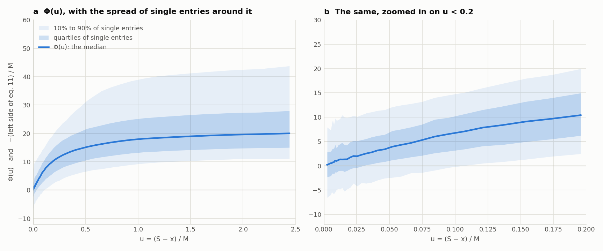
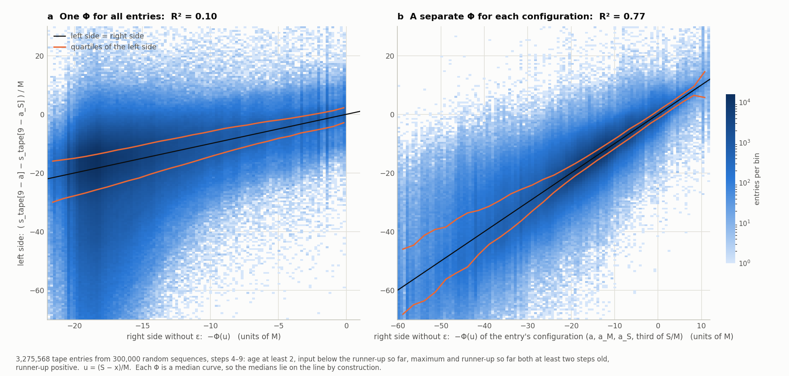

# The tape and its transform

Notes from our discussion on 2026-11-23. Notation as in `report.md`. Numbers from `hide/e32_tape_transform.py` (output in `hide/outputs/e32_tape_transform.txt`). None of this has been checked independently.

## What the tape holds

The scores are $s_t = U h_t$. The entry at index $i = 9 - a$ belongs to the input that arrived $a$ steps ago. Define the tape as the score relative to the runner-up's score,

$$f_t(a) = s_t[9 - a] - s_t[\text{runner-up}] . \tag{1}$$

For $a \ge 2$, and with no new maximum or runner-up in the last few steps, a summary of the measurements in section 3.3 of the report is

$$f_t(a) \approx -\min\big(k\,\lvert x_{t-a} - S_t\rvert,\ \text{floor}\big) . \tag{2}$$

- $S_t$ is the current runner-up.
- $k$ is 60–80 logits per unit.
- Below $S_t$ the floor is $-15\,M$, $-25\,M$ or $-33\,M$, for an input that arrived after both of the top two, between them, or before both.
- The only input above $S_t$ is the maximum. Its entry is $-5\,M$ to $-14\,M$, depending on its age and almost independent of the gap.

I have measured these pieces separately. I have not fitted the formula as a whole.

## Exact synthesis

Let $o$ be the 13 non-pulse units, $r_m$ the mode patterns and $\zeta_m$ (real modes) or $z_m$ (complex pairs) the mode coordinates, so that

$$h_t[o] = \sum_{m\ \text{real}} \zeta_m\, r_m + \sum_{m\ \text{pairs}} 2\,\mathrm{Re}\big(z_m\, r_m\big) . \tag{3}$$

Then, exactly,

$$s_t[i] = \sum_{m\ \text{real}} \zeta_m(t)\, p_m[i] + \sum_{m\ \text{pairs}} 2\,\mathrm{Re}\big(z_m(t)\, p_m[i]\big) + \sum_{u \in \{4,5,9\}} U[i,u]\, h_t[u], \qquad p_m = U_o\, r_m . \tag{4}$$

Keeping only the tape modes (alternating, which is real, and the three pairs short clock, second harmonic, third harmonic):

$$s^{\text{tape}}_t[i] = \zeta_{\text{alt}}(t)\, p_{\text{alt}}[i] + \sum_{m \in \{\text{short},\ \text{h2},\ \text{h3}\}} 2\,\mathrm{Re}\big(z_m(t)\, p_m[i]\big) . \tag{4a}$$

This is exact, and it is what is called $g_t(a)$ below: $g_t(a) = s^{\text{tape}}_t[9 - a]$.

$p_m[i]$ is the readout pattern of mode $m$ over the logit index.

## The clean form: a damped Fourier series in the age

A resting step multiplies each coordinate by its eigenvalue, $z_m \to \lambda_m z_m$. The tape moves one index down, $s_{t+1}[i] = s_t[i+1]$, if and only if

$$p_m[i] = c_m\, \lambda_m^{\,i} . \tag{5}$$

Call $g_t(a)$ the part of the score at age $a$ that is stored in the four tape modes (short clock, second harmonic, third harmonic, alternating). With $i = 9 - a$ and $C_m = c_m \lambda_m^{9}$,

$$g_t(a) = \sum_{m \in \text{tape}} \big(\text{piece of mode } m \text{ at index } 9 - a\big) \approx \sum_{m\ \text{pairs}} 2\,\mathrm{Re}\Big(C_m\, \lambda_m^{-a}\, z_m(t)\Big) + C_{\text{alt}}\, \lambda_{\text{alt}}^{-a}\, \zeta_{\text{alt}}(t) . \tag{6}$$

**$g$ is not $f$.** The full score is

$$s_t[9 - a] = g_t(a) + \big(\text{pieces of level, runner, clock, transient, echo}\big) + \big(\text{pulse units}\big), \tag{7}$$

and the pieces cancel strongly: on final states the short clock's piece alone has rms 87 logits, against 69 for all logits together. The laws in the first section (slope $k$, floors) were measured on the full score $f$. What the tape piece alone holds is measured in the section "What the tape piece holds" below.

Writing $\lambda_m = \rho_m e^{i\omega_m}$:

$$\lambda_m^{-a} = \rho_m^{-a}\, e^{-i\omega_m a} . \tag{8}$$

So each mode is one frequency $\omega_m$ in the age. The factor $\rho_m^{-a}$ grows with age and undoes the decay of $z_m$, which is how an entry keeps its size as it gets older.

Measured on indices 0–7 (ages 2–9):

| mode | $\lambda_m$ | $c_m$ | share of $p_m$ explained by $c_m \lambda_m^{\,i}$ | measured phase step per index |
|---|---|---|---|---|
| short clock | 0.735 ∠ 43.0° | 7.16 ∠ 172° | 0.94 | 40°–57° for $i \le 4$ |
| second harmonic | 0.937 ∠ 83.3° | 1.41 ∠ −164° | 0.86 | 78°–93° for $i \le 3$ |
| third harmonic | 0.837 ∠ 124.8° | 1.77 ∠ −134° | 0.87 | 124°–150° for $i \le 5$ |
| alternating | −0.928 | −0.59 | 0.89 | sign alternates on all indices |

Units: logits per unit of mode coordinate. The coordinates are normalised so that a pulse of unit 4 of size $h$ adds $h$ to each of them.

For comparison, the same fit for the clock mode ($0.951$ ∠ $42.75°$) explains 0.71 of its pattern: its readout pattern is not a shift pattern, in line with $\Sigma$ having no clock eigenvalue.

## The other direction: a convolution

Suppose an event $e$ of size $d_e$ (a pulse of unit 5) happened $a_e$ steps ago and fed mode $m$ with strength $\kappa_m$. Free evolution since then gives

$$z_m(t) = \sum_e \kappa_m\, d_e\, \lambda_m^{\,a_e} . \tag{9}$$

Inserting this into the clean form:

$$g_t(a) \approx \sum_e d_e\, K(a_e - a), \qquad K(n) = \sum_{m\ \text{pairs}} 2\,\mathrm{Re}\big(C_m\, \kappa_m\, \lambda_m^{\,n}\big) + C_{\text{alt}}\, \kappa_{\text{alt}}\, \lambda_{\text{alt}}^{\,n} . \tag{10}$$

The tape works if $K(n)$ is a peak at $n = 0$. From the update rule, $\kappa_m = \ell_m^\top W[o,5]$. I have not computed $K$.

## What the tape piece holds (measured)

This section builds only on equation (4a). Numbers from `hide/e38_tape_fixed_triple.py` (output in `hide/outputs/e38_tape_fixed_triple.txt`); figures from `hide/plot_tape_eq11.py`. One run, not checked by anyone else.

**Notation.** $M_t$ and $S_t$ are the largest and second-largest of the inputs so far, $x_0..x_t$. The entry of age $a$ is $s^{\text{tape}}_t[9 - a]$ and belongs to the input $x_{t-a}$. $a_M$ and $a_S$ are the ages of the maximum and the runner-up at step $t$.

**Which entries.** No sequence is left out. From 300,000 random sequences, at every step $t = 4..9$, an entry is used if

- its age is $a \ge 2$ and its input is below the runner-up, $x_{t-a} < S_t$;
- there was no new maximum or runner-up in the last two steps ($a_M \ge 2$ and $a_S \ge 2$);
- the runner-up is positive, $S_t > 0$.

This gives 3.28 million entries.

### Equation (11) as it was: one curve for all entries

$$s^{\text{tape}}_t[9 - a] - s^{\text{tape}}_t[9 - a_S] = -M_t\,\Phi\!\left(\frac{S_t - x_{t-a}}{M_t}\right) + \varepsilon . \tag{11}$$

$\Phi(u)$ is defined as the median of minus the left side, divided by $M_t$, over the entries with $u = (S_t - x_{t-a})/M_t$:

$$\Phi(0.01) = 1.0,\quad \Phi(0.05) = 3.7,\quad \Phi(0.1) = 6.8,\quad \Phi(0.2) = 10.5,\quad \Phi(0.4) = 14.1,\quad \Phi(1) = 17.9,\quad \Phi(2) = 19.6 . \tag{12}$$

In this figure the line is $\Phi(u)$. The bands are not part of $\Phi$: they show how single entries scatter around it (dark band: quartiles; light band: 10% to 90%). Panel b is panel a zoomed in on $u < 0.2$.

With the new filters this is still a poor description of single entries: $R^2 = 0.10$ (panel a of the figure further down).

### Is the entry a function of $x_{t-a}$, $S_t$ and $M_t$ at all?

No. Test: hold the three values fixed and resample everything else. The configuration (step, and the ages of the entry, the maximum and the runner-up) is drawn from the 3.28 million entries above, and every other input is drawn from $\mathcal N(0,1)$ restricted to values below $S_t$. 200,000 states per triple, $M_t = 1.5$ throughout, values in units of $M_t$.

How to read the table:

- A *configuration* is one combination of four integers: the step $t$, the age $a$ of the entry, the age $a_M$ of the maximum and the age $a_S$ of the runner-up. It says where the three inputs sit, not what their values are.
- **One row is one fixed triple of values** $(M_t, S_t, x_{t-a})$. The first three columns give the triple, and the fourth is how far the entry's input is below the runner-up, in units of $M_t$.
- For each row, 200,000 states are generated. For each state a configuration is drawn at random, independently of the other states, and so are the values of all the other inputs. There are only a few hundred possible configurations, so a row covers all of them and each one occurs in many states (hundreds on average). States with the same configuration differ only in the values of the other inputs.
- In every state the quantity measured is the entry itself, $s^{\text{tape}}_t[9 - a] / M_t$ (not the difference to the runner-up's entry).
- *Mean of the entry* and *its sd* are the mean and the standard deviation of that quantity over the 200,000 states of the row.
- *sd between configurations*: group the states of the row by configuration $(t, a, a_M, a_S)$, take the mean of each group, and take the standard deviation of those means (weighted by group size). This is the variation that comes from the arrangement on the tape.
- *sd within a configuration*: the standard deviation inside each group, averaged over the groups (weighted by group size). Here the triple and the configuration are both fixed, so this is the variation that comes only from the values of the other inputs.

In equations. For one row, number the states $n = 1..N$ with $N = 200{,}000$. State $n$ has configuration $c(n) = (t, a, a_M, a_S)$ and the measured quantity is

$$y_n = \frac{s^{\text{tape}}_t[9 - a]}{M_t} \quad \text{in state } n . \tag{14}$$

The columns "mean of the entry" and "its sd" are

$$\bar y = \frac{1}{N}\sum_{n} y_n , \qquad \sigma = \sqrt{\frac{1}{N}\sum_{n} (y_n - \bar y)^2} . \tag{15}$$

For each configuration $c$, let $N_c$ be the number of states with $c(n) = c$, and

$$\bar y_c = \frac{1}{N_c}\sum_{n:\,c(n) = c} y_n , \qquad \sigma_c = \sqrt{\frac{1}{N_c}\sum_{n:\,c(n) = c} (y_n - \bar y_c)^2} . \tag{16}$$

The last two columns are

$$\sigma_{\text{between}} = \sqrt{\frac{\sum_c N_c\,(\bar y_c - \bar y)^2}{\sum_c N_c}} , \qquad \sigma_{\text{within}} = \frac{\sum_c N_c\,\sigma_c}{\sum_c N_c} , \tag{17}$$

where the sums run over the configurations with $N_c \ge 30$.

If the entry were a function of the triple alone, $\sigma$, $\sigma_{\text{between}}$ and $\sigma_{\text{within}}$ would all be zero. If it were a function of the triple and the configuration, $\sigma_{\text{within}}$ would be zero.

| $M_t$ | $S_t$ | $x_{t-a}$ | $(S_t - x_{t-a})/M_t$ | mean of the entry | its sd | sd between configurations | sd within a configuration |
|---|---|---|---|---|---|---|---|
| 1.5 | 0.5 | 0.47 | 0.02 | 6.3 | 4.9 | 4.6 | 1.5 |
| 1.5 | 0.5 | 0.35 | 0.1 | 3.3 | 5.7 | 5.3 | 1.7 |
| 1.5 | 0.5 | 0.05 | 0.3 | −0.8 | 7.1 | 6.7 | 2.0 |
| 1.5 | 0.5 | −1.00 | 1.0 | −2.0 | 7.5 | 7.0 | 2.1 |
| 1.5 | 1.0 | 0.97 | 0.02 | 9.7 | 5.3 | 4.7 | 1.9 |
| 1.5 | 1.0 | 0.85 | 0.1 | 6.5 | 6.0 | 5.4 | 2.2 |
| 1.5 | 1.0 | 0.55 | 0.3 | 1.6 | 7.5 | 6.8 | 2.7 |
| 1.5 | 1.0 | −0.50 | 1.0 | −3.0 | 9.4 | 8.5 | 3.1 |

- Moving $x_{t-a}$ over the whole range changes the mean of the entry by 8 (at $S_t = 0.5$) or 13 (at $S_t = 1$). With the triple fixed the entry still varies with a standard deviation of 5 to 9. So the entry is not a function of the triple.
- Nearly all of that variation is between configurations (4.6 to 8.5). Within one configuration, where only the values of the other inputs differ, it is 1.5 to 3.1.
- The same holds for the entry minus the runner-up's entry: total sd 6.3 to 11.5, between configurations 6.1 to 9.8, within a configuration 1.1 to 4.6.

So the entry is, to a fair approximation, a function of $x_{t-a}$, $S_t$, $M_t$ **and of the three ages** $a$, $a_M$, $a_S$.

### Equation (11) repaired: one curve per configuration

$$s^{\text{tape}}_t[9 - a] - s^{\text{tape}}_t[9 - a_S] = -M_t\,\Phi_{a,\,a_M,\,a_S}\!\left(\frac{S_t - x_{t-a}}{M_t},\ \frac{S_t}{M_t}\right) + \varepsilon . \tag{13}$$

Each $\Phi_{a, a_M, a_S}$ is again a median curve, fitted on the same entries. How much each ingredient buys:

| $\Phi$ depends on $u$ and on | $R^2$ | quartiles of $\varepsilon$ |
|---|---|---|
| nothing else: equation (11) | 0.10 | $-6.3\,M_t$, $+4.6\,M_t$ |
| $a$ | 0.18 | $-6.1\,M_t$, $+4.4\,M_t$ |
| $a$, $a_M$ | 0.25 | $-5.5\,M_t$, $+4.4\,M_t$ |
| $a$, $a_S$ | 0.39 | $-4.3\,M_t$, $+3.9\,M_t$ |
| $a$, $a_M$, $a_S$ | 0.64 | $-2.9\,M_t$, $+3.2\,M_t$ |
| $t$, $a$, $a_M$, $a_S$ | 0.64 | $-2.8\,M_t$, $+3.2\,M_t$ |
| $a$, $a_M$, $a_S$ and $S_t/M_t$ (three bins) | 0.77 | $-2.1\,M_t$, $+2.3\,M_t$ |

The step $t$ adds nothing once the ages are known. Near the runner-up ($u < 0.1$) the error of the curves per $(a, a_M, a_S)$, expressed as an error in the input, has quartiles $-0.015\,M_t$ and $+0.016\,M_t$ (standard deviation $0.045\,M_t$); with the single curve of equation (11) the standard deviation is $0.092\,M_t$.

Panel a is equation (11), panel b is equation (13) with the last row of the table. In both, the medians lie on the line by construction.

### What this says

- The tape entry is a comparison of its input with the runner-up, but the curve of that comparison is different for each arrangement of entry, maximum and runner-up on the tape. One curve for all arrangements describes almost nothing ($R^2 = 0.10$).
- The age of the runner-up relative to the entry matters more than the age of the maximum.
- Equation (13) is a table of about 340 curves, not yet a formula. The next step is to find how $\Phi_{a, a_M, a_S}$ depends on the three ages, for instance through the two distances $a - a_S$ and $a - a_M$.

## Limits

- The clean form misses 6–14% of each pattern on indices 0–7, and fails on indices 8 and 9 (the two newest inputs, which are scored by other routes).
- It is a statement about resting steps. Only 10% of states are in the exact resting gate pattern.
- It is not an orthogonal Fourier basis: four frequencies with four different decay rates, on eight positions.
- The measurement of the tape piece is for entries of age 2 or more, at steps where the maximum and the runner-up so far are both at least two steps old and the runner-up is positive.
- $\Phi$ in equation (12) is a median curve.
- At the step a maximum is overtaken, its bump comes from the clock mode's wave-unit half (report section 3.5). Two or more steps later the tape modes hold a bump for it (`hide/outputs/e35_tape_by_source.txt`, kernel 3b).
